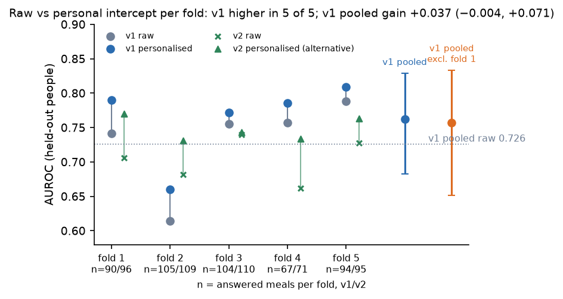
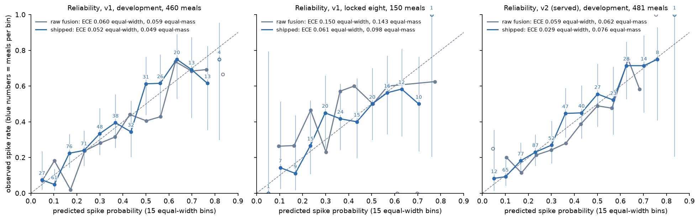
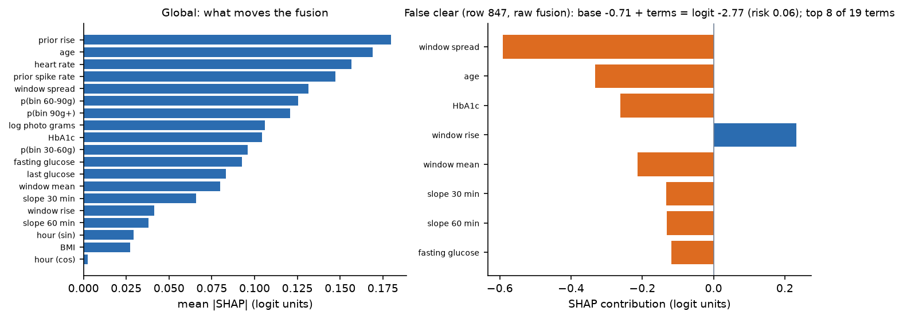

# GLIMPSE: final report
Before eating: a meal photo + the last 2 h of CGM glucose and heart rate + a short profile → **low risk**,
**caution** or **can't judge** (with a reason). Offline, local weights, one Mac.
Maitha Alhosani · MAAI7103 · November 2026 · `just install` → `just predict-folder <in> <out>`

**Bottom line.** GLIMPSE serves v1, frozen on 6 Nov: a small logistic model combines a fine-tuned photo
model's carb estimate with the glucose trend, heart rate and a short profile. Scored once on 8 held-out
people, it reached AUROC 0.645 (0.540–0.736) and met 1 of 4 usefulness targets; with 8 people the interval
is wide. The photo failed its pre-registered test, and the repeated-meal check (D8) suggests its small gain
comes from recognising meals the cohort eats again and again, so we do not claim it adds value. A
sensor-first version, v2, built after that result, let more spikes through on development (12.7% of its
low-risk answers against 7.3%), so it is a tested alternative, not served. The largest single gain comes
from a per-person offset (the intercept) learned from each person's earlier meals, though its interval
crosses zero. After grading, rule R22 stopped clears on a high or fast-rising pre-meal glucose (§4).

| Status at a glance | v1 served, development (481 meals) | v1 served, locked eight (153) | v2 alternative, development (481) |
|---|---|---|---|
| AUROC (95% person-clustered) | 0.762 (0.682–0.829) | 0.645 (0.540–0.736) | 0.754 (0.673–0.815); 0.748 on v1's 460 |
| meals answered with a risk | 460 | 150 | 481 |
| ECE, registered 15 bins (target ≤ 0.05) | 0.052: not met by 0.002 (a perfect model scores about the same here) | 0.061: not met | 0.029, below a perfect model's median 0.051: on track |
| usefulness targets (protocol labels: met / on track / at risk) | 1 met, 3 on track (development labels) | 1 met, 3 not met (final test) | 1 met, 2 on track, 1 at risk (spikes among cleared) |
| spikes among cleared meals (cap 10%) | 7.3% (2.9–14.2%) | 2 of 10; 8 of the 10 clears from one person (person-bootstrap interval 0–100%) | 12.7% (5.9–22.6%) |
| the same, people with prediabetes | 1 of 25 | not split | 6 of 30 |
| served without history (onboarding priors only): cleared; spikes among them | 15.2%; 9.6% | 20.9%; 21.9% (7 of 32) | – |
| with rules R22 and R14 (added 26 Nov): cleared; misses among cleared | 18.1%; 6.9% (6 of 87) | 2 of 10 clears become caution (outcomes not read) | 20.2%; 14.4% |

*Every cell is traced below and tested against outputs/report_metrics/ (report_metrics.json for v1, v2_metrics.json for v2) and the other evidence files. Secondary tables are in docs/report_appendix.md.*

## 1. System and tooling
The user is an adult with prediabetes in a CGM programme who wants fewer spikes but stops logging food
within days. Before a meal they photograph it and get one plain sentence with its reason. The CGM labels
every meal two hours later, so the system learns each person without logging.

One scoring path (Figure 1): the evaluation, the demo, the app and the grader's
`just predict-folder <in> <out>` all call `Pipeline.answer`.

Plain-code rules run first and refuse with a
named reason and who acts next: the user fixes the input, or a person reviews (docs/rule_ledger.md). Three
safety rules were added after AI cold-grading rounds found failures on unseen inputs, none changing an
evaluated decision: below 54 mg/dL the answer is "treat the
low first", not a walk (R14); HbA1c in the diabetes range is out of scope (R15); and a CGM or
heart-rate input beyond the training range in the risk-lowering direction is refused (R16), since a heart
rate of 140 bpm in v1, or 160 bpm in v2, alone turned a prediabetic caution into low risk (no development
or locked meal is affected). Input rules R17 to R21 came from AI grading rounds' unseen files (semicolon
CSVs, a photo not named photo.*, Dexcom "Low"/"High" text, day-first Libre dates, units in the profile).
`prototype.product` selects v1 (served) or v2; v1's frozen files are byte-identical to the tag. The
per-person intercept needs labelled meals: the evaluation replays them in deployment order, and the
folder command takes them as an optional `history.csv`. A profile without onboarding priors gets training
medians, and rule R13 then withholds any low-risk answer: with neither history nor priors there is no
personal basis to clear a meal, so a grader running the samples without `history.csv` sees caution or
can't judge, never low risk.

Tooling: uv with Python 3.14
(locked), strict Pydantic, Loguru, a `just` recipe for every number, 210 tests (209 pass with the data
and weights, one an expected failure; 193 pass without them; logs in outputs/finalize/), W&B offline runs
replayed from committed training histories (outputs/wandb/), and a git history from the 27 Sep proposal;
from 2 Nov every registration commit precedes its results commit.

| Parameters and cost | v1 (served) | v2 (alternative) | cap |
|---|---|---|---|
| largest model (ConvNeXt-Tiny + heads) | 27.8M, a risk input | 27.8M, carb estimate only | 200M |
| fine-tuned (last ConvNeXt stage + heads) | 15.5M | 15.5M | – |
| risk model (logistic fusion) | 20 | 16 | – |
| SensorCNN, the from-scratch network: it ties the trend features, so it is evaluated, not served | 5,217 | 5,217 | 50M |
| parameters a served risk depends on | 27.8M photo model + 20 | 16 | – |
| peak memory while serving; photo checkpoint on disk | 796 MB; 31 MB (author's Mac, 7 Nov) | not measured | – |
| fine-tuning items (CGMacros photos) | 1,221 | 1,221 | 10,000 |
| one whole meal, folder command, with / without photo (2-CPU cloud) | 116 ms (p95 142) / refused | 115 ms (p95 147) / 6.4 ms | ≤300 ms p95 |

{width=90%}

| Quality against cost (development) | risk AUROC | serving cost of the risk |
|---|---|---|
| v2: trend + profile fusion with the intercept (alternative) | 0.754 on 481 meals | 6.4 ms a meal; the photo adds about 110 ms for the carb estimate only |
| v1 (served): + the photo estimate (4 inputs) | 0.762 on 460 meals | 116 ms a meal, needs the photo |
| int8 photo model (460 development photos, in-sample) | 97.0% of v1's decisions kept; carb MAE 15.4 → 17.7 g, what v2 shows | 55 ms against 77 ms per photo |

*Parameter counts: outputs/param_budget.csv (`just params`); memory: outputs/efficiency/efficiency.json. Timing: outputs/efficiency/end_to_end.json, whole folder-command answers (profile, CSV parsing at 4 ms, rules, models) with the pinned weights on a 2-CPU cloud machine, 50 runs; the author's Mac measured v1 at 265 ms warm median on 7 Nov. int8: outputs/efficiency/int8.json; registered on 1,221 photos, run on the 460 development photos that carry a v1 decision so agreement is per decision (a deviation, disclosed in docs/photo_probes_int8.md). AUROCs: outputs/evaluation_v2/, outputs/evaluation_sensor_first/, outputs/cv/.*

## 2. Multimodal design and the photo gate
A pinned, SHA-verified ConvNeXt-Tiny (ImageNet-22k pre-trained, 1k fine-tuned) feeds two small heads,
grams regression and a 4-range carb classifier, with only the last backbone stage fine-tuned. The profile
has eight inputs, including two onboarding priors: each person's spike rate and mean rise over their
first meals. Seven hand-made trend features summarise the 2-h CGM and heart-rate window. SensorCNN ties
the trend features (+0.002, −0.016 to +0.022) and stays a baseline. Fusion is logistic regression, the
capacity 23 development people support; gradient boosting on the same inputs is not shown better (+0.016,
−0.024 to +0.062, fusion study without the intercept). v1's risk uses all three modalities; v2's uses
sensors and profile, with the photo as a separate carb estimate.

| what was trained | starts from | trained parameters | loss; optimiser and schedule | epochs (inner folds) | validation result |
|---|---|---|---|---|---|
| photo model: ConvNeXt-Tiny + grams head + 4-range head | ImageNet-22k weights, SHA-pinned | heads, then the last stage: 15.5M of 27.8M | Huber on log grams + 0.5 × range cross-entropy; AdamW, heads 1e-3, last stage 1e-4, warm-up and cosine; flips, crops keeping 80%, ±10% light | heads 12–16, last stage 2–3 (early stopping) | inner carb MAE 24.2–26.1 g; out of fold 22.6 g |
| SensorCNN: two 1-D convolutions (kernel 25 min) over 24 slots of glucose and heart rate + the profile | random | all 5,217 | binary cross-entropy; AdamW 1e-3, warm-up and cosine; sensor noise each epoch | 11–22 per outer fold (checkpoint: 13) | AUROC 0.688 ± 0.007 out of fold (3 seeds) |
| v1 fusion: logistic regression on 15 trend and profile inputs + 4 photo inputs | – | 20 | log-loss; C chosen on inner folds | – | raw AUROC 0.726 out of fold |
| v3 candidate: the photo heads alone, regularised (§5) | frozen summaries | 3,845 | as the photo model; weight decay 0.1, dropout 0.5, 2 augmented views (chosen) | 7–12 | out-of-fold carb MAE 26.0 g |

*Figure 3 shows the training curves of the inner folds of the intermediate run (outputs/training/). outputs/cv/, outputs/photo_cv/, outputs/robustness_v3/robustness_v3.json.*

| What the photo does (gate first) | result |
|---|---|
| risk gate, pre-registered: AUROC gain over no meal information | +0.025 (−0.010, +0.061): not established |
| secondary endpoint: log-loss gain | +0.016, one-sided p = 0.094 |
| shuffled-photo control; true logged carbs instead (ceiling) | −0.010; +0.024 (−0.003, +0.056) |
| photo estimate against logged carbs (margin 0.03) | +0.002 (−0.027, +0.027): non-inferior |
| carb estimate on held-out people: MAE, Spearman, range F1 | 22.6 g, 0.53, 0.61 (frozen features + ridge: 20.4 g, 0.56, 0.38) |
| the carb estimate's own value, 817 out-of-fold photos: MAE; carb range right | 23.5 g against 29.0 g for typing the training median; 60% against 18% |
| freezing ablation: heads only, then + last stage (inner-fold carb MAE) | 27.5–29.8 g → 24.2–26.1 g; the last stage kept in 5 of 5 folds (rule: keep only if MAE drops ≥ 0.5 g) |
| seed spread of the recipe (3 seeds, intermediate split) | carb MAE 24.9 ± 1.9 g; range F1 0.55 ± 0.04 |
| probe D: grey out the middle half vs an equal-area border | the middle moves the grams more on 84% of development photos (in-sample) and 86% of 14 unseen phone photos |

*outputs/fusion/, outputs/photo_cv/, outputs/promised/, outputs/probes/photo_probes.json, outputs/training/photo_convnext_seeds.json, outputs/v2_explain/v2_explain.json (carb_value); probes D and E registered in docs/photo_probes_int8.md before they ran.*

The gate (docs/gate_s8.md) held both verdict paragraphs before its run; the winning one said the answer
should rest on trend and profile, with the photo as a carb-entry aid. The 5 Nov amendment instead kept the
photo as 4 of v1's 19 inputs. v2 follows the verdict (registered on 26 Nov in docs/v2_sensor_first.md
before any run) and was tested and not adopted (§3, §4). Why the photo adds little: true carbs add at most
about 0.03 here, a ceiling the photo matches. D8 (registered 1 Nov, docs/final_design.md) removed
from training every meal sharing an exact macro profile with the held-out person: the photo's gain fell to
−0.005, against +0.037 for a random drop of the same size (difference −0.041, −0.093 to +0.008). The photo
may be recognising repeated meals rather than reading carbs. Fine-tuning loses to ridge on grams but
wins on the carb range (F1 0.61 against 0.38), and the range is what the user is shown. The probes say
what the photo model reads. It
looks at the plate rather than the background (probe D), and on its
training photos it does not scale grams with how large the food looks (probe E, appendix; inconclusive on the
14 unseen), so it reads what kind of meal this is more than how much.

## 3. Evaluation and ablations
The 45 CGMacros participants (ages 18 to 69, 64% female) wore a CGM for about ten days. 158 of the 481 development
meals (32.8%) spiked, with per-person rates
from 0% to 68%. In the final split, 23 development people form five outer folds, with four inner folds
choosing everything (fusion C, Platt map, intercept shrinkage m, cut-offs); 14 T2D people only train;
8 people were locked at the proposal. Each development meal is scored once; the primary metric is AUROC.
One caveat: fold 1 holds the five people the intermediate evaluation scored, and the calibration fix was
designed after a diagnosis on them, so development carries selection pressure the locked eight do not.
v2, chosen after v1's locked result, carries more, and its development number is likely optimistic as v1's
was (0.762 on development, 0.645 locked).

Postprandial response is person-specific (Zeevi et al. 2015; Berry et al. 2020). The calibration fix is a
per-fold Platt map plus a penalised per-person intercept fitted only on that person's earlier meals whose
2-hour label window has closed. Within a fold Platt preserves the ranking; the intercept changes it
(Figure 2).

{width=48%}

| risk (answered meals) | AUROC (95% person-clustered) | AUPRC (base rate) | Brier (constant forecast) | log-loss | ECE, 15 bins: equal-width / equal-mass |
|---|---|---|---|---|---|
| dev baselines (460): prevalence / profile only / trend + profile LR / gradient boosting / SensorCNN | 0.414 / 0.676 / 0.695 / 0.700 / 0.696 | 0.289 / 0.490 / 0.555 / 0.538 / 0.558 | 0.231 / 0.203 / 0.198 / 0.201 / 0.199 | – | – |
| the same baselines on v2's 481 meals | 0.403 / 0.672 / 0.686 / 0.689 / 0.689 | 0.285 / 0.487 / 0.547 / 0.531 / 0.551 | 0.231 / 0.204 / 0.199 / 0.204 / 0.201 | – | – |
| v1 dev raw fusion (460) | 0.726 (0.659–0.797) | 0.554 (0.328) | 0.192 (0.221) | 0.567 | 0.060 / 0.059 |
| v1 dev + per-fold Platt | 0.714 pooled (= raw within every fold) | 0.541 | 0.194 | 0.572 | 0.023 / 0.056 |
| v1 dev + personal intercept | **0.762 (0.682–0.829)** | **0.591 (0.451–0.694)** | **0.180 (0.148–0.210)** | **0.537** | 0.052 / 0.049 |
| v1 dev, excluding fold 1 (370) | 0.757 (0.651–0.833) | 0.586 (0.335) | 0.185 (0.223) | 0.547 | 0.070 / 0.057 |
| v1 locked raw fusion (150 of 153) | 0.611 (0.510–0.743) | 0.531 (0.420) | 0.251 (0.244) | 0.707 | 0.150 / 0.143 |
| v1 locked shipped (150 of 153) | **0.645 (0.540–0.736)** | **0.547 (0.409–0.658)** | **0.230 (0.199–0.257)** | **0.650** | 0.061 / 0.098 |
| v2 dev raw (481) | 0.694 | 0.545 (0.328) | 0.198 (0.221) | 0.585 | 0.059 / 0.062 |
| v2 dev + personal intercept (alternative) | **0.754 (0.673–0.815)** | **0.601 (0.459–0.688)** | **0.182 (0.151–0.210)** | **0.544** | 0.029 / 0.076 |

*All AUROCs pooled over out-of-fold predictions; a constant per fold scores below 0.5 when pooled because training and test prevalence move in opposite directions across folds. v1 answers 460 development meals (21 had no photo); v2 answers all 481. outputs/report_metrics/, outputs/evaluation_v2/, outputs/evaluation_sensor_first/, outputs/locked_eval/.*

| paired comparisons (95% person-clustered) | development | locked |
|---|---|---|
| v1: intercept minus raw, AUROC | +0.037 (−0.004, +0.071); higher in 5 of 5 folds | +0.033 (−0.054, +0.100) |
| v1: intercept minus raw, log-loss | −0.030 (−0.060, −0.001) | −0.057 (−0.156, +0.009) |
| v2 minus v1, AUROC on the 460 meals both answer (margin 0.03) | −0.015 (−0.045, +0.010): not non-inferior | not computed (v2 never sees the locked eight) |
| v1 with the intercept minus gradient boosting with the same intercept | +0.013 (−0.022, +0.043) | – |
| v1 minus a running spike rate per person (no model, same gate) | +0.063 (+0.030, +0.113) | – |
| CGM removal: trend + profile minus profile only, both with the intercept | +0.033 (+0.007, +0.065) | – |
| mean within-person AUROC, intercept minus raw: v1 / v2 | −0.078 (−0.110, −0.046) / −0.086 (−0.127, −0.045) | – |

*Paired person bootstrap, 2,000 draws. Holm over these 7 development contrasts (p from each interval by a normal approximation; outputs/report_metrics/holm.json): only the running-spike-rate and within-person contrasts survive; the CGM, intercept and v2 contrasts do not. Every intercept baseline uses the shipped replay on its own out-of-fold logits (it reproduces the shipped risk to 1e-16). report_metrics.json (paired_personal_minus_raw, fair_baselines, within_person), v2_metrics.json (paired_v2_minus_v1, within_person).*

| course checks on v1 (registered in docs/final_switch.md before they ran) | prediction | result |
|---|---|---|
| shuffled-label control: fusion refitted with labels shuffled within each training fold, 20 shuffles | AUROC 0.45 to 0.55 | 0.475 (range 0.359–0.599), against 0.750 unshuffled: met, no leak through the inputs |
| learning curve: fusion refitted on 4 / 8 / 12 / all training people per fold | rising, all people within 0.03 of 12 | 0.640 / 0.715 / 0.733 / 0.750: met (+0.017); still creeping up |
| identity shortcut: do the 4 photo inputs name the person? | above chance, far from perfect | 8.0% of meals against 6.1% for the commonest person: met; the photo does not name the person, though the repeated-meal check suggests it may name the meal |
| worst slices (served answers) | worst person below 0.6 | women 0.71 (6 of 66 clears spiked) against men 0.86; the worst three people 0.22 to 0.28, on 11 to 25 meals: met |
| train against validation loss at the best validation epoch | small gap | not met for the photo model, 0.35 (9 runs; Figure 3 shows the 8 inner-fold ones): it overfits its 1,221 photos; met for SensorCNN, 0.02 (5 runs) |

*Shuffled-label and learning-curve checks: development people only, no intercept, C fixed at 0.03, hence 0.750 and not 0.762; outputs/final_checks/final_checks.json.*

Most of the system's edge is
the intercept's own: with it, gradient boosting comes within 0.013 of v1, and the photo adds 0.021
(−0.003, +0.053) under v1's procedure. It works between people, not within them. Averaged per person, AUROC falls
by about 0.08 in both
products (19 of 22 people worse in v1, 20 of 22 in v2), consistent with the offset drifting as each
new label arrives. The system learns each person's base rate, 0.063 better than a plain running spike
rate. Removing the CGM costs 0.033 with an interval above zero (exploratory, post hoc); removing the
profile costs 0.122 (Figure 6).

{width=62%}

| calibration | v1 dev | v1 locked | v2 dev | without history: v1 dev / v1 locked / v2 dev (Platt only) |
|---|---|---|---|---|
| ECE, registered 15 equal-width bins (target ≤ 0.05) | 0.052 | 0.061 | 0.029 | 0.023 / 0.162 / 0.052 |
| ECE a perfectly calibrated model shows at this size (median; 95th centile) | 0.052; 0.072 | 0.094; 0.136 | 0.051; 0.071 | – |
| calibration-in-the-large (mean risk − spike rate) | −0.015 | −0.010 | −0.015 | +0.002 / −0.108 / −0.001 |

*Floor: labels drawn as Bernoulli(risk), 2,000 draws; ECE intervals are person-bootstrap and biased upward. v2's equal-mass ECE is 0.076. report_metrics.json, v2_metrics.json, outputs/v2_explain/v2_explain.json (calibration).*

At this sample size the ECE target cannot separate either product from a perfectly calibrated model. A
stricter null lets the intercept learn from labels drawn from the model itself (study C1): v1's 0.052 is typical
(33% of draws at or below), while v2's 0.029 is lower than all but 1.5%, an anomaly the adaptive
intercept does not explain (the registered prediction, typical, was not met). By the protocol's rule (met
only if the whole interval meets the target) v2 is on track, not met. In Figure 4's v2 panel every bin's
95% Wilson interval contains its mean risk. Without history, v1's risk under-predicts
the harder locked cohort by 11 points, the clearest calibration failure. v1's discrimination is even
across glycaemic status (0.738, 0.566–0.859 healthy; 0.736, 0.648–0.796 prediabetes); usefulness is not
(page one; appendix table).

{width=74%}

## 4. Trust and safety
Decisions are priced: a missed spike costs 5× an unnecessary caution; abstaining costs 2 if the meal
spikes and 0.5 if not. These are declared assumptions (5:1 is a ~17% action threshold; Vickers & Elkin
2006), swept over 16 pre-registered settings that re-choose the cut-offs (appendix). The verdict holds
only near the declared prices. The served cut-offs, 0.15 and 0.16, minimise this cost on the replay of all
development answers in deployment order (checkpoints/thresholds.json); the evaluated numbers use each
fold's own inner-fold cut-offs. Referring more meals does not buy accuracy: at 10% abstention the error on
answered meals rises from 47.0% to 48.1% (report_metrics.json coverage_risk).

Rule R22, added after grading and approved before its count, withholds a clear when the last pre-meal
reading is 140 mg/dL or more or glucose rises faster than 1.5 mg/dL/min. It turns 22 of v1's 109
development clears into caution, only 2 of which spiked (the label is a rise from the pre-meal baseline),
so clears fall to 18.1%, below the 20% target; the author kept it, since "low risk" at 185 mg/dL misleads.

| Usefulness target (fixed before any result) | target | v1 dev (481) | v1 locked (153) | v2 dev (481) | v2, no history, frozen cut-offs |
|---|---|---|---|---|---|
| cost reduction vs always caution | ≥10% | 14.4% (−4.6, +31.5) | −5.7% (−19.4, +5.9) | 10.2% (−11.6, +28.9) | −0.2% |
| cleared as low risk | ≥20% | 22.7% (13.2–34.0%) | 6.5% (0.6–15.9%) | 24.5% (13.5–37.5%) | 11.0% |
| can't judge | ≤20% | 13.7% (8.7–19.2%) | 2.6% (0.6–5.0%) | 8.3% (2.5–15.2%) | 18.5% |
| missed among cleared | ≤10% | 7.3% (2.9–14.2%) | 20% (2 of 10; exact 2.5–55.6%) | 12.7% (5.9–22.6%), 15 of 118 | 15.1% (8 of 53) |
| verdict (met / on track / at risk) | – | 1 met, 3 on track (development labels) | 1 met, 3 not met (final test) | 1 met, 2 on track, 1 at risk | 3 of 4 at risk |

*v1's served point (no history) clears 15.2% with 9.6% spiking on development; on the locked eight it clears 20.9% with 21.9% spiking (report_metrics.json served_operating_point). report_metrics.json, v2_metrics.json (decisions, served_no_history), outputs/locked_eval/locked_summary.json.*

Why v1 is served. v2 is the riskier product: its misses among clears stay near or above 10% at every
low-risk cut, while v1 stays below 10% until about 30% of meals are cleared (cut 0.18; Figure 5,
left); v2's 15 false clears (§5) sit on 8 people; 6 of the 15 fell on people
with prediabetes.
A what-if that withholds clears for a prediabetic profile until 20 labelled meals cuts their misses from
6 to 2 and their clears from 30 to 3 (saving 10.4%); it was chosen on the data it is scored on, so it is
not shipped.

| stress at the evaluated operating point (with history) | v2: AUROC, spikes among cleared | v2: caution → low risk | v1: AUROC | v1: caution → low risk |
|---|---|---|---|---|
| clean | 0.754, 12.7% | – | 0.762 (live photo model: 0.773) | – |
| CGM dropout 10 / 30 / 50 / 70% | 0.754 / 0.753 / 0.754; at 70%, 0.765 on the 461 still answered (their clean 0.764); 12.7% → 11.7% | 0 at every level | 0.762 / 0.762 / 0.762; at 70%, 0.767 on 441 (clean 0.766) | 0 / 0 / 0 / 1 |
| readings removed for 10 / 15 / 18 min before the meal | 0.753 at each; 12.6–12.7% | 0 / 1 / 1 | 0.762 / 0.761 / 0.761 | 1 / 1 / 1 |
| removed for 20 min or more (a gap over the rule's 20) | every meal refused | – | every meal refused | – |
| photo blur radius 2 / 6 / 10 | 0.754, unchanged: the photo is not a risk input | 0 | 0.776 / 0.775 / 0.766 (co-answered clean 0.773–0.774) | 0 / 3 / 6 |
| photo brightness ×0.5 / 0.25 / 0.2 / 0.15 | unchanged | 0 | within 0.002 on the meals still answered: 460 / 453 / 418 / 228 (×0.1: 3 answered) | 1 / 1 / 0 / 0 |

*Registered in docs/stress_quality.md and (heart rate, priors, history) docs/v2_explain.md before their runs; every development meal, clean and perturbed, history from the clean answers. v1's photo stress compares the frozen photo model with itself (in-sample photos). v2's heart-rate, priors and history rows are in the appendix. outputs/robustness/stress_quality.json and v2_input_stress.json; the 22 Nov three-level study (Figure A1) is in the appendix.*

{width=68%}

{width=52%}

Quality holds until a rule refuses. CGM dropout up to 50% moves AUROC by at most 0.001 in either product,
and at 70% only meals with too few recent readings are refused (20 in v2). Gaps under 20 minutes move
at most one decision. The photo cannot move v2's
risk. In v1, heavy blur lets 6 cautions become low risk and lifts the spike rate among clears from 8% to
11%. v2's weak points are its personal inputs. A watch left off gives the largest dangerous flip, 17 cautions
turned low risk, yet misses among clears fall to 11.6% and the saving rises to 12.8%: at v2's cut,
heart rate does not help its decisions. A quarter
of history labels flipped costs 0.055 AUROC. As a detector the unfamiliar-photo check separates 74
meal photos from 31 non-meal pictures with AUROC 0.988 (the local dish passes,
rule R7). For the risk inputs, a distance to the development people separates the 14 type-2
diabetes people's meals with AUROC 0.89; HbA1c alone does it perfectly and fasting glucose reaches 0.92,
which is why R15 is a rule. Both registered predictions (studies O1 and O2 in docs/final_switch.md) were met.

| monitoring (docs/monitoring.md) | demonstration | result |
|---|---|---|
| photo drift: weekly median kNN distance above the training q90 | 3 resampled training weeks, then 6 synthetic non-meal pictures | fires on week 4 only (0.709 against 0.25–0.37) |
| missed among cleared above 10%, 80-answer windows | v1 development answers, then locked | 7 of 21 ordinary development windows fire: too noisy |
| CUSUM on calibration, v1 development then locked (registered) | blocks of 20 answers | no alarm (2.4 of 4), against a registered expectation of one |
| CUSUM on the caution share (registered) | same | one alarm in the 7th locked block at the per-fold cut-offs; none at the deployed or served cut-offs |
| power against volume, v1 (registered 26 Nov): calibration CUSUM, same shift | 300 streams | 23% / 46% / 56% / 69% detected within 120 / 240 / 480 / 960 answers, 5–7% false alarms; expectation (above 80% at 960) not met |

*outputs/monitoring/; v2's two monitoring rows are in the appendix; maintainer actions per alert in docs/monitoring.md.*

The photo-drift rule catches only pictures the per-answer gate already refuses, and the heart-rate rule
only a watch taken off. The outcome rules are too noisy at this volume: a 10-point rise in the spike rate
is caught within 120 answers in under a quarter of streams and within 960 in about two thirds. A
deployment would need well over 1,000 answers per check, or per-person monitoring.

Feedback (src/glimpse/feedback.py): after a meal a validated label comes from the user or from the CGM at
+2 h; with the logged answer it forms a `history.csv` row, tagged with the product that wrote it. The
dietitian consultation did not complete, so the cost matrix stays a declared assumption hedged by the sweep.

## 5. Explainability and failure analysis

| failure class | count: v1 / v2 | corpus | root cause | action |
|---|---|---|---|---|
| rule refusal | 8 of 13, 25 of 25 / 5 of 13, 15 of 25; no crash or raw error | instructor cases; hostile inputs | input (format, units, gaps, unreadable photo), a low, out of scope | named refusal; rules R1–R21 (R6 preventive, R7 a recorded limitation); before the rules, the 5 Nov naive run gave 2 raw errors and 1 whole-file rejection on 23 hostile inputs, now 0 of 25 |
| missing-photo refusal | 21 of 481 / none | development meals | input | v1 asks the user for a photo; v2 answers them |
| near-cut false clear (within 0.031 of the fold's cut) | 4 of 109 / 6 of 118 | cleared development meals | threshold; v2: 4 of 6 on people with prediabetes | the frozen band would refer 4 of v2's 6; the price of a hard cut |
| confident false clear | 4 of 109 / 9 of 118 | cleared development meals | v2: in 6 of 9 the person's intercept lowered the logit by 0.7 to 1.1, a low base rate clearing a meal that spiked; 2 cold starts | the prediabetes what-if (§4), not shipped |
| locked false clear | 2 of 10 | cleared locked meals | cohort shift; 8 of 10 clears from one person | monitor (too few clears to fire) |
| false caution | 175 of 306 (locked 78 of 139) / 186 of 323 | development cautions | narrow band, 33–42% base rate | the price of v1's caution-first cut; v2's wider band refers some |
| heart rate missing makes v2 more permissive | 17 cautions turn low risk | development, watch removed | median imputation of an input with a within-person sign | flagged `hr_missing`; a rule withholding clears is a candidate, not shipped |
| implausible carb range for a local dish (1 Nov; now flagged "range unsure") | 1 dish | instructor case 11, 14 real phone photos | the embedding measures look, not nutrition | v1: a recorded limitation (rule R7); v2 shows it as an estimate to confirm |
| carb heads disagree (grams outside the shown range) | 47% of 817 out-of-fold photos; instructor 10 and 11 | development photos; instructor cases | two heads trained jointly but read separately | shown as "about N g; range unsure", flagged |

*outputs/folder_run and outputs/stress_run (v1, served), outputs/v2_sensor_first/ (v2), report_metrics.json (errors, false_clears_exploratory), v2_explain.json (taxonomy), outputs/probes/. Half of v1's 8 development false clears are in fold 1; v2's 15 spread over all five folds (6 in fold 5).*

Probe B was registered as an expected pass (a rising pre-meal trace raises risk on at least 90% of meals)
and failed: risk rose on only 8.5% of meals in both products. The label is baseline-relative, so a meal eaten
on a rising trace has a
higher baseline and a smaller measured rise; our registration encoded naive physiology. Exact SHAP for the
frozen v1 fusion (Figure 7) ranks prior rise first, then age, heart rate and prior spike rate. Attribution
and ablation disagree for heart rate (−0.21 coefficient, +0.007 when removed): attribution measures
in-sample use, ablation out-of-sample loss. In v2 the same four lead (outputs/v2_explain/), and the sign has a
reading (exploratory): within a person, a higher heart rate than usual before a meal goes with fewer
spikes (−0.51, −0.88 to −0.25, person fixed effects). The
per-person
intercept moves v2's logit by 0.51 on average, against 0.64 for the whole fusion.

| the course's debugging checks | evidence | status |
|---|---|---|
| leakage ("too good"): group split, duplicates, shuffled labels | person-level folds, 0 cross-split duplicates (docs/data_card.md), shuffled labels 0.475 | done |
| a baseline for every number | prevalence, profile only, trend LR, gradient boosting, SensorCNN, running spike rate (§3) | done |
| hidden subgroup, worst slice; confidently wrong | glycaemic status, sex, age, worst people; reliability with noise floor, confident false clears (§3) | done; women are v1's worst slice, clears for prediabetes v2's |
| shortcut | shuffled photo, true-carb ceiling, repeated-meal check, identity check | done; the repeated-meal check points to meal recognition |
| broken stage; test set once | per-stage timing, photo vs carbs vs fusion arms; locked eight scored once, guarded | done |
| LR range test; overfit one batch (robustness checks 1, 2: R1, R2 in docs/robustness_v3.md) | used rate 1e-3 within 10× of the suggested 2.7e-3 (photo heads) and 7.7e-3 (SensorCNN); both fit 32 items (loss 3.87 → 0.005; 0.70 → 0.008) with finite gradient norms | done (docs/robustness_v3.md) |
| label audit of the 20 worst meals (check 3) | 20% have a rise within 5 mg/dL of the 50 mg/dL cut, against 9% of all meals; none has poor coverage | done: part of the confident errors is label noise at the cut |
| classical and zero-shot photo baselines (check 4) | colour histogram + ridge 27.5 g, against 20.4 g for frozen summaries + ridge; zero-shot needs CLIP weights this offline build cannot fetch | classical done; zero-shot a gap |

A regularised photo branch (v3, robustness checks 5 to 7) cut the train-validation gap from 0.35 to
0.13 but raised carb error from 22.6 to 26.0 g; without repeated meals its photo gain is +0.009 (−0.010,
+0.031), so it stays a candidate (appendix).

{width=58%}

False clears, the costliest error, fell on healthy people in v1 (7 of its 8 development false clears),
while people with prediabetes were rarely cleared; on the harder locked cohort v1 flagged 91% of meals, a
nudge a user learns to ignore.

## 6. Reproducibility
The 8 locked people were scored once, on 25 Nov, with v1 (10 low risk, 139 caution, 4 can't judge). The
development estimate lies above the locked interval; selection pressure and the harder cohort (42.0% of
150 scored meals spiked) both act, inseparable at n=8. Re-weighting development to the locked eight's mix
of sex and glycaemic status (check 8) moves AUROC only from 0.762 to 0.749, so the mix alone does not explain
the drop. Design decision D7 also registered the photo gate on the locked eight as the primary test; that
run scored only v1, so the endpoint was never computed and cannot be now.

`just evaluate` reruns the development evaluations and re-derives every table from committed outputs;
`just evaluate-all` adds the stress, timing, int8 and registered-check studies (about 45 minutes); `just verify-outputs`
re-derives every data-free output and fails on drift beyond 1e-9.

**AI-assisted development.** Code and documents were built with an LLM assistant, and the commits say
so. The author set the goals and approved each pre-registration, freeze and verdict. After the tag, AI cold
grades led to the dated rounds in docs/changelog.md; the assistant wrote those registrations under her
instruction, and the changelog ends with her dated sign-off. No v1 artifact or locked number changed.

## 7. Limitations and conclusion
CGMacros is de-identified public PhysioNet data under the source study's ethics approval; no new human
data. Forty-five people from one study, repeated standardised meals, no local cuisine; T2D participants
only train, so no claim is made for them. The three weakest points, as we see them:
1. The only clean test has 8 people, and it failed 3 of 4 usefulness targets.
2. The photo, the largest network, is not shown to add value; it may only recognise repeated meals.
3. Most of the edge is a per-person base rate; within a person, v1 ranks meals at AUROC 0.60 (v2 0.54).

What this supports: an advisory research prototype, with no clinical validation, end-user test or
regulatory review, that clears a meal only with personal history or onboarding
priors. The learning curve still creeps up, so
more people, not a bigger model, comes next, with clears for prediabetes withheld until a rule like §4's
what-if is tested on new people, and per-person monitoring.

**References.** Liu et al., ConvNeXt, CVPR 2022 · Zeevi et al., Cell 2015,
doi:10.1016/j.cell.2015.11.001 · Berry et al., Nature Medicine 2020, doi:10.1038/s41591-020-0934-0 ·
Vickers & Elkin, Med Decis Making 2006, doi:10.1177/0272989X06295361 · CGMacros: Scientific Data 2025,
doi:10.1038/s41597-025-05851-7, and PhysioNet v1.0.0.
