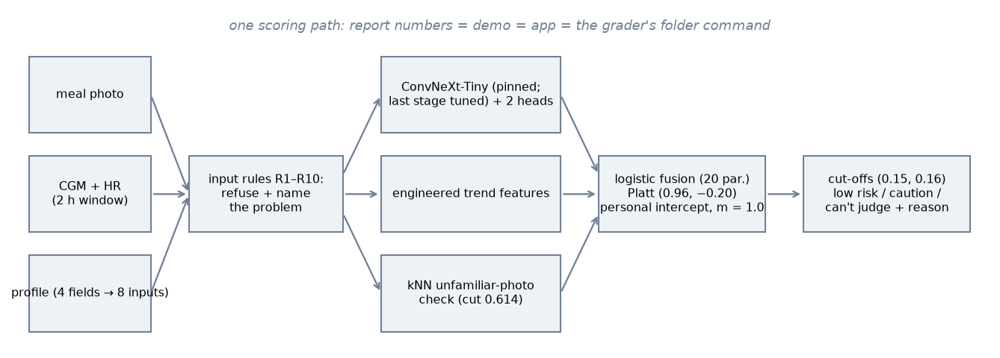
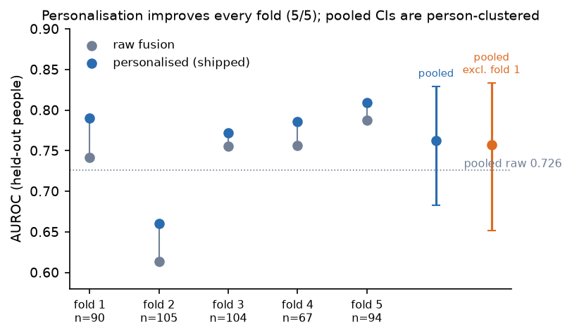
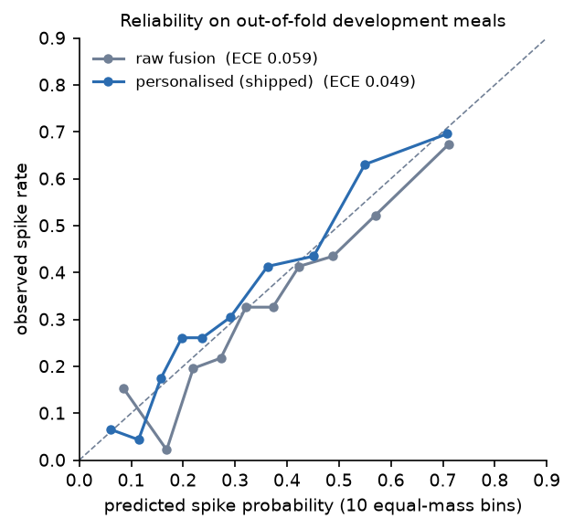
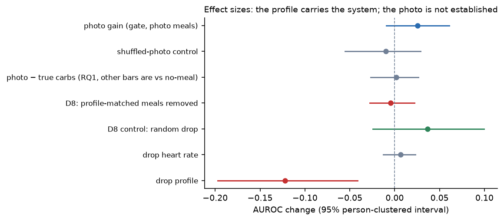
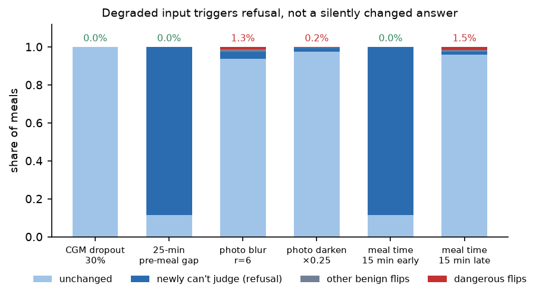

# GLIMPSE: final report
Before eating: a meal photo + the last 2 h of CGM glucose and heart rate + a short profile → **low risk**,
**caution** or **can't judge** (with a reason). Offline, local weights, one Mac.
Maitha Alhosani · MAAI7103 · November 2026 · `just install` → `just predict-folder <in> <out>`

<!-- BUDGET 3,000 words: bottom line 180 · §1 350 · §2 525 · §3 650 · §4 550 · §5 475 · §6 300 · §7 200.
     Check with `just wordcount`. TODO markers: [S16] filled 22 Nov, [DIET] 19 Nov, [REGEN] 12 Nov. -->

**Bottom line.** The central fix this phase was calibration, and it worked: a per-person intercept,
fitted only on each person's earlier meals and replayed in deployment order, raises AUROC from 0.726
to 0.762 and improves every one of the five folds individually, while halving the per-person
calibration gaps the intermediate diagnosed. The photo's contribution was put through a pre-registered
gate and did not pass: +0.025 AUROC with a 95% interval crossing zero (−0.010, +0.061), so, per the
paragraph committed before the run, the shipped product is sensor + confirmed carbs, with the photo
head as a carb-entry assist rather than an established risk signal. Safety behaves by design: 8 of 109
cleared meals spiked (7.3%, interval 2.6–14.4% against a pre-registered 10% cap), degraded input
triggers refusal rather than a changed answer, and a 23-case adversarial input suite produces zero
crashes and zero raw error rows. [S16: one sentence with the locked-8 result, scored once on 22 Nov —
whatever it shows.]

## 1. System and tooling
<!-- 350 words: condensed user/workflow from the intermediate; ONE scoring path (D2); the instructor
command; efficiency table below; tooling line (uv, pydantic, loguru, ruff, 129 tests, CI, W&B). -->
An adult with prediabetes in a 10–14 day CGM programme wants fewer spikes but stops logging food
within days. Before eating they photograph the meal and get **low risk**, **caution** (with a nudge:
smaller carb portion, a short walk), or **can't judge** with the reason in one plain sentence. The
CGM labels every meal itself two hours later (`cgm_auto`, the same spike rule as training), so the
system learns each person without any logging effort; abstentions escalate to a confirm-carbs step or
a dietitian. A wellness nudge, not a medical device.

There is exactly one scoring path: every number in this report, the demo, the app and the grader's
`just predict-folder <in> <out>` go through the same `Pipeline.answer`, and plain-code input rules run
before any model (§4). Tooling: uv + Python 3.14 (locked), strict Pydantic on config, data and
outputs, `just` recipes for every number, ruff + 130 tests in CI, W&B offline exports, and an
incremental git history in which every pre-registration precedes its run. The system trains and runs
on one laptop. Figure 1 shows the single path.

| Measured on the shipped pipeline | value | cap |
|---|---|---|
| largest model (ConvNeXt-Tiny + heads) | 27.8M | 200M |
| pretrained total | 27.8M | 1B |
| trained from scratch (heads 3,845 + SensorCNN 5,217 + fusion 20) | 9,082 | 50M |
| cold first answer / warm median / p95 | 1.55 s / 264 ms / 270 ms | ≤300 ms p95 |
| peak memory / checkpoint | 797 MB / 31 MB | – |

## 2. Multimodal design and the photo gate
<!-- 525 words: architecture (frozen backbone + two heads, SensorCNN as RQ2 baseline only, LR fusion
with capacity argument: 23 dev people support ~20 params); photo CV quality (22.6 g MAE, Spearman .53,
bin F1 .61 vs ridge-on-true-macros F1 .38); then the gate. -->
Three parts. A pinned, SHA-verified ConvNeXt-Tiny backbone (ImageNet-22k) feeds two small heads — grams
regression and a 4-bin carb classifier — with only the last backbone stage fine-tuned; on
held-out people the photo head reaches 22.6 g MAE, Spearman 0.53 and bin F1 0.61 (a ridge on true
macros gets a better MAE, 20.4 g, but F1 0.38 — the heads earn their 3,845 parameters on the bins;
patients' own carb counts err by ~15–20% of meal content, so this error band has company: Brazeau et
al. 2013, Vasiloglou et al. 2018).
Hand-made trend features summarise the 2-h CGM/HR window; SensorCNN, the required from-scratch model
(5,217 parameters), is kept as the RQ2 baseline only: at the intermediate evaluation, on its held-out
five people, 0.696 AUROC against the engineered-feature logistic regression's 0.691 — a gain of
+0.004 (−0.040, +0.045) that fails the pre-registered bar, so the hand-made features stayed.
Fusion is a 20-parameter logistic regression. With 23 development people and four inner folds behind
every choice, that is the capacity the data supports; it is also the course's own prescription for
this data size (frozen pretrained features plus a simple classifier). Gradient boosting, the usual
tabular default, was tried at the intermediate stage and lost clearly (AUROC 0.596 against the
logistic regression's 0.691), and an attention or transformer head on the CGM sequence fails the
same test the SensorCNN tie already settles: with 481 meals from 23 people, no higher-capacity
sequence model meets the "simplest option that meets the measured bar" rule. Training recipe, read
from the committed config: AdamW throughout; heads at learning rate 1e-3, the fine-tuned last stage
at 1e-4 (ten times smaller, the taught differential-rate rule); warm-up plus cosine schedule; weight
decay 0.05 (photo) and 0.01 (SensorCNN); batch 64; early stopping by patience on inner folds, final
epochs fixed at the medians (12 heads + 2 last-stage). Photo loss: Huber on log grams plus 0.5 times
cross-entropy on the bin; SensorCNN: binary cross-entropy. Augmentation during last-stage training:
horizontal flips, crops keeping at least 80% of the plate, brightness and contrast within 10%, and
deliberately no hue change, because colour tells foods apart.

Whether the photo helps at all was decided by a gate, not by us. The pre-registered gate returned
+0.025 AUROC (−0.010, +0.061; shuffled-photo control −0.010); per the pre-commitment
(docs/gate_s8.md, both outcome paragraphs committed before the run, the losing one deleted in git),
the shipped product is sensor + confirmed carbs, with the photo head as a carb-entry assist, not an
established risk signal. Three results corroborate the verdict rather than soften it. RQ1: replacing
the photo estimate with the participants' true logged carbs gains only +0.002 over profile + trend —
an information ceiling no better photo encoder can break (ceiling analysis: replace a stage with its
ground-truth output; a small jump means the stage is not the bottleneck). D8: excluding training meals that share an
exact macro profile with a held person's meal kills the photo gain (−0.005) while a size-matched
random drop keeps it (+0.037) — the small gain rides on CGMacros' repeated standardised meals.
Channel ablations: dropping heart rate changes +0.007 (it stays only because the feature set was
fixed before the ablation); dropping the profile costs −0.122 — the tabular core is the backbone of
performance.

## 3. Evaluation and ablations
<!-- 650 words: partition v2 (5 outer folds, 4 inner folds = every selection; 14 T2D train-only;
481 dev meals scored exactly once, splits/reconciliation.md; fold 1 declared = intermediate's scored
people); the headline and per-fold tables; calibration method (Platt on inner-OOF + penalised personal
intercept, 2-h label gate, replay); (m, lo, hi) by min expected cost on replayed inner risks; m basin. -->
Partition v2: the 23 development target people form five outer folds; four inner folds inside each
fold's training people are the validation split for every choice (fusion C, Platt, the shrinkage m,
the cut-offs); 14 T2D people are training-only and never scored; 8 people have been locked since the
proposal. A committed reconciliation (splits/reconciliation.md) asserts that the 481 development meals
are scored exactly once — the intermediate's double-count, answered in kind. One declared caveat:
fold 1 contains the five people the intermediate evaluation already scored (the same seeded draw), so
the pooled development estimate is optimistic. The personalised model beats raw in all five outer
folds; the pooled estimate excluding the previously-scored fold 1 is 0.757 (0.651–0.833) against
0.762 overall, and the locked eight, scored once in §6, are the only fully clean measurement.

Postprandial response is strongly person-specific (Zeevi et al. 2015; Berry et al. 2020), and the
calibration fix (the intermediate's central criticism) is a per-fold Platt map on inner
out-of-fold fusion risks plus a penalised per-person intercept b_p(t), fitted only on the person's
earlier meals and replayed in deployment order under a 2-hour label-availability gate — deployment
gets those labels free from the CGM itself. One reading note on the table below: within every fold
the Platt AUROC equals the raw AUROC exactly, because a monotone per-fold map cannot reorder meals
inside its fold; the pooled Platt figure (0.714) below raw (0.726) is an artefact of mixing five
fold-specific maps, and the calibration evidence is the reliability diagram (Figure 3), the
equal-mass ECE (0.059 raw to 0.049 shipped), the log-loss (0.537 personal vs 0.572/0.567) and the
halved per-person gaps, not AUROC. For binary logits, Platt scaling is temperature scaling plus a
bias term, a strict generalisation of the taught one-parameter fix, fitted here on inner
out-of-fold risks only; the personal intercept extends the same post-hoc principle by one penalised
parameter per person.

| risk (dev, 481 meals) | AUROC (95% person-clustered) | log-loss |
|---|---|---|
| raw fusion | 0.726 (0.659–0.797) | 0.567 |
| + per-fold Platt | 0.714 pooled (= raw within every fold) | 0.572 |
| + personal intercept (shipped) | **0.762 (0.682–0.829)** | **0.537** |
| shipped, excluding fold 1 | 0.757 (0.651–0.833) | 0.547 |

| fold | n | raw | personal | m | cut-offs (lo, hi) |
|---|---|---|---|---|---|
| 1 | 90 | .742 | .790 | 1.0 | .21, .21 |
| 2 | 105 | .614 | .661 | 2.0 | .13, .23 |
| 3 | 104 | .755 | .772 | 0.5 | .13, .20 |
| 4 | 67 | .757 | .786 | 1.0 | .15, .17 |
| 5 | 94 | .788 | .809 | 1.0 | .14, .14 |

Per-person gaps halved: rare spikers predicted 20.9% vs observed 14.2% (was 29.3%); frequent 42.6% vs
52.9% (was 37.0%). Cut-off variation (two folds chose no abstention band) is reported as a finding:
the cost optimiser priced abstention at zero value for those inner distributions. The cost-vs-m curve
is a flat basin (m ∈ [0.5, 2] across folds). The deployed values were frozen from the all-development
replay by a pre-registered procedure (docs/final_design.md amendment): Platt (0.96, −0.20), m = 1.0,
cut-offs (0.15, 0.16) — the replay, like two of the five folds, chose a near-degenerate abstention
band, and §4 reports that as a finding.

## 4. Trust and safety
<!-- 550 words: cost matrix as declared assumption (missed spike 5× unnecessary caution; abstain 2,
0.5) with DCA framing (Vickers & Elkin 2006: the threshold IS the harm ratio) and the pre-registered
sensitivity sweep; usefulness vs pre-registered targets; robustness table; stress suite; monitoring. -->
Decisions are priced, not guessed: a missed spike costs 5× an unnecessary caution and abstention
costs (2, 0.5) — declared assumptions (in decision-curve terms the 5:1 ratio IS a ~17% action
threshold: Vickers & Elkin 2006), with a pre-registered sensitivity sweep over missed-spike ∈ {3,5,7,10} × abstention
multipliers committed alongside. All four usefulness targets were fixed before any result
(docs/evaluation_protocol.md) and all four hold at the point estimate: cost reduction 14% (min 10%),
cleared 23% (min 20%), abstain 14% (max 20%), missed-among-cleared 7.3% (max 10%). In plain terms:
of every 100 meals a user eats, the app lets about 23 pass without any caution, flags 64, declines
to answer 14, and of the meals it clears about 7 in 100 still spike, which the programme's dietitian
sees because the CGM reports every outcome two hours later. Two folds — and
the final all-development replay — chose a (near-)degenerate abstention band: the cost optimiser
honestly prices borderline abstention at almost nothing for those risk distributions, and we report
that as a finding rather than forcing a band.
8 of 109 cleared meals spiked (7.3%; person-clustered 95% CI 2.6–14.4%):
within the cap at the point estimate, though with only 17 people contributing cleared meals the
interval's upper bound exceeds it — a limit of cohort size, monitored continuously in deployment,
where the CGM labels every meal at +2 h (cgm_auto). The 8 misses spread across 6 people. Abstaining instead of
guessing is established practice for medical ML (Kompa et al. 2021).

| perturbation (same per-fold pipelines, no history) | unchanged | dangerous flips | newly can't-judge |
|---|---|---|---|
| CGM dropout 30% | 100% | 0.0% | 0% |
| 25-min pre-meal gap | 11% | 0.0% | **89% (refusal, by design)** |
| photo blur r=6 | 94% | 1.3% | 4% |
| photo darken ×0.25 | 97% | 0.2% | 2% |

Stress suite: 23 hostile inputs (timezone offsets, malformed JSON, binary CSVs, truncated/CMYK/GIF
photos, empty folders...) → zero crashes, zero raw error rows; rules R8–R10 added only against
observed failures of a recorded naive run (commits 3ee062b → 3cf9973), like R1–R6 before them;
the invariant is enforced by tests on every commit. Monitoring: four signals with alert rules
(docs/monitoring.md); drift baseline committed. [DIET: two dietitians, three structured questions —
cap acceptability, label wording, the rising-baseline case; responses folded in here, or the honest
pending line.]

## 5. Explainability and failure analysis
<!-- 475 words: probes A+B; R7; D8 as failure insight; S14 taxonomy (false-cleared + abstention
breakdown) TODO 10 Nov; label-definition discussion. -->
Failure taxonomy (every class observed, none hypothetical). **T1 rule refusals:** malformed or
degraded input never reaches a model — 13 instructor and 23 stress cases all end in a structured
refusal naming the problem (§4). **T2 missing-photo abstentions:** 21 of 481 dev meals have no usable
photo; the system abstains rather than guessing carbs. **T3 borderline abstentions:** 45 meals, all in
folds 2–4 — folds 1 and 5 chose no abstention band, so where the band exists is itself a product of
per-fold cost optimisation, and we report it as such rather than as a stable property. **T4 near-cut
false-clears:** 3 of the 8 missed-among-cleared sat within 0.03 of their fold's cut — boundary
sensitivity, the price of any hard threshold. **T5 confident false-clears, the genuine blind spot:**
the other 5 were cleared at risks 0.03–0.13, far from the cut; four of the five had ten or more
earlier labelled meals available (the fifth had one), so personalisation mostly had data and still
cleared them; they spread across 4 people, so no single outlier explains them. **T6 confident-wrong carb estimate (R7):** a visually familiar,
nutritionally unfamiliar local dish passes the kNN check and gets a wrong bin — structural, detailed
below. **T7 label-definition surprise (probe B):** not a model failure but a communication one; also
below.

Probe B failed exactly as a label-correct model should: the label is baseline-relative, so a rising
pre-meal trace lowers predicted spike probability — the registration, not the model, encoded naive
physiology (pre-registered with a committed expected-fail, commit 17da63a). Probe A: risk moves in the photo's direction on 100% of meals, yet the
extreme bottom↔top-decile plate swap leaves 68.5% of decisions unchanged (median swing 0.102) — the
gate's verdict seen mechanistically. R7 (rule ledger): the kNN check measures visual, not nutritional,
familiarity — a local lamb-and-rice dish scores 0.318 against the deployed 0.614 cut (more familiar
than the clean tuna-bowl case at 0.406) and gets a confident wrong carb bin; the sweep under a ≤2%
false-flag budget shows the deployed cut is already the strictest, so no threshold fixes it — the
finding survived the final model's regenerated reference unchanged; mitigations are the confirm-carbs
tier and per-answer distance monitoring; a nutrition-aware embedding is named future work. Clinical note the probe forces: a user already rising into a meal may see "low
risk" while clinically ascending — a rise-over-last-value label is worth future work; whether the
app should add a separate "your glucose is rising now" note is one of the three questions put to the
dietitians (§4).

## 6. Reproducibility
<!-- 300 words: fresh-clone chain; one-Mac story + CSCC sentence; W&B; manifest; locked-8 protocol. -->
The 8 locked subjects were scored once, on 22 Nov, from frozen artifacts verified by a fresh-clone
run; every reported number comes from the same Pipeline.answer path the instructor command invokes.
[S16: locked-8 tables here.] We pre-commit, before that run: the locked-8 result is reported as
measured, in the same form as §3, whatever it shows, and no re-tuning follows from it. A fresh-clone
dry-run (5 Nov) proved the chain early — clone, `uv sync`, one documented weights step (pinned
Hugging Face revision, SHA-256-verified) reproduce the selftest, the 13-case instructor suite and the
23-case stress suite — and itself found and fixed two onboarding defects before a grader could. The
serving artifacts were regenerated from the all-development replay under a pre-registered procedure
whose own guard stopped the first run over a 0.001 reference near-miss; the decision is recorded in
the open in docs/final_design.md. Every number in this report has a `just` recipe; W&B offline
exports and the full incremental git history are committed. Cluster access existed; the deployed
system trains and runs on one Mac overnight, and the reproducibility environment was deliberately not
split.

**AI-assisted development, verified.** The code was built with an LLM assistant, as the course
expects, and the defence is the verification trail rather than the authorship: a probe write-up
stated n=397 where the committed output says 460, caught by a line-by-line check against the
evidence files and corrected in a dated commit; a fold-level AUROC was rounded the wrong way (.787
for 0.786) and fixed the same way; and the artifact-freeze procedure the assistant wrote stopped its
own first run over a 0.001 criterion near-miss, with the decision recorded before the rerun. Every
such correction is in the git history by design.

## 7. Limitations and conclusion
<!-- 200 words -->
Forty-five people from one study, with repeated standardised meals that D8 shows inflate any
photo-memorisation effect; no local-cuisine data, and R7 names exactly the dish class that would
suffer. T2D participants are training-only, so no claim is made for them. Heart rate adds nothing
here. The photo is not established as a risk signal, and the label's baseline-relative definition can
diverge from a user's intuition (probe B). This is an advisory prototype on an open dataset — no
clinical validation, no regulatory review — built so that a clinical study *could* evaluate it: one
scoring path, pre-registered targets and gates, continuous outcome monitoring for free from the CGM
itself. That discipline is the contribution that survives any single number: the gate shipped its
losing paragraph, the probes caught their authors, the guard that froze the final artifacts stopped
its own first run, and the locked eight were touched exactly once.

**Appendix: taught-technique coverage.** Group split by person and a pristine locked test set
scored once (weeks 4-5); nested cross-validation for every selection, thresholds moved instead of
class weights, loss separated from metric (week 2); capacity, data and compute treated as
currencies, wall-clock reported as a first-class number (week 3, section 1); frozen pretrained
features with a simple classifier, differential learning rates, augmentation without hue change,
transfer learning over training from scratch (weeks 5-6); shuffled-label control, ceiling analysis,
error taxonomy, pre-registered hypotheses, seed-noise caution, subgroup reporting, graceful
degradation (week 11, sections 2-5); cost-chosen confidence thresholds, refusal to human review,
validated outputs only, worst-slice reporting, scope-limited deployment (week 9, sections 4-5);
sequence models considered and measured against the bar (weeks 8-10, RQ2). Not used, with reasons
in the text: attention heads, full fine-tuning, ensembles, self-supervised pretraining.

**References.** Zeevi et al., Cell 2015 · Berry et al., Nature Medicine 2020 · Vickers & Elkin,
Med Decis Making 2006 · Brazeau et al., Diabetes Res Clin Pract 2013 · Vasiloglou et al.,
Nutrients 2018 (GoCARB) · Kompa, Snoek & Beam, npj Digital Medicine 2021 · CGMacros, PhysioNet.
