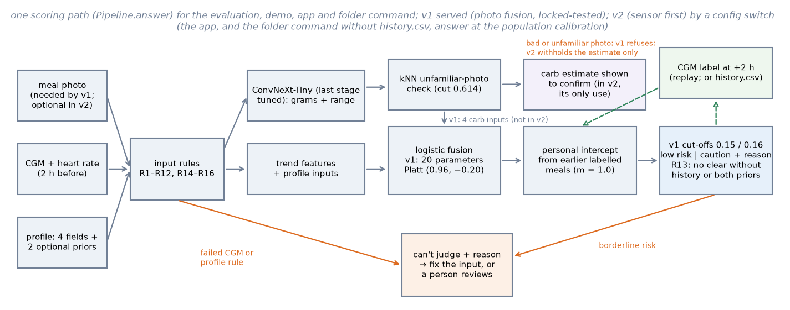

# GLIMPSE: final report
Before eating: a meal photo + the last 2 h of CGM glucose and heart rate + a short profile → **low risk**,
**caution** or **can't judge** (with a reason). Offline, local weights, one Mac.
Maitha Alhosani · MAAI7103 · November 2026 · `just install` → `just predict-folder <in> <out>`

**Bottom line.** GLIMPSE serves v1, its model frozen on 6 Nov: a small logistic model combines a fine-tuned photo
model's carb estimate with the glucose trend, heart rate and a short profile. Scored once on 8 held-out
people, it reached AUROC 0.645 (0.540–0.736) and met 1 of its 4 usefulness targets (few can't-judge
answers): it cleared too few meals, missed too many of those it cleared and cost more than always saying
caution. The product is not shown to work on unseen people. The photo failed its pre-registered test; its
small gain may come from recognising repeated meals (§2), so we do not claim it adds value. A sensor-first
alternative,
v2, let more spikes through on development and is not served. A 26 Nov safety rule (R22) and a 27 Nov external
check of v2 are in the table's last two rows.

| Status at a glance | v1 served, development (481 meals) | v1 served, locked eight (153) | v2 alternative, development (481) |
|---|---|---|---|
| AUROC (95% person-clustered) | 0.762 (0.682–0.829) | 0.645 (0.540–0.736) | 0.754 (0.673–0.815); 0.748 on v1's 460 |
| meals answered with a risk | 460 | 150 | 481 |
| ECE, registered 15 bins (target ≤ 0.05) | 0.052: not met by 0.002 (a perfect model scores about the same here) | 0.061: not met | 0.029, below a perfect model's median 0.051: on track |
| usefulness targets (protocol labels: met / on track / at risk) | 1 met, 3 on track (development labels, before R22); with R22 the cleared-share target is missed (row below) | 1 met, 3 not met (final test) | 1 met, 2 on track, 1 at risk (spikes among cleared) |
| spikes among cleared meals (cap 10%) | 7.3% (2.9–14.2%) | 2 of 10; 8 of the 10 clears from one person (person-bootstrap interval 0–100%) | 12.7% (5.9–22.6%) |
| served without history (onboarding priors only): cleared; spikes among them | 15.2%; 9.6% | 20.9%; 21.9% (7 of 32); cost 17.0% above always caution | – |
| with rules R22 and R14 (added 26 Nov): cleared; misses among cleared | 18.1%; 6.9% (6 of 87); the cleared share is now under its 20% target | 2 of 10 clears become caution (outcomes not read) | 20.2%; 14.4% |
| external check, 27 Nov, exploratory: v2 as frozen on 12 unseen people (BIG IDEAs dataset, 201 meals) | – (v1 needs a photo) | – | AUROC 0.628 (0.535–0.704); ECE 0.053; 16.9% cleared, 14.7% of them spiked (5 of 34) |

*Table cells are tested against their evidence files; more in docs/report_appendix.md.*

| Intermediate feedback (1 Nov) | response | where |
|---|---|---|
| product claim statistically fragile | intervals on the main claims; the claim is withdrawn where not established | §2, §3 |
| thresholds not validation-chosen | evaluated cut-offs chosen on inner folds | §4 |
| test set of 5 people | 8 locked people scored once; 12 external people | §3, §6 |
| scratch CNN adds nothing | it still ties the trend features (+0.002): a baseline, not served | §2 |
| evaluation and deployment differ | one scoring path, `Pipeline.answer` | §1 |
| code hard to read | named files split, dead files deleted; `cli.py` (741 lines) and `report_metrics.py` (719) are still long | README |
| meal count double-counted | 481 development and 153 locked meals, disjoint | splits/reconciliation.md |
| recurring meal profiles | tested: without them the photo's gain is −0.005 | §2 |

## 1. System and tooling
The user is an adult with prediabetes in a CGM programme who wants fewer spikes but stops logging food
within days. Before a meal they photograph it and get one sentence with its reason. A spike is a rise
of at least 50 mg/dL above the 30-minute
pre-meal mean within 2 hours. The CGM labels
every meal two hours later, so the system learns each person without logging. The adopter would be the
programme, offering it to its participants; the §4 targets are its operational test. Out of scope:
diabetes, any dosing decision, and sensors that report every 15 minutes.

One scoring path (Figure 1): the evaluation, the demo, the app and the grader's
`just predict-folder <in> <out>` all call `Pipeline.answer`.

Plain-code rules run first and refuse with a
named reason and who acts next: the user fixes the input, or a person reviews (docs/rule_ledger.md). Three
safety rules were added after AI review rounds found failures on unseen inputs: below 54 mg/dL the
answer is "treat the
low first", not a walk (R14); HbA1c in the diabetes range is out of scope (R15); and a CGM or
heart-rate input beyond the training range in the risk-lowering direction is refused (R16), since an extreme
heart rate alone turned a prediabetic caution into low risk. Their effect on
scored decisions is in docs/rule_ledger.md. Input rules R17 to
R21 came from AI review rounds' unseen files.
`prototype.product` selects v1 (served) or v2; v1's frozen files are byte-identical to the tag. The
per-person intercept needs labelled meals: the evaluation replays them in deployment order, and the
folder command takes them as an optional `history.csv`. A profile without onboarding priors gets training
medians, and rule R13 then withholds any low-risk answer. The instructor samples carry no priors, so without
`history.csv` they
give caution or can't judge, never low risk (`samples/returning_user` shows all three answers).

Tooling: uv with Python 3.14 (locked), strict Pydantic, Loguru, a `just` recipe behind every table, 215 tests
(214 pass with the data and weights, one an expected failure; 198 pass without
them; logs in outputs/finalize/), W&B offline runs replayed from committed training histories
(outputs/wandb/), and a git history from the 27 Sep proposal; from 2 Nov every registration
commit precedes
its results commit (except the same-day 27 Nov checks).

| Parameters and cost | v1 (served) | v2 (alternative) | cap |
|---|---|---|---|
| largest model (ConvNeXt-Tiny + heads) | 27.8M, a risk input | 27.8M, carb estimate only | 200M |
| fine-tuned (last ConvNeXt stage + heads) | 15.5M | 15.5M | – |
| pretrained + fine-tuned total (`just params`) | 27.8M | 27.8M | 1B |
| risk model (logistic fusion) | 20 | 16 | – |
| SensorCNN, the from-scratch network: it ties the trend features, so it is evaluated, not served | 5,217 | 5,217 | 50M |
| peak memory while serving; photo checkpoint on disk | 796 MB; 31 MB of fine-tuned weights, plus the pinned backbone (author's Mac, 7 Nov) | not measured | – |
| fine-tuning items (CGMacros photos) | 1,221 | 1,221 | 10,000 |
| one whole meal, folder command, with / without photo (2-CPU cloud) | 116 ms (p95 142; author's Mac, 7 Nov: 265 ms warm median, p95 271, first answer 1.57 s) / refused | 115 ms (p95 147) / 6.4 ms | ≤300 ms p95 |

{width=80%}

| Quality against cost (development) | risk AUROC | serving cost of the risk |
|---|---|---|
| v2: trend + profile fusion with the intercept (alternative) | 0.754 on 481 meals | 6.4 ms a meal; the photo adds about 110 ms for the carb estimate only |
| v1 (served): + the photo estimate (4 inputs) | 0.762 on 460 meals | 116 ms a meal, needs the photo |
| int8 photo model (460 development photos, in-sample) | 97.0% of v1's decisions kept; carb MAE 15.4 → 17.7 g, what v2 shows | 55 ms against 77 ms per photo |

*outputs/param_budget.csv, outputs/efficiency/ (int8 run on the 460 photos with a v1 decision, a disclosed deviation), outputs/cv/.*

## 2. Multimodal design and the photo gate
A pinned, SHA-verified ConvNeXt-Tiny (ImageNet-22k pre-trained, 1k fine-tuned) feeds two small heads,
grams regression and a 4-range carb classifier, with only the last backbone stage fine-tuned. The profile
has eight inputs, including two onboarding priors: each person's spike rate and mean rise over their
first meals. Seven hand-made trend features summarise the 2-h CGM and heart-rate window. SensorCNN ties
the trend features (+0.002, −0.016 to +0.022, on 481 meals) and stays a baseline. Fusion is logistic regression, the
capacity 23 development people support; gradient boosting on the same inputs is not shown better (logistic
minus boosting +0.016, −0.024 to +0.062, fusion study without the intercept). v1's risk uses all three
modalities; v2's uses
sensors and profile, with the photo as a separate carb estimate.

| what was trained | starts from | trained parameters | loss; optimiser and schedule | epochs (inner folds) | validation result |
|---|---|---|---|---|---|
| photo model: ConvNeXt-Tiny + grams head + 4-range head | ImageNet-22k weights, SHA-pinned | heads, then the last stage: 15.5M of 27.8M | Huber on log grams + 0.5 × range cross-entropy; AdamW (weight decay 0.05, dropout 0.2, fixed), heads 1e-3, last stage 1e-4, warm-up and cosine; flips, crops keeping 80%, ±10% light | heads 12–16, last stage 2–3 (early stopping) | inner carb MAE 24.2–26.1 g; out of fold 22.6 g |
| SensorCNN: two 1-D convolutions (kernel 25 min) over 24 slots of glucose and heart rate + the profile | random | all 5,217 | binary cross-entropy; AdamW 1e-3 (weight decay 0.01, dropout 0.2, fixed), warm-up and cosine; sensor noise each epoch | 11–22 per outer fold (checkpoint: 13) | AUROC 0.688 ± 0.007 out of fold (3 seeds) |
| v1 fusion: logistic regression on 15 trend and profile inputs + 4 photo inputs | – | 20 | log-loss; C chosen on inner folds | – | raw AUROC 0.726 out of fold |

*outputs/cv/, outputs/photo_cv/, outputs/training/, outputs/robustness_v3/robustness_v3.json. SensorCNN's 0.688 averages three seeds' AUROCs; §3's baseline rows score the seeds' averaged prediction. One seed (20260927, configs/default.yaml) fixes Python, NumPy and PyTorch; 3-seed rows use 0, 1, 2. The optimiser itself was not compared.*

| What the photo does (gate first) | result |
|---|---|
| risk gate, pre-registered: AUROC gain over no meal information | +0.025 (−0.010, +0.061): not established |
| shuffled-photo control; true logged carbs instead (ceiling) | −0.010; +0.024 (−0.003, +0.056) |
| photo estimate against logged carbs (margin 0.03) | +0.002 (−0.027, +0.027): non-inferior |
| carb estimate on held-out people: MAE, Spearman, range F1 | 22.6 g, 0.53, 0.61 (frozen features + ridge: 20.4 g, 0.56, 0.38) |
| the carb estimate's own value, 817 out-of-fold photos: MAE; carb range right | 23.5 g against 29.0 g for typing the training median; 60% against 18% |
| freezing ablation: heads only, then + last stage (inner-fold carb MAE) | 27.5–29.8 g → 24.2–26.1 g; the last stage kept in 5 of 5 folds (rule: keep only if MAE drops ≥ 0.5 g) |
| probe D: grey out the middle half vs an equal-area border | the middle moves the grams more on 84% of development photos (in-sample) and 86% of 14 unseen phone photos |

*outputs/fusion/, outputs/photo_cv/, outputs/promised/, outputs/probes/, outputs/training/, outputs/v2_explain/; probes D and E registered before they ran. The 817 photos: every photographed meal of the 23 development people.*

The gate's verdict, written before the run (docs/gate_s8.md): rest the answer on trend and profile; use the
photo as a carb-entry aid. The 5 Nov amendment kept the photo as
4 of v1's 19 inputs; v2 follows the verdict (docs/v2_sensor_first.md) and was not adopted. Why the photo
adds little: true carbs add about 0.02 on CGMacros' standardised meals, a ceiling the
photo matches.
A repeated-meal check (D8, registered 1 Nov) removed
from training every meal sharing an exact macro profile with the held-out person: the photo's gain fell to
−0.005, against +0.037 for a random drop of the same size (difference −0.041, −0.093 to +0.008). The photo
may be recognising repeated meals rather than reading carbs. Fine-tuning loses to ridge on grams (22.6
against 20.4 g). Its range head scores F1 0.61, but range heads on frozen features reach 0.62 (v3, a
regularised heads-only candidate, appendix), so the
fine-tune is not shown to help the range either. It looks at the plate, not the background (probe D), but on
its training photos it does not scale grams with how large the food looks (probe E, appendix): it reads what
kind of meal, not how much.

## 3. Evaluation and ablations
The 45 CGMacros participants (ages 18 to 69, 64% female) wore a CGM for about ten days. 158 of the 481 development
meals (32.8%) spiked, with per-person rates
from 0% to 68%. In the final split, 23 development people form five outer folds, with four inner folds
choosing everything (regularisation, Platt map, intercept shrinkage, cut-offs); 14 T2D people only train;
8 people were locked at the proposal. Each development meal is scored once; the primary metric is AUROC.
Fold 1 holds the five people the intermediate evaluation scored, and the calibration fix was
designed after a diagnosis on them, so development carries selection pressure the locked eight do not.
v2, chosen after v1's locked result, carries more; its development number is likely optimistic.

Postprandial response is person-specific (Zeevi et al. 2015; Berry et al. 2020). The calibration fix is a
per-fold Platt map plus a penalised per-person intercept fitted only on that person's earlier meals whose
2-hour label window has closed (Figure A4, appendix).

| risk (answered meals) | AUROC (95% person-clustered) | AUPRC (base rate) | Brier (constant forecast) | log-loss | ECE, 15 bins: equal-width / equal-mass |
|---|---|---|---|---|---|
| dev baselines (460): prevalence / profile only / trend + profile LR / gradient boosting / SensorCNN | 0.414 / 0.676 / 0.695 / 0.700 / 0.696 | 0.289 / 0.490 / 0.555 / 0.538 / 0.558 | 0.231 / 0.203 / 0.198 / 0.201 / 0.199 | – | – |
| v1 dev raw fusion (460) | 0.726 (0.659–0.797) | 0.554 (0.328) | 0.192 (0.221) | 0.567 | 0.060 / 0.059 |
| v1 dev + personal intercept | **0.762 (0.682–0.829)** | **0.591 (0.451–0.694)** | **0.180 (0.148–0.210)** | **0.537** | 0.052 / 0.049 |
| v1 locked raw fusion (150 of 153) | 0.611 (0.510–0.743) | 0.531 (0.420) | 0.251 (0.244) | 0.707 | 0.150 / 0.143 |
| v1 locked shipped (150 of 153) | **0.645 (0.540–0.736)** | **0.547 (0.409–0.658)** | **0.230 (0.199–0.257)** | **0.650** | 0.061 / 0.098 |
| v2 dev + personal intercept (alternative) | **0.754 (0.673–0.815)** | **0.601 (0.459–0.688)** | **0.182 (0.151–0.210)** | **0.544** | 0.029 / 0.076 |
| v2 as frozen, external: 12 people, 201 meals (27 Nov) | 0.628 (0.535–0.704) | – | 0.185 (0.189) | – | 0.053 / – |
| external baselines: running spike rate / logged carbs alone / v2 recipe + logged carbs, no intercept (0.624 without) | 0.553 (0.415–0.652) / 0.734 (0.638–0.818) / 0.749 | – | – | – | – |

*AUROCs are pooled over out-of-fold predictions, so a per-fold constant scores below 0.5. v1 answers 460 development meals (21 had no photo); v2 all 481. outputs/report_metrics/, outputs/locked_eval/.*

| paired comparisons (95% person-clustered) | development | locked |
|---|---|---|
| v1: intercept minus raw, AUROC | +0.037 (−0.004, +0.071); higher in 5 of 5 folds | +0.033 (−0.054, +0.100) |
| v1: intercept minus raw, log-loss | −0.030 (−0.060, −0.001) | −0.057 (−0.156, +0.009) |
| class weighting against thresholds alone (fusion, registered 8 Nov) | +0.006 (−0.001, +0.012): no gain, not adopted | – |
| v2 minus v1, AUROC on the 460 meals both answer (margin 0.03) | −0.015 (−0.045, +0.010): not non-inferior | not computed (v2 never sees the locked eight) |
| v1 with the intercept minus gradient boosting with the same intercept | +0.013 (−0.022, +0.043) | – |
| v1 minus a running spike rate per person (no model, same gate) | +0.063 (+0.030, +0.113) | – |
| CGM removal: trend + profile minus profile only, both with the intercept | +0.033 (+0.007, +0.065) | – |
| mean within-person AUROC, intercept minus raw: v1 / v2 | −0.078 (−0.110, −0.046) / −0.086 (−0.127, −0.045) | – |

*Paired person bootstrap, 2,000 draws. Holm over 7 of these contrasts (not class weighting or v2's within-person one; normal-approximation p; holm.json): only the running-spike-rate and v1 within-person contrasts survive. report_metrics.json, v2_metrics.json.*

| course checks on v1 (registered in docs/final_switch.md before they ran) | prediction | result |
|---|---|---|
| shuffled-label control: fusion refitted with labels shuffled within each training fold, 20 shuffles | AUROC 0.45 to 0.55 | 0.475 (range 0.359–0.599), against 0.750 unshuffled: mean met, no sign of a label leak; single shuffles range wider than predicted |
| learning curve: fusion refitted on 4 / 8 / 12 / all training people per fold | rising, all people within 0.03 of 12 | 0.640 / 0.715 / 0.733 / 0.750: met (+0.017); still creeping up |
| identity shortcut: do the 4 photo inputs name the person? | above chance, far from perfect | 8.0% of meals against 6.1% for the commonest person: met for the photo (it may still name the meal, §2). The sensor and profile inputs name the person in 97.8% of meals, as a profile must; that is the base-rate edge of §7 |
| worst slices (served answers) | worst person below 0.6 | women 0.71 (6 of 66 clears spiked) against men 0.86; the worst three people 0.22 to 0.28, on 11 to 25 meals: met |
| train against validation loss at the best validation epoch | small gap | not met for the photo model, 0.35 (9 runs; Figure 2 shows the 8 inner-fold ones): it overfits its 1,221 photos; met for SensorCNN, 0.02 (5 runs) |

*Shuffled-label and learning-curve checks: their own harness (no intercept, fixed C = 0.03), so 0.750 is not comparable with 0.726 or 0.762; final_checks.json.*

Much of the system's edge is the intercept's: with it, gradient boosting comes within 0.013 of v1, and the
photo adds 0.021 (−0.003, +0.053) under v1's procedure. Averaged per person, AUROC falls by about 0.08 in
both products (19 of 22 people worse in v1, 20 of 22 in v2). The system learns each person's base rate,
0.063 better than a plain running spike rate. Removing the CGM costs 0.033 with an interval above zero (post
hoc; not significant after Holm); removing the profile costs 0.122 (fusion study, no intercept; Figure 3).

{width=45%}

{width=45%}

| calibration | v1 dev | v1 locked | v2 dev | without history: v1 dev / v1 locked / v2 dev (Platt only) |
|---|---|---|---|---|
| ECE, registered 15 equal-width bins (target ≤ 0.05) | 0.052 | 0.061 | 0.029 | 0.023 / 0.162 / 0.052 |
| ECE a perfectly calibrated model shows at this size (median; 95th centile) | 0.052; 0.072 | 0.094; 0.136 | 0.051; 0.071 | – |
| calibration-in-the-large (mean risk − spike rate) | −0.015 | −0.010 | −0.015 | +0.002 / −0.108 / −0.001 |

*Floor: labels drawn as Bernoulli(risk), 2,000 draws; v2's 0.029 is lower than about 99% of them, unexplained (appendix); a second simulation gives 0.058 and 0.052 (final_checks.json). report_metrics.json, v2_metrics.json, v2_explain.json.*

At this sample size the ECE target cannot separate either product from a perfectly calibrated model. Without
history, v1's risk under-predicts
the harder locked cohort by 11 points, the clearest calibration failure. v1's discrimination is even
across glycaemic status (0.738 healthy, 0.736 prediabetes); usefulness is not
(page one; appendix table).

{width=64%}

External check (exploratory, 27 Nov; docs/external_bigideas.md lists IDs and dates). The frozen v2, model
only, was scored on a second public dataset (BIG IDEAs, PhysioNet), with age, BMI and fasting glucose
imputed. Four of its 16 people have no usable meal (food-log dates not overlapping their CGM). On 201 meals of
12 people AUROC is 0.628 (0.535–0.704); the mean risk is
0.5 points above the spike rate. The intercept is not shown to help the ranking (0.624 without it) and ranks 6
of 11 people's own meals below chance (within-person 0.473, against 0.620 without it). Logged carbs alone
score 0.734. A separate carb-aware model, v2's recipe without the intercept refitted on CGMacros with the
logged carbs as one more input, scores 0.749 on these meals, +0.126 (+0.060, +0.188) over the same recipe
without carbs; 10 of 11 people rank
better. With its Platt map and
cut-offs from CGMacros alone, its decisions cut cost by 16.3% (7.9–27.4%) and 1 of its 21 clears spiked; it
clears 10.4% of meals against a 20% target, and out of fold on CGMacros the same
recipe saves 9.6% (−7.7% to +24.6%). This is a third look at the same 12 people.

## 4. Trust and safety
Decisions are priced: a missed spike costs 5× an unnecessary caution; abstaining costs 2 if the meal
spikes and 0.5 if not. These are declared assumptions (5:1 implies a ~17% action threshold; Vickers & Elkin
2006), swept over 16 pre-registered
settings that re-choose the cut-offs (appendix). The verdict holds only near the declared prices. Evaluated
numbers use each fold's own inner-fold cut-offs. The served pair, 0.15 and 0.16, minimises this cost on all
development answers (checkpoints/thresholds.json), never the locked eight, and sits inside the five folds'
choices (medians 0.14 and 0.20, appendix).
Referring more meals buys little: before R22, across six ways of referring more, misses among clears run
from 4.9% to 8.4% against 7.3% with no band (intervals overlap); a refer band of 0.05 around the cut refers
22% of meals and leaves 4.9% (0.0–11.6%) missed, while clears fall from 23.7% to 13.3% of the 460 meals.

Rule R22, added on 26 Nov, withholds a clear when the last pre-meal
reading is 140 mg/dL or more or glucose rises faster than 1.5 mg/dL/min. It turns 22 of v1's 109
development clears into caution, only 2 of which spiked (registered prediction not met),
so clears fall to 18.1%, below the 20% target, and the cost reduction to 10.7%; the author kept it, since
"low risk" at 185 mg/dL misleads. The table below predates R22.

| Usefulness target (fixed before any result) | target | v1 dev (481) | v1 locked (153) | v2 dev (481) | v2, no history, frozen cut-offs |
|---|---|---|---|---|---|
| cost reduction vs always caution | ≥10% | 14.4% (−4.6, +31.5) | −5.7% (−19.4, +5.9) | 10.2% (−11.6, +28.9) | −0.2% |
| cleared as low risk | ≥20% | 22.7% (13.2–34.0%) | 6.5% (0.6–15.9%) | 24.5% (13.5–37.5%) | 11.0% |
| can't judge | ≤20% | 13.7% (8.7–19.2%) | 2.6% (0.6–5.0%) | 8.3% (2.5–15.2%) | 18.5% |
| missed among cleared | ≤10% | 7.3% (2.9–14.2%) | 20% (2 of 10; exact 2.5–55.6%) | 12.7% (5.9–22.6%), 15 of 118 | 15.1% (8 of 53) |
| verdict (met / on track / at risk) | – | 1 met, 3 on track (development labels, before R22) | 1 met, 3 not met (final test) | 1 met, 2 on track, 1 at risk | 3 of 4 at risk |

*report_metrics.json (served_operating_point: the no-history row on page one), v2_metrics.json, outputs/locked_eval/locked_summary.json.*

Why v1 is served. v2 is the riskier product: its misses among clears stay near or above 10% at every
low-risk cut, while v1 stays below 10% until about 30% of meals are cleared (cut 0.18; Figure 5,
left); 6 of v2's 15 false clears (§5) fell on people with prediabetes.

| stress at the evaluated operating point (with history) | v2: AUROC, spikes among cleared | v2: caution → low risk | v1: AUROC | v1: caution → low risk |
|---|---|---|---|---|
| clean | 0.754, 12.7% | – | 0.762 (live photo model: 0.773) | – |
| CGM dropout 10 / 30 / 50 / 70% | 0.754 / 0.753 / 0.754; at 70%, 0.765 on the 461 still answered (their clean 0.764); 12.7% → 11.7% | 0 at every level | 0.762 / 0.762 / 0.762; at 70%, 0.767 on 441 (clean 0.766) | 0 / 0 / 0 / 1 |
| readings removed for 10 / 15 / 18 min before the meal (20 min or more: every meal refused, by rule) | 0.753 at each; 12.6–12.7% | 0 / 1 / 1 | 0.762 / 0.761 / 0.761 | 1 / 1 / 1 |
| photo blur radius 2 / 6 / 10 | 0.754, unchanged: the photo is not a risk input | 0 | 0.776 / 0.775 / 0.766 (co-answered clean 0.773–0.774) | 0 / 3 / 6 |

*Registered before their runs (docs/stress_quality.md, docs/v2_explain.md); v1's photo rows are in-sample; v2's other rows and Figure A1 are in the appendix. outputs/robustness/.*

{width=60%}

CGM dropout up to 50% moves AUROC by at most 0.001, and gaps under 20 minutes turn at most one caution into
low risk. In v1, heavy blur lets 6 cautions become low risk and lifts the spike
rate among clears from 8% to 11% (live photo model). In v2 a watch left off gives the largest dangerous flip,
17 cautions
turned low risk. As a detector the unfamiliar-photo check separates 74
meal photos from 31 non-meal pictures (30 synthetic or generated, one screenshot) with AUROC 0.988; at the
served cut it flags 25 of the 31 and 1 of the 74 meal photos, and the one real hard case, the local dish,
passes (rule R7). HbA1c alone separates the 14 type-2 people's meals
perfectly, which supports R15 as a rule (docs/final_switch.md).

| monitoring (docs/monitoring.md) | demonstration | result |
|---|---|---|
| photo drift: weekly median kNN distance above the training q90 | 3 resampled training weeks, then 6 synthetic non-meal pictures | fires on week 4 only (0.709 against 0.25–0.37) |
| missed among cleared above 10%, 80-answer windows | v1 development answers, then locked | 7 of 21 ordinary development windows fire: too noisy |
| power against volume, v1 (registered 26 Nov): calibration CUSUM, same shift | 300 streams | 23% / 46% / 56% / 69% detected within 120 / 240 / 480 / 960 answers, 5–7% false alarms; expectation (above 80% at 960) not met |

*final_checks.json (the power row), outputs/monitoring/ (the others); CUSUM and v2 rows in the appendix; actions per alert in docs/monitoring.md.*

The outcome rules are too
noisy at this volume: a 10-point rise in the spike rate
is caught within 120 answers in under a quarter of streams and within 960 in about two thirds. A
deployment would need well over 1,000 answers per check.

Feedback (src/glimpse/feedback.py): after a meal a validated label comes from the user or from the CGM at
+2 h; with the logged answer it forms a `history.csv` row. A row
only moves that person's intercept at their next meal; no model is refitted from feedback. The
dietitian consultation did not complete, so the cost matrix stays a declared assumption hedged by the sweep.

## 5. Explainability and failure analysis

| failure class | count: v1 / v2 | corpus | root cause | action |
|---|---|---|---|---|
| rule refusal | 8 of 13, 25 of 25 / 5 of 13, 15 of 25; no crash or raw error | instructor cases; hostile inputs | input (format, units, gaps, unreadable photo), a low, out of scope | named refusal, rules R1–R21; the 5 Nov naive run gave 2 raw errors and 1 whole-file rejection on 23 hostile inputs, now 0 of 25 |
| near-cut false clear (within 0.031 of the fold's cut) | 4 of 109 / 6 of 118 | cleared development meals | threshold; v2: 4 of 6 on people with prediabetes | the frozen band would refer 4 of v2's 6; the price of a hard cut |
| confident false clear | 4 of 109 / 9 of 118 | cleared development meals | v1: 2 cold starts (one labelled meal) after steep falls, 2 with 10 and 20 labels; v2: in 6 of 9 the intercept lowered the logit by 0.7 to 1.1 (a low base rate); 2 cold starts | v1: a "falling now" what-if flips 10 clears and avoids 3 of the 8 misses (chosen on the scored data), not shipped; v2: the prediabetes what-if (appendix), not shipped |
| locked false clear | 2 of 10 | cleared locked meals | cohort shift; 8 of 10 clears from one person | none: the monitor cannot catch this |
| false caution | 175 of 306 (locked 78 of 139) / 186 of 323 | development cautions | narrow band, 33–42% base rate | none in v1: cost-optimal at the declared 5:1, fewer only at other prices (sweep, appendix); v2's wider band refers some |
| heart rate missing makes v2 more permissive | 17 cautions turn low risk | development, watch removed | median imputation of an input with a within-person sign | flagged `hr_missing`; a rule withholding clears is a candidate, not shipped |

*outputs/folder_run, outputs/stress_run, outputs/v2_sensor_first/, report_metrics.json, v2_explain.json, outputs/probes/. Half of v1's 8 development false clears are in fold 1; v2's 15 spread over all five folds.*

Probe B was registered as an expected pass (a rising pre-meal trace raises risk on at least 90% of meals)
and failed in v1: risk rose on only 8.5% of meals in both products. The premise is not supported: on the
481 development meals the 30-minute pre-meal slope shows no association with the measured rise (Spearman +0.04, −0.07
to +0.14). Exact SHAP for the frozen v1 fusion (Figure A5, appendix) ranks prior rise first, then age, heart rate and
prior spike rate. Attribution and ablation disagree for heart rate (−0.21 coefficient, +0.007 when removed):
attribution measures in-sample use, ablation out-of-sample loss. Within a person, a higher heart rate than
usual goes with fewer spikes (−0.51, −0.88 to −0.25, exploratory).

| the course's debugging checks | evidence | status |
|---|---|---|
| leakage ("too good"): group split, duplicates, shuffled labels | person-level folds, 0 cross-split duplicates (docs/data_card.md), shuffled labels 0.475 | done |
| a baseline for every number | prevalence, profile only, trend LR, gradient boosting, SensorCNN, running spike rate (§3); zero-shot not run (appendix) | done, one gap |
| hidden subgroup, worst slice; confidently wrong | glycaemic status, sex, age, worst people; reliability with noise floor (§3), confident false clears (table above) | done; women are v1's worst slice, clears for prediabetes v2's |
| shortcut | shuffled photo, true-carb ceiling, repeated-meal check, identity check | done; the repeated-meal check hints at meal recognition (interval includes zero); post hoc, a fixed-C harness gives the photo +0.036 (+0.010, +0.073), robustness_v3.json |
| broken stage; test set once | per-stage timing, photo vs carbs vs fusion arms; locked eight scored once, guarded | done |
| LR range test; overfit one batch (robustness checks 1 and 2, docs/robustness_v3.md) | used rate 1e-3 within 10× of the suggested 2.7e-3 (photo heads) and 7.7e-3 (SensorCNN); both fit 32 items (loss 3.87 → 0.005; 0.70 → 0.008) with finite gradient norms | done (docs/robustness_v3.md) |
| label audit of the 20 worst meals (check 3) | 20% have a rise within 5 mg/dL of the 50 mg/dL cut, against 9% of all meals; none has poor coverage | done: part of the confident errors is label noise at the cut |
| JPEG compression (served photo model, 200 photos, in-sample; 27 Nov) | quality 50: median shift 1.8 g, 96% keep their carb range; quality 20: 92.5%; quality 10: 84% | done: carb estimate stable at quality 50 and above; decisions not re-scored |
| crop augmentation on a portion task (heads, 3 seeds; 27 Nov) | carb MAE 26.9 g with crops keeping 80%, 26.9 g without the crop (seeds 26.4–27.5), 30.2 g with no augmentation | done: the crop neither helps nor hurts; augmentation helps |

Who gets hurt. A false clear tells a person with prediabetes that a meal is safe when it is not, and we
priced it as the worst error. In v1 most false clears fell on healthy people, and R22 now holds back a
clear when glucose is already high or rising. The other harm is alert fatigue: on the
locked people v1 said caution for 91% of meals, and a warning that is always on gets ignored.

For a pilot we would propose clearing only with personal history or priors, and a clinician reviewing each
person's missed clears. With R22 the locked rates give about 5 clears, 92 cautions and 3 referrals per 100
meals: too few clears to change what a person eats.

## 6. Reproducibility
The 8 locked people were scored once, on 25 Nov, with v1 (10 low risk, 139 caution, 4 can't judge); later
analyses reuse those answers. The development estimate lies above the locked interval, and the cohort was
harder (42.0% of 150 scored meals spiked). A development-only challenge (27 Nov, exploratory;
docs/locked_challenge.md, two predictions not met): of 5,000 draws of 8 development people, 16.8% meet at most
1 of 4 targets (48.9% at a spike rate of 40% or more), but only 2.8% have AUROC at or below 0.645.
Re-weighting development to a 42% spike rate cuts its cost reduction from 14.4% to 2.8%, and no cut-off rule
we tried repairs that. The targets were never secure at eight people; the ranking drop is unlikely to be
sampling alone; the locked result stands (`just locked-challenge`). Re-weighting to the locked mix of sex and
glycaemic status moves AUROC only from 0.762
to 0.749 (docs/robustness_v3.md). The design registered the photo gate on the locked eight as the primary
test;
that run scored only v1, so the endpoint was never computed and cannot be now.

`just evaluate` reruns every evaluation and study behind the tables (60 to 90 minutes; `just evaluate-fast`,
15 minutes, skips the stress, timing, int8 and check studies; the external check needs the second dataset);
`just verify-outputs`
re-derives every data-free output and fails on drift beyond 1e-9.

**AI-assisted development.** Code, registrations and document drafts were written with an LLM assistant at
the author's instruction, and the commits say so. The decisions were the author's: serving v1 again after v2
was not shown as good, limiting R16, not labelling the 14 local photos, keeping v3 a candidate, and adding
R22 at a cost in clears (her dated sign-off, docs/changelog.md). No v1 artifact or locked number changed.

## 7. Limitations and conclusion
CGMacros is de-identified public PhysioNet data under the source study's ethics approval; no new human
data. Forty-five people from one study, repeated standardised meals, no local cuisine; T2D participants
only train, so no claim is made for them. The three weakest points:

1. The clean test has 8 people and failed 3 of 4 usefulness targets; the external check (12 people, v2,
   model only) points the same way: AUROC 0.63 and decisions not shown useful.
2. The photo, the largest network, is not shown to add value on CGMacros at its registered gate; it may only
   recognise repeated meals. The carbs it is meant to supply add +0.126 AUROC on external free-living meals
(§3), untested with photos.
3. Most of the edge is a per-person base rate; within a person, v1 ranks meals at AUROC 0.60 (v2 0.54).

What this supports: an advisory research prototype, with no clinical validation, end-user test or
regulatory review, that clears a meal only with personal history or priors. Next: a carb-aware v2 without the
intercept, with photo or confirmed carbs, scored once on new people, more than eight, with cut-offs fixed
first.

**References.** Liu et al., ConvNeXt, CVPR 2022 · Zeevi et al., Cell 2015, doi:10.1016/j.cell.2015.11.001 · Berry et
al., Nat Med 2020, doi:10.1038/s41591-020-0934-0 · Vickers & Elkin, Med Decis Making 2006,
doi:10.1177/0272989X06295361 · CGMacros (PhysioNet), Sci Data 2025, doi:10.1038/s41597-025-05851-7 · Cho, Kim,
Bent & Dunn,
BIG IDEAs glycemic-wearable data, PhysioNet v1.1.2, 2023, doi:10.13026/zthx-5212.
