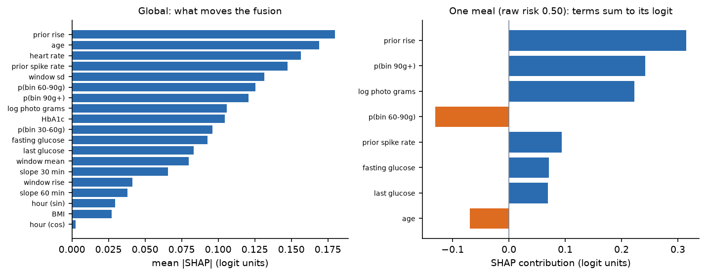

# GLIMPSE: final report
Before eating: a meal photo + the last 2 h of CGM glucose and heart rate + a short profile → **low risk**,
**caution** or **can't judge** (with a reason). Offline, local weights, one Mac.
Maitha Alhosani · MAAI7103 · November 2026 · `just install` → `just predict-folder <in> <out>`

<!-- BUDGET 3,000 words: bottom line 180 · §1 350 · §2 525 · §3 650 · §4 550 · §5 475 · §6 300 · §7 200.
     Check with `just wordcount`. TODO markers: [S16] filled 22 Nov, [DIET] 19 Nov, [REGEN] 12 Nov. -->

**Bottom line.** The central fix this phase was calibration, and it worked: a per-person intercept,
fitted only on each person's earlier meals and replayed in deployment order, raises AUROC from 0.726
to 0.762 and improves every one of the five folds individually, while halving the per-person
calibration gaps the intermediate diagnosed. The photo went through a pre-registered gate and did not pass (+0.025
AUROC, interval −0.010 to +0.061), so, per the paragraph committed before the run, the shipped
product is sensor + confirmed carbs, with the photo head as a carb-entry assist. Safety behaves by design: 8 of 109
cleared meals spiked (7.3%, interval 2.9–14.2% against a pre-registered 10% cap), degraded input
triggers refusal, with dangerous flips at most 1.5%, and a 23-case adversarial suite produces zero crashes
and zero error rows. [S16: one sentence with the locked-8 result, scored once on 22 Nov, whatever it shows.]
<!-- S16 bottom-line template (fill from the one scoring run, as measured): "On the 8 locked people
(N meals, XX% spike rate), scored exactly once: personal AUROC 0.XXX (0.XXX-0.XXX), raw 0.XXX;
XX cleared / XX caution / XX can't judge; missed-among-cleared X of XX." -->

## 1. System and tooling
<!-- 350 words: condensed user/workflow from the intermediate; ONE scoring path (D2); the instructor
command; efficiency table below; tooling line (uv, pydantic, loguru, ruff, tests, CI, W&B). -->
The objective: develop and internally validate, on person-grouped splits, a pre-meal spike-risk
model, and test under pre-registered gates whether the meal photo adds signal beyond sensors and
profile. An adult with prediabetes in a CGM programme wants fewer spikes but stops logging food
within days. Before eating they photograph the meal and get **low risk**, **caution** (with a
nudge), or **can't judge** with the reason in one plain sentence. The CGM labels every meal itself
two hours later (`cgm_auto`, the training spike rule), so the system learns each person without
logging effort; abstentions escalate to confirm-carbs or a dietitian. A wellness nudge, not a
medical device.

One scoring path: every number here, the demo, the app and the grader's
`just predict-folder <in> <out>` go through the same `Pipeline.answer`; plain-code input rules run
first (§4). Tooling: uv + Python 3.14 (locked), strict Pydantic throughout, a `just` recipe for
every number, 130 tests in CI, W&B offline exports, and a git history (from 2 Nov; earlier
ordering in the dated design docs) in which every pre-registration precedes its run. It trains and runs on one laptop; Figure 1 shows the single path.

| Measured on the shipped pipeline | value | cap |
|---|---|---|
| largest model (ConvNeXt-Tiny + heads) | 27.8M | 200M |
| pretrained total | 27.8M | 1B |
| trained from scratch (heads 3,845 + SensorCNN 5,217 + fusion 20) | 9,082 | 50M |
| cold first answer / warm median / p95 | 1.57 s / 265 ms / 271 ms | ≤300 ms p95 |
| peak memory / checkpoint | 796 MB / 31 MB | – |

## 2. Multimodal design and the photo gate
<!-- 525 words: architecture (frozen backbone + two heads, SensorCNN as RQ2 baseline only, LR fusion
with capacity argument: 23 dev people support ~20 params); photo CV quality (22.6 g MAE, Spearman .53,
bin F1 .61 vs ridge-on-true-macros F1 .38); then the gate. -->
Three parts. A pinned, SHA-verified ConvNeXt-Tiny backbone (ImageNet-22k) feeds two small heads, grams
regression and a 4-bin carb classifier, with only the last backbone stage fine-tuned; on
held-out people the photo head reaches 22.6 g MAE, Spearman 0.53 and bin F1 0.61 (a ridge on true
macros gets a better MAE, 20.4 g, but F1 0.38; the heads earn their 3,845 parameters on the bins, though the heads agree on only 51% of bins, not the
old 90% aim;
patients' own carb counts err by ~15–20% of meal content: Brazeau 2013, Vasiloglou 2018).
The profile comprises eight inputs: age, BMI, HbA1c, fasting glucose, meal hour (as sine and
cosine) and two onboarding priors (spike rate and mean rise); it is the channel whose removal costs
the most (0.122 AUROC). Hand-made trend features summarise the 2-h CGM/HR window; SensorCNN, the required from-scratch model
(5,217 parameters), is kept as the RQ2 baseline only: on the intermediate cross-validation with the
test people excluded, 0.691 AUROC against the engineered-feature logistic regression's 0.686, a
paired gain of +0.002 (−0.016, +0.022) that fails the pre-registered bar, so the hand-made features
stayed.
Fusion is a 20-parameter logistic regression. With 23 development people and four inner folds behind
every choice, that is the capacity the data supports; it is also the course's own prescription for
this data size (frozen pretrained features plus a simple classifier). Gradient boosting, the usual
tabular default, earns no extra capacity: on the same 19 fusion inputs and folds, the shipped
regression is non-inferior under the pre-registered bar (paired +0.015, −0.024 to +0.062,
outputs/promised). An attention or transformer head on the CGM sequence fails the
same test the SensorCNN tie already settles: with 481 meals from 23 people, no higher-capacity
sequence model meets the "simplest option that meets the measured bar" rule. Recipe, from the committed config: AdamW; heads at
1e-3, the last stage at 1e-4 (the taught differential-rate rule); warm-up plus cosine; weight decay
0.05 photo, 0.01 SensorCNN; batch 64; early stopping on inner folds, final epochs at the medians
(12 + 2); over 3 fresh seeds of that recipe, held-out carb error is 24.9 ± 1.9 g (bin F1
0.55 ± 0.04). Photo loss: Huber on log grams + 0.5 × bin cross-entropy; SensorCNN: cross-entropy.
Augmentation: flips, crops keeping 80% of the plate, brightness and contrast within 10%, and no hue
change, because colour tells foods apart.

Whether the photo helps at all was decided by a gate, not by us. The pre-registered gate returned
+0.025 AUROC (−0.010, +0.061; shuffled-photo control −0.010); per the pre-commitment
(docs/gate_s8.md records both pre-written outcome paragraphs; the losing one was removed on the
verdict),
the shipped product is sensor + confirmed carbs, with the photo head as a carb-entry assist, not an
established risk signal. Three results corroborate it. RQ1: even the participants' true logged carbs gain only
+0.024 (−0.003, +0.056) over profile + trend, and the photo estimate lands within +0.002 of them
(non-inferior): an information ceiling no photo encoder can break (the taught ceiling analysis). D8: excluding training meals that share an
exact macro profile with a held person's meal kills the photo gain (−0.005) while a size-matched
random drop keeps it (+0.037, interval −0.024 to +0.099, a point contrast only): the small gain
rides on CGMacros' repeated standardised meals.
Channel ablations: dropping heart rate changes +0.007 (it stays only because the feature set was
fixed before the ablation); dropping the profile costs −0.122. The tabular core carries the system.

## 3. Evaluation and ablations
<!-- 650 words: partition v2 (5 outer folds, 4 inner folds = every selection; 14 T2D train-only;
481 dev meals scored exactly once, splits/reconciliation.md; fold 1 declared = intermediate's scored
people); the headline and per-fold tables; calibration method (Platt on inner-OOF + penalised personal
intercept, 2-h label gate, replay); (m, lo, hi) by min expected cost on replayed inner risks; m basin. -->
The 45 CGMacros participants are healthy, prediabetic and T2D adults (ages 18 to 69, 64% female),
each wearing a CGM for about ten days; meals without a usable 2-hour pre-meal window are
excluded by the app's own checks. 158 of the 481 development meals (32.8%) met the spike
definition, with per-person rates from 0% to 68%: per-person calibration is the central problem. Partition v2: the 23 development target people form
five outer folds; four inner folds inside each
fold's training people are the validation split for every choice (fusion C, Platt, the shrinkage m,
the cut-offs); 14 T2D people are training-only and never scored; 8 people have been locked since the
proposal. A committed reconciliation (splits/reconciliation.md) asserts the 481 development meals are
scored exactly once, answering the intermediate's double-count. One declared caveat:
fold 1 contains the five people the intermediate evaluation already scored (the same seeded draw),
and the calibration fix was chosen after a diagnosis made on those people, so the development
estimate carries selection pressure the locked eight do not. The personalised model beats raw in all five outer
folds; the pooled estimate excluding the previously-scored fold 1 is 0.757 (0.651–0.833) against
0.762 overall, and the locked eight, scored once in §6, are the only fully clean measurement.

Postprandial response is person-specific (Zeevi et al. 2015; Berry et al. 2020). The
calibration fix: a per-fold Platt map on inner out-of-fold risks plus a penalised per-person
intercept b_p(t), fitted only on the person's earlier meals and replayed in deployment order under
a 2-hour label-availability gate; deployment gets those labels free from the CGM. Reading note: within every fold
the Platt AUROC equals the raw AUROC exactly, because a monotone per-fold map cannot reorder meals
inside its fold; the pooled Platt figure (0.714) below raw (0.726) is an artefact of mixing five
fold-specific maps, and the calibration evidence is the reliability diagram (Figure 3), the
equal-mass ECE (0.059 raw to 0.049 shipped), the log-loss (0.537 personal vs 0.572/0.567) and the
halved per-person gaps, not AUROC. For binary logits, Platt scaling is temperature scaling plus a
bias term, a strict generalisation of the taught one-parameter fix, fitted here on inner
out-of-fold risks only; the personal intercept extends the same post-hoc principle by one penalised
parameter per person.

| risk (dev, 460 answered of 481 meals) | AUROC (95% person-clustered) | log-loss |
|---|---|---|
| raw fusion | 0.726 (0.659–0.797) | 0.567 |
| + per-fold Platt | 0.714 pooled (= raw within every fold) | 0.572 |
| + personal intercept (shipped) | **0.762 (0.682–0.829)** | **0.537** |
| shipped, excluding fold 1 | 0.757 (0.651–0.833) | 0.547 |

| fold | m | cut-offs (lo, hi) |
|---|---|---|
| 1 | 1.0 | .21, .21 |
| 2 | 2.0 | .13, .23 |
| 3 | 0.5 | .13, .20 |
| 4 | 1.0 | .15, .17 |
| 5 | 1.0 | .14, .14 |

Discrimination is even across glycaemic status: AUROC 0.738 for the 11 healthy people (217 meals,
21% spike rate), 0.736 for the 12 prediabetic (243 meals, 43%); no subgroup gap, though the cohort
limits firmer fairness claims. Per-person gaps halved: rare spikers
predicted 20.9% vs observed 14.2% (was 29.3%); frequent 42.6% vs
52.9% (was 37.0%). The cost-vs-m curve
is a flat basin (m ∈ [0.5, 2] across folds). The deployed values were frozen from the all-development
replay by a pre-registered procedure (docs/final_design.md amendment): Platt (0.96, −0.20), m = 1.0,
cut-offs (0.15, 0.16). The replay, like two of the five folds, chose a near-degenerate abstention
band; §4 reports that as a finding.

## 4. Trust and safety
<!-- 550 words: cost matrix as declared assumption (missed spike 5× unnecessary caution; abstain 2,
0.5) with DCA framing (Vickers & Elkin 2006: the threshold IS the harm ratio) and the pre-registered
sensitivity sweep; usefulness vs pre-registered targets; robustness table; stress suite; monitoring. -->
Decisions are priced, not guessed: a missed spike costs 5× an unnecessary caution, abstention
(2, 0.5), declared assumptions (the 5:1 ratio is a ~17% action threshold in decision-curve terms:
Vickers & Elkin 2006), with a pre-registered cost sensitivity sweep committed alongside. All four usefulness targets were fixed before any result
(docs/evaluation_protocol.md) and all four hold at the point estimate, the protocol's on-track
label: cost reduction 14% (min 10%),
cleared 23% (min 20%), abstain 14% (max 20%), missed-among-cleared 7.3% (max 10%). In plain terms: of
every 100 meals, the app clears about 23, flags 64 and declines 14; of the cleared, about 7 in 100
still spike, which the programme's dietitian sees because the CGM reports every outcome at +2 h. Two folds, and
the final all-development replay, chose a (near-)degenerate abstention band: the cost optimiser
honestly prices borderline abstention at almost nothing for those risk distributions, and we report
that as a finding rather than forcing a band.
8 of 109 cleared meals spiked (7.3%; 95% CI 2.9–14.2%): within the cap at the point estimate,
though with only 17 people contributing cleared meals the upper bound exceeds it, a cohort-size
limit, monitored continuously in deployment through cgm_auto. The 8 misses spread across 6 people.
Abstaining instead of guessing is established practice for medical ML (Kompa et al. 2021).

Stress suite: 23 hostile inputs (timezone offsets, malformed JSON, binary CSVs, broken photos,
empty folders) give zero crashes and zero raw error rows; rules R8-R10 were added only against
observed failures of a recorded naive run, like R1-R6, and tests enforce this on every commit. Monitoring: four signals with alert rules
(docs/monitoring.md); drift baseline committed. [DIET: two dietitians, three structured questions:
cap acceptability, label wording, the rising-baseline case; responses folded in here, or the honest
pending line.]

## 5. Explainability and failure analysis
<!-- 475 words: probes A+B; R7; D8 as failure insight; S14 taxonomy (false-cleared + abstention
breakdown) TODO 10 Nov; label-definition discussion. -->
Failure taxonomy (every class observed, none hypothetical). **T1 rule refusals:** malformed or
degraded input never reaches a model; all 9 malformed instructor and all 23 stress cases end in a
structured refusal naming the problem (§4); the 4 clean cases answer. **T2 missing-photo abstentions:** 21 of 481 meals, no photo, no
guess. **T3 borderline abstentions:** 45 meals, all in folds 2–4; folds 1 and 5 chose no band, so
where the band exists is itself a product of per-fold cost optimisation. **T4 near-cut
false-clears:** 4 of the 8 missed-among-cleared sat within 0.031 of their fold's cut: boundary
sensitivity, the price of any hard threshold. **T5 confident false-clears, the genuine blind spot:**
the other 4 were cleared 0.05–0.14 below the cut (risks 0.03–0.16); two were cold starts with one
earlier labelled meal, two had 10 and 20, so personalisation sometimes had data and still cleared
them; the four spread across 4 people, so no single outlier explains them. **T6 confident-wrong carb estimate (R7):** a visually familiar,
nutritionally unfamiliar local dish passes the kNN check and gets a wrong bin; structural, detailed
below. **T7 label-definition surprise (probe B):** not a model failure but a communication one; also
below.

Probe B failed exactly as a label-correct model should: the label is baseline-relative, so a rising
pre-meal trace lowers predicted spike probability; the registration, not the model, encoded naive
physiology (pre-registered with a committed expected-fail in docs/probes_s13.md). Exact SHAP for the linear fusion (Figure 6; terms verified to sum to each meal's logit) puts the
personal priors first, matching the profile ablation; where the two disagree (heart rate high by
attribution, nil by ablation) the cause is correlated inputs: attribution measures use, ablation
measures loss.

Probe A: risk moves in the photo's direction on 100% of meals, yet the
extreme bottom↔top-decile plate swap leaves 68.5% of decisions unchanged (median swing 0.102): the
gate's verdict seen mechanistically. R7 (rule ledger): the kNN check measures visual, not nutritional, familiarity. A local
lamb-and-rice dish scores 0.318 against the 0.614 cut (more familiar than the clean tuna bowl at
0.406) and gets a confident wrong carb bin; the sweep under a ≤2% false-flag budget shows no
threshold fixes it, and the finding survived the final model's regenerated reference. Mitigations:
the confirm-carbs tier and per-answer distance monitoring; a nutrition-aware embedding is future
work. Clinical note the probe forces: a user already rising into a meal may see "low risk" while
clinically ascending; whether the app should add a separate "your glucose is rising now" note is
one of the three dietitian questions (§4).

## 6. Reproducibility
<!-- 300 words: fresh-clone chain; one-Mac story + CSCC sentence; W&B; manifest; locked-8 protocol. -->
The 8 locked subjects are scored once, on 22 Nov, from frozen artifacts verified by a fresh-clone
run; every reported number comes from the same Pipeline.answer path the instructor command invokes.
[S16: locked-8 tables here.]
<!-- S16 section template: one table in the S3 format (raw / personal AUROC + log-loss, locked 8),
one decisions line, one sentence comparing with dev (higher/lower/within CI), zero interpretation
beyond the pre-committed paragraph. Budget ~55 words; headroom is reserved. --> We pre-commit, before that run: the result is reported as measured, in
the same form as §3, and no re-tuning follows. A fresh-clone dry-run (5 Nov) proved the chain:
clone, `uv sync`, one documented weights step (pinned revision, SHA-256) reproduce the selftest and
both input suites, and the dry run itself found and fixed two onboarding defects. The serving
artifacts were regenerated from the all-development replay under a pre-registered procedure whose
own guard stopped the first run over a 0.001 near-miss; the decision is recorded in
docs/final_design.md. Cluster access existed; the deployed system trains and runs on one Mac
overnight, and the reproducibility environment was deliberately not split.

**AI-assisted development, verified.** The code was built with an LLM assistant, as the course
expects; the defence is the verification trail. A probe write-up stated n=397 where the committed
output says 460, caught by the number-to-file check. A fold AUROC was
rounded the wrong way (.787 for 0.786). The artifact-freeze procedure stopped its own first run
over a 0.001 near-miss, the decision recorded before the rerun. Each correction
is a dated commit, and every intermediate commitment is reconciled in docs/evaluation_protocol.md.

## 7. Limitations and conclusion
<!-- 200 words -->
CGMacros is a de-identified public PhysioNet dataset collected under the source study's ethics
approval; no new human data. Forty-five people from one study, with repeated standardised meals
that D8 shows inflate any photo-memorisation effect; no local-cuisine data, and R7 names the dish
class that would suffer. T2D participants are training-only, so no claim is made for them. Heart rate adds nothing
here. The photo is not established as a risk signal, and the label's baseline-relative definition can
diverge from a user's intuition (probe B). This is an advisory prototype with no clinical validation and no
regulatory review, built so that a clinical study could evaluate it: one scoring path,
pre-registered targets and gates, outcome monitoring for free from the CGM. That discipline is checkable: the gate shipped its
losing paragraph, the probes caught their authors, the guard that froze the final artifacts stopped
its own first run, and the locked eight are touched exactly once.

**Appendix: taught-technique coverage.** Group split, pristine locked set (weeks 4-5); nested CV,
thresholds over class weights (week 2); wall-clock as a first-class number (week 3); frozen
features + simple classifier, differential rates, hue-preserving augmentation (weeks 5-6);
shuffled-label control, ceiling analysis, error taxonomy, pre-registration, subgroup caution,
graceful degradation (week 11); cost-chosen thresholds, refusal to human review, validated outputs,
worst-slice reporting (week 9); sequence models measured against the bar (weeks 8-10, RQ2). Not
used, reasons in the text: attention, full fine-tuning, ensembles, self-supervised pretraining.

**References.** Zeevi et al., Cell 2015 · Berry et al., Nature Medicine 2020 · Vickers & Elkin,
Med Decis Making 2006 · Brazeau et al., Diabetes Res Clin Pract 2013 · Vasiloglou et al.,
Nutrients 2018 (GoCARB) · Kompa, Snoek & Beam, npj Digital Medicine 2021 · CGMacros, PhysioNet.
