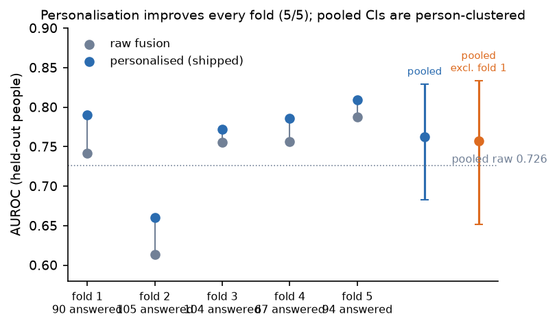
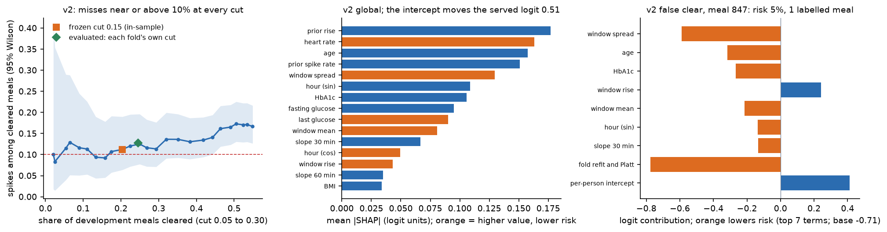
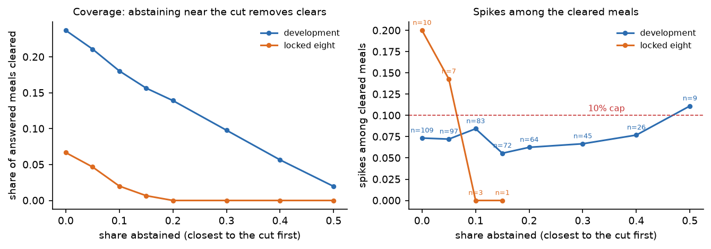
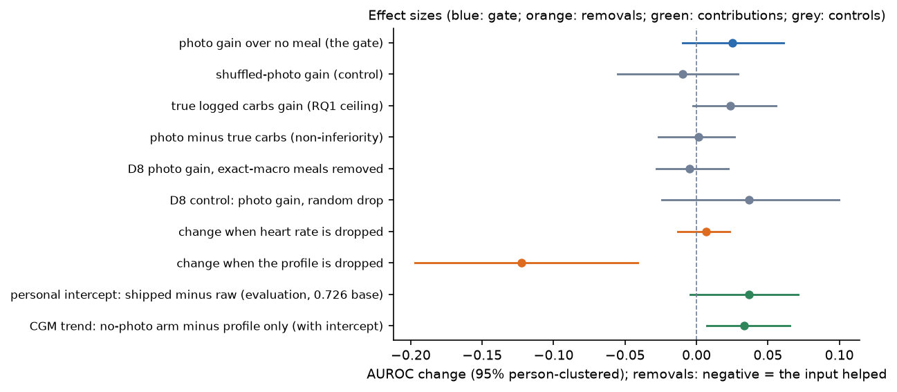

# GLIMPSE: final report
Before eating: a meal photo + the last 2 h of CGM glucose and heart rate + a short profile → **low risk**,
**caution** or **can't judge** (with a reason). Offline, local weights, one Mac.
Maitha Alhosani · MAAI7103 · November 2026 · `just install` → `just predict-folder <in> <out>`

**Bottom line.** Two products share one code path. v1 fuses the photo's carb estimate with glucose trend
and profile; it was frozen on 6 Nov and is the model the 8 locked people measured, once: AUROC 0.645, and
the usefulness targets are not met. The photo failed its pre-registered gate, whose pre-written verdict
said the answer should rest on sensors and profile with the photo only as a carb aid. v2 is that product,
pre-registered and built on 26 Nov, the day after v1's locked result was known, and now served: risk from
15 sensor and profile inputs, with the photo as a separate carb estimate that never blocks an answer. On
development v2 answers every meal with usable glucose data and its ECE (0.029) meets the target, though at
this size that cannot be told apart from noise; v1 remains the more accurate model. It is not shown to be as accurate as v1 (paired
−0.017, −0.045 to +0.010) and lets more spikes through its clears (12.7%), worst for the intended users:
6 of 30 clears for people with prediabetes spiked, against 1 of 25 in v1. In both, a per-person intercept
learned from earlier meals carries most of the edge; it separates people well but ranks a person's own
meals worse. v2 has no clean test: the locked eight are spent on v1.

| Status at a glance | v1, development (481 meals) | v1, locked eight (153) | v2 served, development (481) |
|---|---|---|---|
| AUROC (95% person-clustered) | 0.762 (0.682–0.829) | 0.645 (0.540–0.736) | 0.754 (0.673–0.815); 0.748 on v1's 460 |
| meals answered with a risk | 460 | 150 | 481 |
| ECE, registered 15 bins (target ≤ 0.05) | 0.052, at the noise floor | 0.061 | 0.029, below a perfect model's median 0.051: on track |
| usefulness targets (protocol labels: met / on track / at risk) | 1 met, 3 on track | 1 met, 3 not met (final test) | 1 met, 2 on track, 1 at risk (spikes among cleared) |
| spikes among cleared meals (cap 10%) | 7.3% (2.9–14.2%) | 2 of 10 | 12.7% (5.9–22.6%) |
| the same, people with prediabetes | 1 of 25 | not split | 6 of 30 |
| the samples' path (no history, no priors), with rule R13 | – | – | 0 cleared; cost −5.3% |

*Every cell is traced below and tested against outputs/report_metrics/ (report_metrics.json for v1, v2_metrics.json for v2) and the other evidence files. Secondary tables are in docs/report_appendix.md.*

## 1. System and tooling
The user is an adult with prediabetes in a CGM programme who wants fewer glucose spikes but stops logging
food within days. Before a meal they photograph it; the system answers in one plain sentence with its
reason. The CGM labels every meal two hours later (`cgm_auto`, the training spike rule on raw readings),
so the system learns each person without logging. It is a wellness nudge, not a medical device.

One scoring path (Figure 1): the evaluation, the demo, the app and the grader's
`just predict-folder <in> <out>` all call `Pipeline.answer`. Plain-code rules run first and refuse with a
named reason (docs/rule_ledger.md). `prototype.product` in the config selects v2 (served) or v1; v1's
frozen files are byte-identical to the tag. The per-person intercept needs labelled meals: the evaluation
replays them in deployment order, and the folder command takes them as an optional `history.csv`. A
profile without onboarding priors gets training medians, and rule R13 then withholds any low-risk answer:
with neither history nor priors there is no personal basis to clear a meal, so a grader running the
samples without `history.csv` sees caution or can't judge, never low risk. Tooling: uv with Python 3.14
(locked), strict Pydantic, Loguru, a `just` recipe for every number, 187 tests (all pass with the data and
weights, one an expected failure; 171 run without them; logs in outputs/finalize/), W&B offline runs replayed from committed training histories, and a git history from 2 Nov in
which every registration commit precedes its results commit.

| Parameters and cost | v1 (photo fusion) | v2 (served) | cap |
|---|---|---|---|
| largest model (ConvNeXt-Tiny + heads) | 27.8M, a risk input | 27.8M, carb estimate only | 200M |
| fine-tuned (last ConvNeXt stage + heads) | 15.5M | 15.5M | – |
| risk model (logistic fusion) | 20 | 16 | – |
| trained from scratch in the product: carb heads 3,845 (inside the 15.5M) + fusion | 3,865 | 3,861 | 50M |
| SensorCNN, trained from scratch, evaluated only (not in either product) | 5,217 | 5,217 | – |
| parameters a served risk depends on | 27.8M photo model + 20 | 16 | – |
| fine-tuning items (CGMacros photos) | 1,221 | 1,221 | 10,000 |
| one whole meal, folder command, with / without photo (2-CPU cloud) | 116 ms (p95 142) / refused | 115 ms (p95 147) / 6.4 ms | ≤300 ms p95 |

| Quality against cost (development) | risk AUROC | serving cost of the risk |
|---|---|---|
| v2: trend + profile fusion with the intercept (served) | 0.754 on 481 meals | 6.4 ms a meal; the photo adds about 110 ms for the carb estimate only |
| v1: + the photo estimate (4 inputs) | 0.762 on 460 meals | 116 ms a meal, needs the photo |
| int8 photo model (460 development photos, in-sample) | 97.0% of v1's decisions kept; carb MAE 15.4 → 17.7 g, what v2 shows | 55 ms against 77 ms per photo |
| SensorCNN from scratch instead of trend features (no intercept) | 0.688 ± 0.007 (3 seeds) | 5,217 parameters |

*Timing: outputs/efficiency/end_to_end.json, whole folder-command answers (profile, CSV parsing at 4 ms, rules, models) with the pinned weights on a 2-CPU cloud machine, 50 runs; the author's Mac measured v1 at 265 ms warm median on 7 Nov. int8: outputs/efficiency/int8.json; registered on 1,221 photos, run on the 460 development photos that carry a v1 decision so agreement is per decision (a deviation, disclosed in docs/photo_probes_int8.md). AUROCs: outputs/evaluation_v2/, outputs/evaluation_sensor_first/, outputs/cv/.*

## 2. Multimodal design and the photo gate
A pinned, SHA-verified ConvNeXt-Tiny (ImageNet-22k pre-trained, 1k fine-tuned) feeds two small heads,
grams regression and a 4-range carb classifier, with only the last backbone stage fine-tuned. The profile
has eight inputs: age, BMI, HbA1c, fasting glucose, meal hour (sine and cosine) and two onboarding priors,
each person's spike rate and mean rise over their first meals. Seven hand-made trend features summarise
the 2-h CGM and heart-rate window. SensorCNN, the from-scratch sequence model, ties the trend features
(+0.002, −0.016 to +0.022) and stays a baseline. Fusion is logistic regression, the capacity 23
development people support; gradient boosting on the same inputs is not shown better (+0.016,
−0.024 to +0.062, fusion study without the intercept). In v2 the served risk uses two modalities, sensors
and profile; the photo is a third, separate output, the carb estimate the user confirms.

| Photo recipe | value | how it was set |
|---|---|---|
| optimiser and rates | AdamW; heads 1e-3 (warm-up + cosine), last stage 1e-4 | fixed in the config (taught differential rates) |
| heads epochs per outer fold → shipped | 12–16 → 12 (median) | early stopping on 4 inner folds |
| last stage: keep, epochs → shipped | kept in 5 of 5 folds; 2–3 → 2 | kept only if inner MAE drops ≥0.5 g (it fell from 27.5–29.8 g to 24.2–26.1 g) |
| loss; augmentation | Huber on log(1+grams) + 0.5 × range cross-entropy; flips, crops keeping 80% of the area, brightness and contrast ±10%, no hue change | fixed in code, not ablated |
| seed spread of the recipe (intermediate split, 3 seeds) | carb MAE 24.9 ± 1.9 g, range F1 0.55 ± 0.04 | outputs/training/photo_convnext_seeds.json |

| What the photo does (gate first) | result |
|---|---|
| risk gate, pre-registered: AUROC gain over no meal information | +0.025 (−0.010, +0.061): not established |
| secondary endpoint: log-loss gain | +0.016, one-sided p = 0.094 |
| shuffled-photo control; true logged carbs instead (ceiling) | −0.010; +0.024 (−0.003, +0.056) |
| photo estimate against logged carbs (margin 0.03) | +0.002 (−0.027, +0.027): non-inferior |
| carb estimate on held-out people: MAE, Spearman, range F1 | 22.6 g, 0.53, 0.61 (frozen features + ridge: 20.4 g, 0.56, 0.38) |
| the carb estimate's own value, 817 out-of-fold photos: MAE; carb range right | 23.5 g against 29.0 g for typing the training median; 60% against 18% |
| probe D: grey out the middle half vs an equal-area border | the middle moves the grams more on 84% of development photos (in-sample) and 86% of 14 unseen phone photos |
| probe E: zoom in so the food fills more of the frame | grams rise on 40% of development photos (in-sample); 57% of the 14 unseen, inconclusive |

*outputs/fusion/, outputs/photo_cv/, outputs/promised/, outputs/probes/photo_probes.json; probes D and E registered in docs/photo_probes_int8.md before they ran.*

The gate (docs/gate_s8.md) held both verdict paragraphs before its run. The losing one was deleted; the
winning one said the answer should rest on trend and profile, with the photo as a carb-entry aid. The
5 Nov amendment instead regenerated the photo-arm fusion, so v1 uses the photo estimate as 4 of 19 inputs
and refuses a meal without a usable photo. v2 corrects this: it was registered on 26 Nov
(docs/v2_sensor_first.md) before any run, uses the gate's own comparator arm unchanged, and keeps every
other step of v1's procedure. Why the photo adds little: true carbs add at most about 0.03 here, a
ceiling the photo matches. Fine-tuning loses to ridge on grams but wins on the carb range (F1 0.61
against 0.38), and the range is what the user is shown. The probes say what the photo model reads. It
looks at the plate rather than the background (probe D; a low bar for centred food photos), and on its
training photos it does not scale grams with how large the food looks (probe E; inconclusive on the 14
unseen), so it reads what kind of meal this is more than how much. That fits a cohort eating repeated
standardised meals.

## 3. Evaluation and ablations
The 45 CGMacros participants are healthy, prediabetic and T2D adults (ages 18 to 69, 64% female), each
wearing a CGM for about ten days. 158 of the 481 development meals (32.8%) spiked, with per-person rates
from 0% to 68%. In partition v2, 23 development people form five outer folds, with four inner folds
choosing everything (fusion C, Platt map, intercept shrinkage m, cut-offs); 14 T2D people only train;
8 people were locked at the proposal. Each development meal is scored exactly once
(splits/reconciliation.md). The primary metric is AUROC on the development target cohort, as registered.
One caveat: fold 1 holds the five people the intermediate evaluation scored, and the calibration fix was
designed after a diagnosis on them, so development carries selection pressure the locked eight do not.
v2 adds more: it was chosen after v1's locked result, and its development number is optimistic in the same
way v1's was (0.762 on development, 0.645 locked). Two checks: without fold 1 v2 scores 0.749; on each
person's last third of meals 0.774 (0.681–0.841), against 0.740 on the first two thirds. More history does
not make clears safer: spikes among cleared meals rise from 9.6% (7 of 73) to 17.8% (8 of 45) in the last
third, and only 3 of v2's 15 false clears are cold starts.

Postprandial response is person-specific (Zeevi et al. 2015; Berry et al. 2020). The calibration fix is a
per-fold Platt map plus a penalised per-person intercept fitted only on that person's earlier meals whose
2-hour label window has closed. Within a fold Platt preserves the ranking; the intercept changes it
(Figure 2).

| risk (answered meals) | AUROC (95% person-clustered) | AUPRC (base rate) | Brier (constant forecast) | log-loss | ECE, 15 bins: equal-width / equal-mass |
|---|---|---|---|---|---|
| dev baselines (460): prevalence / profile only / trend + profile LR / gradient boosting / SensorCNN | 0.414 / 0.676 / 0.695 / 0.700 / 0.696 | 0.289 / 0.490 / 0.555 / 0.538 / 0.558 | 0.231 / 0.203 / 0.198 / 0.201 / 0.199 | – | – |
| v1 dev raw fusion (460) | 0.726 (0.659–0.797) | 0.554 (0.328) | 0.192 (0.221) | 0.567 | 0.060 / 0.059 |
| v1 dev + per-fold Platt | 0.714 pooled (= raw within every fold) | 0.541 | 0.194 | 0.572 | 0.023 / 0.056 |
| v1 dev + personal intercept | **0.762 (0.682–0.829)** | **0.591 (0.451–0.694)** | **0.180 (0.148–0.210)** | **0.537** | 0.052 / 0.049 |
| v1 dev, excluding fold 1 (370) | 0.757 (0.651–0.833) | 0.586 (0.335) | 0.185 (0.223) | 0.547 | 0.070 / 0.057 |
| v1 locked raw fusion (150 of 153) | 0.611 (0.510–0.743) | 0.531 (0.420) | 0.251 (0.244) | 0.707 | 0.150 / 0.143 |
| v1 locked shipped (150 of 153) | **0.645 (0.540–0.736)** | **0.547 (0.409–0.658)** | **0.230 (0.199–0.257)** | **0.650** | 0.061 / 0.098 |
| v2 dev raw (481) | 0.694 | 0.545 (0.328) | 0.198 (0.221) | 0.585 | 0.059 / 0.062 |
| v2 dev + personal intercept (served) | **0.754 (0.673–0.815)** | **0.601 (0.459–0.688)** | **0.182 (0.151–0.210)** | **0.544** | 0.029 / 0.076 |

*All AUROCs pooled over out-of-fold predictions. v1 answers 460 development meals (21 had no photo); v2 answers all 481. outputs/report_metrics/, outputs/evaluation_v2/, outputs/evaluation_sensor_first/, outputs/locked_eval/.*

| paired comparisons (95% person-clustered) | development | locked |
|---|---|---|
| v1: intercept minus raw, AUROC | +0.037 (−0.004, +0.071); higher in 5 of 5 folds | +0.033 (−0.054, +0.100) |
| v1: intercept minus raw, log-loss | −0.030 (−0.060, −0.001) | −0.057 (−0.156, +0.009) |
| v2 minus v1, AUROC on the 460 meals both answer (margin 0.03) | −0.017 (−0.045, +0.010): not non-inferior | not computed (v2 never sees the locked eight) |
| v1 with the intercept minus gradient boosting with the same intercept | +0.013 (−0.022, +0.043) | – |
| v1 minus a running spike rate per person (no model, same gate) | +0.063 (+0.030, +0.113) | – |
| CGM removal: trend + profile minus profile only, both with the intercept | +0.033 (+0.007, +0.065) | – |
| mean within-person AUROC, intercept minus raw: v1 / v2 | −0.078 (−0.110, −0.046) / −0.086 (−0.127, −0.045) | – |

*Paired person bootstrap, 2,000 draws. Every intercept baseline uses the shipped replay on its own out-of-fold logits (it reproduces the shipped risk to 1e-16). report_metrics.json (paired_personal_minus_raw, fair_baselines, within_person), v2_metrics.json (paired_v2_minus_v1, within_person).*

The intercept's evidence is log-loss and all five folds, not pooled AUROC. Most of the system's edge is
the intercept's own: with it, gradient boosting comes within 0.013 of v1, and the photo adds 0.017 over
v2. It works between people, not within them. Averaged per person, AUROC falls by about 0.08 in both
products (19 of 22 people worse in v1, 20 of 22 in v2), because the offset drifts as each new label arrives. The system
learns each person's base rate, 0.063 better than a plain running spike rate. Removing the CGM costs
0.033 with an interval above zero (exploratory, post hoc); removing the profile costs 0.122 (Figure 6).

| calibration | v1 dev | v1 locked | v2 dev | without history: v1 dev / v1 locked / v2 dev (per-fold Platt) |
|---|---|---|---|---|
| ECE, registered 15 equal-width bins (target ≤ 0.05) | 0.052 | 0.061 | 0.029 | 0.023 / 0.162 / 0.052 |
| ECE a perfectly calibrated model shows at this size (median; 95th centile) | 0.052 | 0.094 | 0.051; 0.071 | – |
| calibration-in-the-large (mean risk − spike rate) | −0.015 | −0.010 | −0.015 | +0.002 / −0.108 / −0.001 |

*Floor: labels drawn as Bernoulli(risk), 2,000 draws; ECE intervals are person-bootstrap and biased upward. v2's equal-mass ECE is 0.076. report_metrics.json, v2_metrics.json, outputs/v2_explain/v2_explain.json (calibration).*

At this sample size the ECE target cannot separate either product from a perfectly calibrated model. v2's
0.029 is lower than 99% of draws from a perfect model of this size (median 0.051), an unusually smooth fit,
likely because each fold's Platt map and the intercepts were fitted on overlapping development meals; its
person-bootstrap interval (biased upward) runs 0.03 to 0.09, and equal-mass bins give 0.076. By the
protocol's rule (met only if the whole interval meets the target) v2 is on track, not met. In Figure 3's
v2 panel every bin's 95% Wilson interval contains its mean risk. Without history, v1's risk under-predicts
the harder locked cohort by 11 points, the clearest calibration failure. Discrimination is even across
glycaemic status; usefulness is not (table).

| by glycaemic status, development | people, meals, spike rate | v1 AUROC (95%) | v1 cleared, spikes among them | v2 AUROC | v2 cleared, spikes among them |
|---|---|---|---|---|---|
| healthy | 11, 224, 21.0% | 0.738 (0.566–0.859) | 37.5% (84), 7 | 0.701 | 39.3% (88), 9 |
| prediabetes | 12, 257, 43.2% | 0.736 (0.648–0.796) | 9.7% (25), 1 | 0.739 | 11.7% (30), 6 |

*report_metrics.json (subgroups), v2_metrics.json (subgroups).*

## 4. Trust and safety
Decisions are priced: a missed spike costs 5× an unnecessary caution; abstaining costs 2 if the meal
spikes and 0.5 if not. These are declared assumptions (5:1 is a ~17% action threshold; Vickers & Elkin
2006), swept over 16 pre-registered settings that re-choose the cut-offs (appendix). The verdict holds
only near the declared prices.

| Usefulness target (fixed before any result) | target | v1 dev (481) | v1 locked (153) | v2 dev (481) | v2, no history, frozen cut-offs |
|---|---|---|---|---|---|
| cost reduction vs always caution | ≥10% | 14.4% (−4.6, +31.5) | −5.7% (−19.4, +5.9) | 10.2% (−11.6, +28.9) | −0.2% |
| cleared as low risk | ≥20% | 22.7% (13.2–34.0%) | 6.5% (0.6–15.9%) | 24.5% (13.5–37.5%) | 11.0% |
| can't judge | ≤20% | 13.7% (8.7–19.2%) | 2.6% (0.6–5.0%) | 8.3% (2.5–15.2%) | 18.5% |
| missed among cleared | ≤10% | 7.3% (2.9–14.2%) | 20% (2 of 10; exact 2.5–55.6%) | 12.7% (5.9–22.6%), 15 of 118 | 15.1% (8 of 53) |
| verdict (met / on track / at risk) | – | 1 met, 3 on track | 1 met, 3 not met (final test) | 1 met, 2 on track, 1 at risk | 3 of 4 at risk |

*v1's served point (no history) clears 15.2% with 9.6% spiking on development and 21.9% on the locked eight (report_metrics.json served_operating_point). report_metrics.json, v2_metrics.json (decisions, served_no_history), outputs/locked_eval/locked_summary.json.*

Of every 100 development meals v2 clears 25, flags 67 and refers 8; of the 25 cleared, about 3 spike.
v1 clears 23 with about 2 spiking. On the locked cohort, whose risks ran higher, v1 flagged 139 of 153
meals, so always flagging was the cheaper policy. v2's referral tier is unstable: the folds chose bands
0, 10, 1, 0 and 1 points wide, so its 40 referred development meals (spike rate 15%) came mostly from one
fold. The frozen band, 0.15 to 0.22, is seven points wide; applied to the same development risks
(in-sample, since it was chosen on them) it refers 86 meals (18%, spike rate 15%), clears 20% with 11 of
98 spiking, and saves 13.2% against always flagging. Without history both products are worse; without
priors as well, v2 would clear 7% of meals with 7 of 34 spiking and cost more than always flagging. Rule
R13 refers those meals instead: no misses, 21% referred, 5.3% more costly than always flagging.

v2 is served on the strength of the gate's pre-written verdict and a registration that said it ships
whatever the development result; there was no safety gate, and on the numbers it is the riskier product.
No low-risk cut keeps the interval on its misses under 10% (Figure 4, left); the point dips under 10% only
when fewer than 16% of meals are cleared. Its 15 false clears (§5) sit on 8 people, 6 on people with
prediabetes. A what-if that withholds clears for a prediabetic profile until 20 labelled meals (post hoc,
not shipped) cuts their misses from 6 to 2 and their clears from 30 to 3, with the overall saving at
10.4%; withholding them always gives 10.2% misses and a 12.1% saving. Either rule would need its own
registration and a test before serving.

| stress at the evaluated operating point (with history) | v2: AUROC, spikes among cleared | v2: caution → low risk | v1: AUROC | v1: caution → low risk |
|---|---|---|---|---|
| clean | 0.754, 12.7% | – | 0.762 (live photo model: 0.773) | – |
| CGM dropout 10 / 30 / 50 / 70% | 0.754 / 0.753 / 0.754; at 70%, 0.765 on the 461 still answered (their clean 0.764); 12.7% → 11.7% | 0 at every level | 0.762 / 0.762 / 0.762; at 70%, 0.767 on 441 (clean 0.766) | 0 / 0 / 0 / 1 |
| readings removed for 10 / 15 / 18 min before the meal | 0.753 at each; 12.6–12.7% | 0 / 1 / 1 | 0.762 / 0.761 / 0.761 | 1 / 1 / 1 |
| removed for 20 min or more (a gap over the rule's 20) | every meal refused | – | every meal refused | – |
| heart rate removed / half its readings dropped | 0.745 / 0.753; 11.6% / 12.6% | 17 (9 the other way) / 0 | – | – |
| onboarding priors removed (history kept) | 0.701; 14.6% | 7 (35 the other way) | – | – |
| history cut to the last 3 / last 10 meals | 0.740 / 0.745; 13.0% / 11.8% | 13 / 7 | – | – |
| 10% / 25% of history labels flipped | 0.735 / 0.699; 16.9% / 11.7% | 2 / 2 (23 / 50 the other way) | – | – |
| photo blur radius 2 / 6 / 10 | 0.754, unchanged: the photo is not a risk input | 0 | 0.776 / 0.775 / 0.766 (co-answered clean 0.774) | 0 / 3 / 6 |
| photo brightness ×0.5 / 0.25 / 0.2 / 0.15 | unchanged | 0 | within 0.002 on the meals still answered: 460 / 453 / 418 / 228 (×0.1: 3 answered) | 1 / 1 / 0 / 0 |

*Registered in docs/stress_quality.md and (heart rate, priors, history) docs/v2_explain.md before their runs; every development meal, clean and perturbed, history from the clean answers. v1's photo stress compares the frozen photo model with itself (in-sample photos). outputs/robustness/stress_quality.json and v2_input_stress.json; the 22 Nov three-level study (Figure A1) is in the appendix.*

Quality holds until a rule refuses. CGM dropout up to 50% moves AUROC by at most 0.001 in either product,
and at 70% only the meals left with too few recent readings are refused (20 in v2). Gaps change nothing up
to 18 minutes and refuse every meal from 20, the rule's threshold, so the curve is a step by design. The
photo cannot move v2's risk. In v1, heavy blur lets 6 cautions become low risk and lifts the spike rate
among clears from 8% to 11%, and darkness ends in refusals by the contrast rule. v2's own weak points are
its personal inputs. A watch left off (heart rate missing) is the largest dangerous flip in any condition,
17 cautions turned low risk, though not on average lower risk as we expected, and with misses among clears
falling to 11.6% and the saving rising to 12.8%, so heart rate's value to v2 is unproven; the folder answer
is flagged `hr_missing`. Wrong history labels hurt most: a quarter flipped costs 0.055 AUROC, more than cutting the
history to three meals.

| unfamiliar-photo check at the 0.614 cut | photos | median kNN distance | flagged |
|---|---|---|---|
| training photos, leave-one-out (the budget) | 1,221 | 0.291 | 1.1% (budget 2%) |
| real phone photos of local meals | 14 | 0.433 | 0 of 14 |
| synthetic non-meal pictures (monitoring week 4) | 6 | 0.709 | the week's median is above the cut |
| instructor screenshot / dark photo / local dish | 3 | 0.771 / 0.613 / 0.318 | screenshot only (the dark photo is caught by the contrast rule) |

*No realistic labelled out-of-distribution set exists, so no detection AUROC is claimed. In v2 a flagged photo only withholds the carb estimate. outputs/ood/, outputs/monitoring/monitoring.json.*

| monitoring (docs/monitoring.md) | demonstration | result |
|---|---|---|
| photo drift: weekly median kNN distance above the training q90 | 3 resampled training weeks, then 6 synthetic non-meal pictures | fires on week 4 only (0.709 against 0.25–0.37) |
| missed among cleared above 10%, 80-answer windows | v1 development answers, then locked | 7 of 21 ordinary development windows fire: too noisy |
| CUSUM on calibration, v1 development then locked (registered) | blocks of 20 answers | no alarm (2.4 of 4), against a registered expectation of one |
| CUSUM on the caution share (registered) | same | one alarm in the 7th locked block at the per-fold cut-offs; none at the deployed or served cut-offs |
| detection power, v2 (replay 4, registered): stream switches to prediabetic people only (spike rate 43%) | 500 simulated streams | calibration CUSUM: 23% detect within 120 answers, 5% false alarms before the switch; caution share: 13%, 1% |

*outputs/monitoring/; maintainer actions per alert in docs/monitoring.md.*

The photo-drift rule catches only pictures the per-answer gate already refuses. The outcome rules are too
noisy at this volume: even a 10-point rise in the spike rate is caught within 120 answers in under a
quarter of streams. A deployment would need far more users per monitoring window, or per-person
monitoring, before any of these rules could serve as an alarm.

Feedback (src/glimpse/feedback.py): after a meal a validated record comes from the user (ate it all,
part, none) or from the CGM at +2 h; "did not eat it" gives no label. Records feed the folder command as
`history.csv`; the app does not take them yet. The file carries the logit of the product that wrote it,
and the folder command does not yet check which product that was, so a v1-era history would set v2's
intercept wrong. The planned dietitian consultation did not complete; its
three questions are committed, and the cost matrix stays a declared assumption hedged by the sweep.

## 5. Explainability and failure analysis
Every class below was observed.

| failure class | count: v1 / v2 | corpus | root cause | action |
|---|---|---|---|---|
| rule refusal | 8 of 13, 23 of 23 / 5 of 13, 14 of 23; no crash or raw error | instructor cases; hostile inputs | input (format, units, gaps) | named refusal; rules R1–R13 (R6 preventive, R7 a recorded limitation) |
| missing-photo refusal | 21 of 481 / none | development meals | input | v2 answers them |
| near-cut false clear (within 0.031 of the fold's cut) | 4 of 109 / 6 of 118 | cleared development meals | threshold; v2: 4 of 6 on people with prediabetes | the frozen band would refer 4 of v2's 6; the price of a hard cut |
| confident false clear | 4 of 109 / 9 of 118 | cleared development meals | model: 0.039–0.132 below the cut in v2; 2 cold starts; 3 people carry 7 | the prediabetes what-if (§4), not shipped |
| locked false clear | 2 of 10 | cleared locked meals | cohort shift; 8 of 10 clears from one person | monitor (too few clears to fire) |
| false caution | 175 of 306; 78 of 139 | development; locked cautions | narrow band, 33–42% base rate | v2's wider band refers some of them |
| confident wrong carb range | 1 dish | instructor case 11, 14 real phone photos | the embedding measures look, not nutrition | v2 shows it as an estimate to confirm |
| label-definition surprise | 1 probe | probe B | baseline-relative label | wording; dietitian question |

*outputs/folder_run and outputs/stress_run (v2), outputs/v1_photo_fusion/ (v1), report_metrics.json (errors, false_clears_exploratory), v2_explain.json (taxonomy), outputs/probes/. Half of v1's 8 development false clears are in fold 1; v2's 15 spread over all five folds (6 in fold 5).*

Probe B was registered as an expected pass (a rising pre-meal trace raises risk on at least 90% of meals)
and failed: risk rose on only 8%. The label is baseline-relative, so a meal eaten on a rising trace has a
higher baseline and a smaller measured rise; our registration encoded naive physiology. Exact SHAP for the
frozen v1 fusion (Figure 7) ranks prior rise first, then age, heart rate and prior spike rate. Attribution
and ablation disagree for heart rate (−0.21 coefficient, +0.007 when removed): attribution measures
in-sample use, ablation out-of-sample loss. In v2 (Figure 4) the same four lead, and the sign has a
reading: within a person, a higher heart rate than usual before a meal goes with fewer spikes (−0.51,
−0.88 to −0.25, person fixed effects), while between people mean heart rate and spike rate are unrelated
(Spearman 0.00), so fitness is an unlikely explanation; the cause is untested (recent activity is one
candidate). The per-person
intercept moves the served logit by 0.51 on average, against 0.64 for the whole fusion. Probes A and C move one input at a time through a linear
fusion, so their direction is guaranteed; what they show is size. The most extreme photo swap leaves 68.5%
of v1's decisions unchanged, and moving any one of HbA1c, fasting glucose or the two priors from its 10th to 90th percentile changes
11–17% of decisions.

The errors fall on different people. A false clear, the costliest error, tells someone a spiking meal is
safe; 7 of v1's 8 development false clears fell on healthy people, while people with prediabetes, the
intended users, were rarely cleared. v2 clears a few more of their meals and misses more of them: 6 of
its 30 clears for people with prediabetes spiked, against 1 of 25 for v1. On a harder cohort the opposite fails: with 91% of locked meals flagged, the
nudge becomes noise a user learns to ignore. A dietitian programme would need history and onboarding
priors before trusting any clear, and should read a stream of cautions as the system's uncertainty, not
the user's diet.

## 6. Reproducibility
The 8 locked people were scored once, on 25 Nov, with v1: 10 low risk, 139 caution, 4 can't judge;
2 of 10 clears spiked; cost −5.7% against always caution. The development estimate lies above the locked
interval; selection pressure and the harder cohort (42.0% of 150 scored meals spiked) both act,
inseparable at n=8. D7 also registered the photo gate on the locked eight as the primary test; that run
scored only v1, so the endpoint was never computed and cannot be now. v2 is evaluated on development only.

`just evaluate` reruns both development evaluations, v2's metrics and explanation, and re-derives every
other table from committed outputs; `just evaluate-all` also recomputes the stress, probe, timing and
int8 studies (about 40 minutes); `just report-numbers` re-derives every descriptive number, replay and
figure without data or weights, and `just verify-outputs` fails if any number drifts beyond 1e-9;
`just reproduce-all` chains every compute study. Tests check the
report's cells against the evidence files. The folder, stress and demo runs were regenerated on 26 Nov
under the final code with the pinned weights and data; every v1 decision matched the committed one.

**AI-assisted development.** Code and documents were built with an LLM assistant, and the commits say
so. The author set the goals and approved each pre-registration, freeze and verdict up to the tag. After
it, cold grades by AI agents led to the dated round in docs/changelog.md, including v2, which she chose
on 26 Nov knowing the locked result; the assistant wrote that round's registrations under her
instruction, and the changelog lists each one; her dated sign-off on them is the changelog's last entry.
No v1 artifact or locked number changed.

## 7. Limitations and conclusion
CGMacros is de-identified public PhysioNet data under the source study's ethics approval; no new human
data. Forty-five people from one study, repeated standardised meals, no local cuisine; T2D participants
only train, so no claim is made for them. v2 is the product the pre-registration points to and answers
more meals; v1 is more accurate on development by a margin the data cannot confirm, misses fewer spikes,
and is the only one with a clean test, which failed the usefulness targets. Our recommendation for any
use: let v2 flag and refer, and withhold low-risk answers for people with prediabetes until a rule like
§4's what-if has been registered and tested on new people; history alone does not make clears safer (§3).
The served configuration does not do this: it is the frozen v2 as registered. Heart rate has a consistent
within-person sign but no proven value; a next version should test it with more people. This is an advisory prototype with no clinical validation,
end-user test or regulatory review, built so that a clinical study could evaluate it.

| Glossary | meaning |
|---|---|
| v1, v2 | v1: photo fusion, frozen 6 Nov, locked-tested; v2: sensor first, frozen 26 Nov, served |
| intercept, m | the per-person offset learned from earlier labelled meals; its shrinkage toward zero |
| Platt | population recalibration of the fusion logit |
| R1–R13 | the rules in docs/rule_ledger.md, each with the failure that prompted it (R6 preventive, R7 a recorded limitation) |
| partition v2 | the final split: 23 development people in 5 outer folds, 14 T2D training only, 8 locked; outputs/evaluation_v2/ is v1 on partition v2, product v2 lives in outputs/evaluation_sensor_first/ |
| D7 | the design decision registering the photo gate's endpoints |

**References.** Zeevi et al., Cell 2015, doi:10.1016/j.cell.2015.11.001 · Berry et al., Nature
Medicine 2020, doi:10.1038/s41591-020-0934-0 · Vickers & Elkin, Med Decis Making 2006,
doi:10.1177/0272989X06295361 · CGMacros: Scientific Data 2025, doi:10.1038/s41597-025-05851-7, and
PhysioNet v1.0.0.
