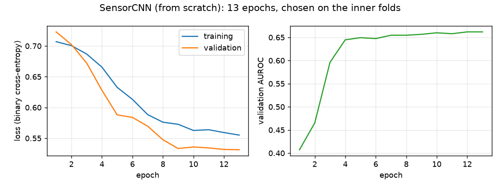
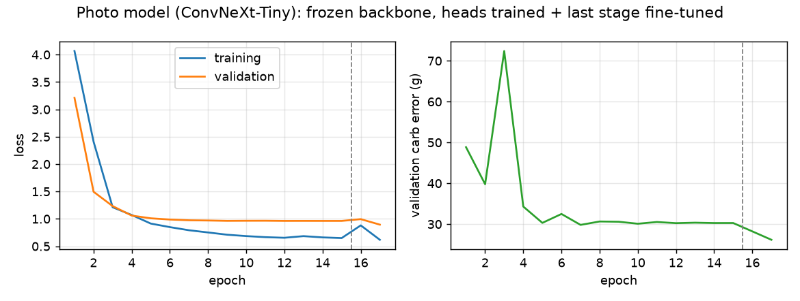
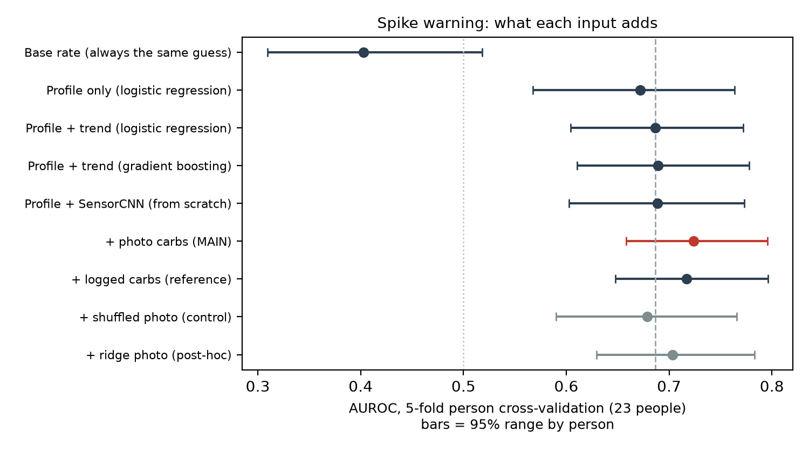
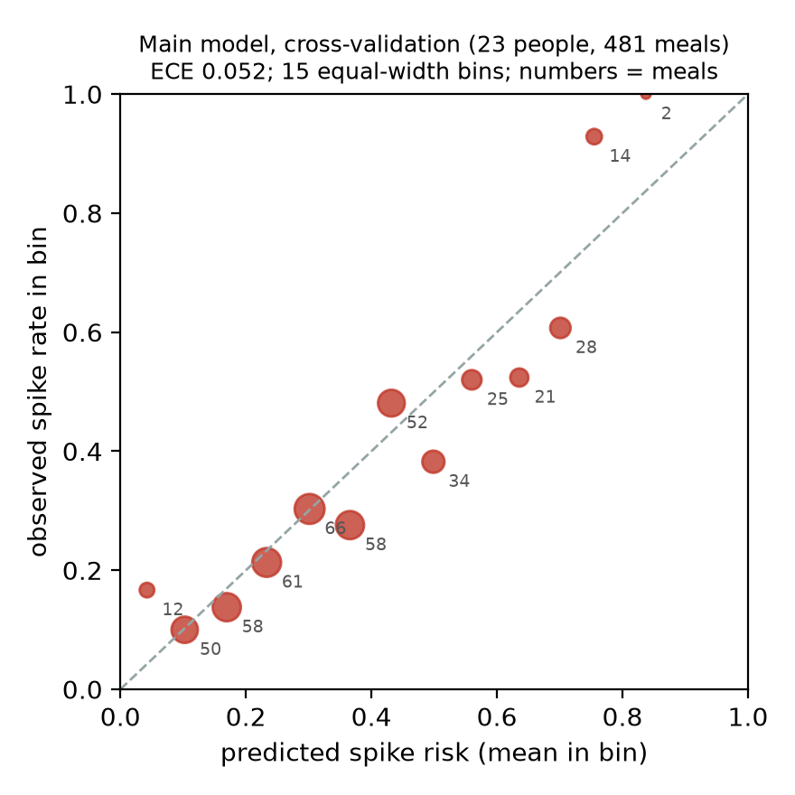
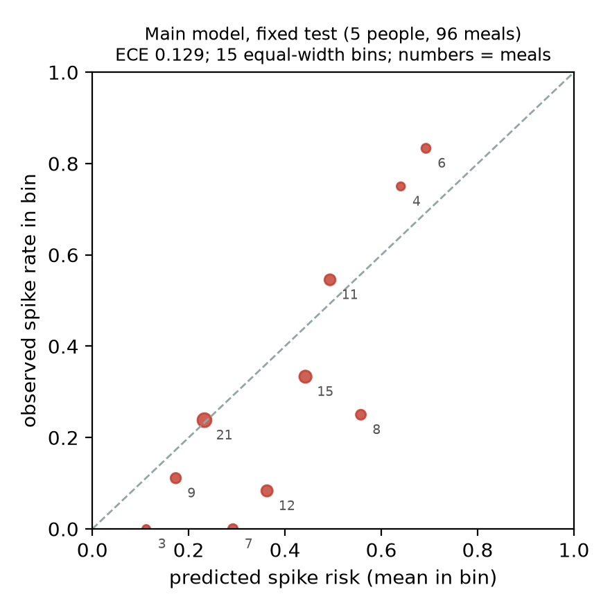

# GLIMPSE: intermediate report
Before eating: a meal photo + the last 2 h of CGM glucose and heart rate + a short profile → **low risk**, **caution** or **can't judge** (with a reason). Offline, local weights, Docker self-test.
Maitha Alhosani · MAAI7103 · October 2026 · `just install` → `just demo`

**Bottom line.** A meal photo helps predict a glucose spike, about as much as asking the person to log their carbs, and this was checked against a shuffled-photo control. The product runs end to end but is not yet safe to clear meals, because it misjudges who spikes rarely and who spikes often. In numbers: the photo adds +0.037 AUROC over profile + trend logistic regression (+0.003 to +0.073), which holds on the whole CV range but not once the test people are removed (−0.007 to +0.077); the shuffled-photo control is consistent with it (photo minus shuffled +0.045, −0.006 to +0.098), logged carbs are matched (+0.007), and a 5-person sanity check (people also inside the CV) was scored once. The main comparison and its decision rules were fixed before training; later additions are dated in `docs/evaluation_protocol.md`. The product runs end to end on all four inputs (nothing is stubbed) but does not yet meet its clearance target: it is miscalibrated in opposite directions, over-predicting for rare spikers and under-predicting for frequent spikers (test ECE 0.129), and clears 3% of test meals. Section 4 lists each limit with its fix and pass target.

## 1. User and workflow
An adult with prediabetes in a 10–14 day continuous glucose monitor (CGM) programme wants fewer spikes (a rise ≥ 50 mg/dL within 2 h) but stops logging food within days. Before eating they take one photo and get *caution* with a nudge (smaller carb portion, a walk), *low risk*, or *can't judge* with the reason. The programme pays a per-member fee, as it drops manual logging; abstentions and a sample of answers go to its dietitian for review; a wellness nudge, not a medical device. **Feedback (mocked):** the CGM labels each meal 2 h later, the user can correct it in `just app`, and validated `FeedbackRecord`s are stored for retraining.

## 2. Work completed
**Tooling:** uv + Python 3.14 + lock; `just`; strict Pydantic for config, data and outputs; Loguru (stderr + rotating file); ruff + 85 tests; Linux CI with an offline Docker self-test. **Blockers:** none for dependencies. Photo cross-validation costs 90 min per seed on the Mac, so the CV photo arm has one seed; the final model's seed spread is measured below.

**Data:** CGMacros (PhysioNet, CC BY-NC-SA, 45 adults), downloaded by `just install`, each meal validated with Pydantic; 24 five-minute CGM and heart-rate slots before the meal; augmentation: sensor noise, photo flips and crops; the same window code serves training and the demo. Splits are by person (seed 20260927); `tests/test_splits.py` asserts no shared people, scaling fitted on train only and zero cross-split photo duplicates; quality counts and the fine-tuning ledger are in `outputs/data/`.

| Split | People | Scored meals | Spike rate |
|---|---|---|---|
| Train (14 healthy/prediabetes + 14 type 2 diabetes, included for more spike examples and never scored) | 28 | 547 | 48% |
| Validation | 4 | 99 | 19% |
| Test (scored once) | 5 | 96 | 29% |
| Locked for the final | 8 | – | – |
| **Main estimate:** 5-fold person cross-validation (CV) over the 23 non-locked healthy/prediabetes people, since 5 test people cannot rank models | 23 | 481 | 33% |

**Models** (`just params` → `outputs/param_budget.csv`; forward-pass shape tests in `tests/test_models.py`):

| Model | Role | Parameters / limit |
|---|---|---|
| SensorCNN: two 1-D convolutions (25-min kernels) over glucose, heart rate, missing flag + profile | from scratch | 5,217 / 50M |
| ConvNeXt-Tiny (ImageNet-22k) + carbs head + 4-bin carb-range head | fine-tuned | 27.8M / 200M |
| Fusion: logistic regression on 15 profile/trend + 4 photo inputs | classical | 20 |
| DINOv2-S photo check (final; compared with the current nearest-neighbour check) | *planned* | 22M / 200M |
| **Pretrained total** | | 27.8M (+22M) / 1B |
| **Fine-tuning photos** (every photo any fit touched, so the cap is never under-counted; 865 unique in the final model) | | 1,221 (2,021 with Nutrition5k) / 10,000 |

The CNN is the required from-scratch model, and its role is this test: whether the raw trace beats 7 hand-made trend numbers; two layers with 25-min kernels cover the window with few weights. ConvNeXt-Tiny + carb-range head follows the proposal feedback; with 865 photos the backbone is kept frozen except its last stage. Learned parts (CNN, photo model, fusion) and deterministic parts (input rules, cut-offs) are separate in code: rules run first (CGM complete and in range; photo readable, not blank, familiar), then the models, then fixed cut-offs.

**Training** (seeded; settings validated at start-up; per-epoch logs to Loguru and CSV; checkpoints `sensor_cnn_e13_valauc0.662.pt`, `photo_convnext_e17_valmae26.2.pt`):

| Model | Recipe | Validation (4 people) | Seed spread |
|---|---|---|---|
| SensorCNN | BCE, AdamW, warm-up + cosine; 13 epochs chosen on inner folds | AUROC 0.662 | CV AUROC 0.688 ± 0.009 (3 seeds) |
| Photo model | Huber on log carbs + cross-entropy on carb ranges; 15 head epochs on a frozen backbone, then the last stage unfrozen for 2 epochs (inner-fold error 30.7 → 25.4 g) | carb error 26.2 g, carb-range F1 0.55 | 25.5 ± 2.5 g, F1 0.54 ± 0.02 (3 seeds, `just photo-seeds`) |

 

CNN validation loss sits below training loss because validation people spike less. Photo validation error flattens near 30 g from epoch 5 while training loss keeps falling (mild overfitting; the epoch-3 spike is in the gram error only); unfreezing the last stage (dashed line) cuts it to 26 g. Photo ablation in CV (`outputs/photo_cv/photo_cv_summary.json`):

| Carb estimate | Error (g) | Carb-range F1 | Spike AUROC when fused |
|---|---|---|---|
| Median guess | 27.7 | 0.08 | – |
| Frozen ConvNeXt + ridge | 20.4 | 0.38 | 0.703 |
| Fine-tuned, grams only | 22.5 | – | 0.704 |
| Fine-tuned, grams + carb ranges (used) | 22.5 | 0.61 | **0.724** |

Fine-tuning worsens the gram error but its carb-range head raises the fused AUROC by +0.020 (+0.005 to +0.035); it is kept for that. The proposal's fusion (spike logit plus three rise quantiles, non-negative carb weight) was simplified to the logistic regression after the proposal feedback; rise intervals, if kept, become a separate conformal layer in the final.

**Pipeline:** `just demo`, `predict` and `app` share one path: `MealInput` → window code → rules → photo model → fusion → cut-offs → Pydantic `Answer` JSON, e.g. `{"decision": "low risk", "risk": 0.108, "reason": "risk 11% is below the low-risk cut-off 14%"}`. Bad input returns *can't judge* with its reason.

## 3. Results
AUROC is primary; 95% ranges come from resampling people; on the test every model is trained on the same 28 people. Full tables: `outputs/evaluation/results.md`, `.json`, `.csv`.

| Model | CV AUROC (range) | CV without test people | Test AUROC |
|---|---|---|---|
| Profile only (logistic regression) | 0.672 (0.567–0.764) | 0.659 | 0.765 |
| Profile + trend (logistic regression) | 0.686 (0.604–0.772) | 0.686 | 0.695 |
| Profile + trend (gradient boosting) | 0.689 (0.610–0.778) | – | 0.632 |
| Profile + SensorCNN (scratch) | 0.689 (0.603–0.773) | 0.691 | 0.674 |
| **+ photo (main model; photo arms one seed)** | **0.724 (0.659–0.796)** | **0.719** | 0.742 |
| + logged carbs (reference) · + shuffled photo (control) | 0.717 · 0.679 | 0.715 · – | – |

| Paired difference (by person) | Estimate | 95% range | Reading |
|---|---|---|---|
| Photo vs profile + trend | +0.037 | +0.003 to +0.073 | the main claim |
| Same, without the test people | +0.033 | −0.007 to +0.077 | not yet certain |
| Photo vs shuffled photo (control) | +0.045 | −0.006 to +0.098 | consistent with the signal coming from the photo; the range just touches zero |
| Photo vs logged carbs (RQ1) | +0.007 | −0.020 to +0.032 | photo matches logging |
| Scratch CNN vs trend numbers (RQ2) | +0.002 | −0.016 to +0.022 | tie; CNN stays a baseline |
| Test: main vs profile only | −0.023 | −0.114 to +0.159 | 5 people do not separate models |

CV AUROC is pooled across folds, so the constant baseline scores 0.40 rather than 0.50; within-fold means are in `results.md`. Post-hoc checks are labelled in `docs/evaluation_protocol.md`; nothing was tuned on the test.

**Calibration** (main model; 15 equal-width bins; meals per bin in the figures): CV ECE 0.052, test ECE 0.129. On the test it over-predicts in the 0.3–0.6 bins (45% predicted, 30% spiked, 46 meals) and under-predicts above 0.6 (10 meals). **Cause, checked without test labels:** in CV without the test people, rare spikers get 30% predicted vs 16% observed and frequent spikers 42% vs 54% (correlation −0.77); the errors cancel in the CV ECE. The validation people (31% vs 19%) and most test people are rare spikers.

 

| Target (*met* = whole range meets it) | CV / test | Status |
|---|---|---|
| Photo adds signal | +0.037 (+0.003 to +0.073); −0.007 to +0.077 without test people | met (CV rule); at risk without the test people |
| RQ1: photo not worse than logged carbs by > 0.03 | +0.007 (−0.020 to +0.032) | met under the pre-specified one-sided rule: lower bound −0.020 > −0.030 (the upper bound leaves a small disadvantage possible) |
| RQ2: scratch CNN beats trend numbers | +0.002 (−0.016 to +0.022) | at risk (tie) |
| ECE ≤ 0.05 | 0.052 / 0.129 | at risk |
| Cost saving ≥ 10%; cleared ≥ 20%; spikes among cleared ≤ 10% (vs the best always-same answer) | 9%, 14%, 12% / 7%, 3%, 0% | at risk |
| *Can't judge* ≤ 20% | 11% / 16% in the demo path (6 no photo, 7 borderline, 2 unfamiliar; `results.md` gives 9% because its path fills missing photos with an average estimate) | met |
| Response time p95 ≤ 300 ms | 282 ms (`outputs/demo/demo_summary.json`; uncommitted repeat runs differ by a few ms) | met |

**Abstention cut-offs and rubric 5b.** A validation-chosen rule is implemented and frozen (`just recalibrate`: Platt recalibration fitted on the 4 validation people, cut-offs chosen on that risk) but not deployed: on 14 CV people whose labels it never saw it cleared 39% of meals with 22% spikes (cost −22%), because fitting to 4 rare spikers pushed frequent spikers to 36% predicted vs 59% observed. Four validation people are too few and too alike to choose a rule, so the deployed cut-offs are the pre-registered cost-based ones, frozen before the test (*low risk* below 0.143, *caution* from 0.20, *can't judge (borderline)* between). They are a derivation from the costs, not evidence of usefulness: over-prediction pushes meals to *caution*, so 3% are cleared. This deviates from 5b and is fix 2 in §4. Details, including the earlier failure of the pre-registered 0.31 rule: `outputs/evaluation/recalibration.md`, `docs/evaluation_protocol.md`.

**Evidence index** (every headline number and the file that produces it):

| Claim | File | Command |
|---|---|---|
| CV AUROC ladder, paired differences, RQ1/RQ2, targets | `outputs/evaluation/results.md`, `.json` | `just evaluate` |
| Fixed test, calibration bins, calibration by person | `outputs/evaluation/results.md` §Fixed test, §Calibration | `just evaluate` |
| Validation-chosen rule and its failed stability check | `outputs/evaluation/recalibration.md` | `just recalibrate` |
| Photo ablation (median / ridge / grams / ranges) | `outputs/photo_cv/photo_cv_summary.json`, `outputs/fusion/fusion_summary.json` | `just photo-cv`, `just fusion` |
| Learning curves, epochs, seed spread | `outputs/training/*_history.csv`, `*_choice.json`, `photo_convnext_seeds.json` | `just train`, `just photo-seeds` |
| Decisions on the test, latency, test cases | `outputs/demo/demo_summary.json`, `cases.md` | `just demo` |
| Parameter budget, fine-tuning ledger, data quality | `outputs/param_budget.csv`, `outputs/data/` | `just params`, `just prepare` |

**Test cases** (`outputs/demo/cases.md`):

| Case | Input | Expected | Actual |
|---|---|---|---|
| Normal | meal at 15:32 (glucose then fell 33 mg/dL) | low risk | **low risk** (11%) |
| Warning | meal at 19:03 (then rose 58 mg/dL) | caution | **caution** (25%) |
| Abstain | same meal, last 40 min of CGM removed | can't judge | **can't judge**: "0 readings in the last 30 min" |
| Abstain | a plain white picture | can't judge | **can't judge**: "photo is almost blank" |
| Wrong | meal at 12:47 (rose 35 mg/dL, no spike) | low risk | **caution** (48%): large carb portion, but this person responds mildly |

## 4. Limits, deviations and plan for the final
**Proposal feedback acted on:** a shorter report; startup framing narrowed to a per-member nudge for CGM programmes with a dietitian queue (§1; validated by the final user test); ConvNeXt-Tiny + carb-range head; scratch CNN tested (it ties); person CV and a locked hold-out for the small data; fusion cut to a 20-parameter logistic regression.

**Proposal items: status and final plan** (deviations in bold):

| Proposal item | Status now | Final |
|---|---|---|
| Photo model: EfficientNet-B0, Nutrition5k pre-training (≤ 5,006) then CGMacros | changed: ConvNeXt-Tiny + carb-range head on CGMacros only | Nutrition5k pre-training of the heads, cut to 800 items to keep cap headroom; kept only if CV carb error or carb-range F1 improves |
| **Week-4 gate:** carb error < 23.1 g and < 29.1 g under profile exclusion; photo gain lower bound > 0 on both | 22.5 g and lower bound +0.003 on the person-excluded split; **the profile-excluded split was not run** | run the profile-excluded split (meals sharing a macro profile with a test person removed) and report both halves of the gate |
| Repeated-meal check (62% of meals share a macro profile across people) | **not run**; only exact and look-alike photo duplicates checked | same profile-excluded split; near-duplicate photos already share a fold |
| Scratch 1-D CNN vs engineered trends (RQ2) | done: tie (+0.002, −0.016 to +0.022) | 4 h window, 3 seeds; else kept as baseline |
| Fusion: logit + 3 rise quantiles, non-negative carb weight | changed: logistic regression, no quantiles, no constraint | conformal rise intervals as a separate layer, coverage 75–85% at 80% nominal, if the product needs them |
| Photo OOD: DINOv2-S kNN | changed: nearest-neighbour + blank rule on ConvNeXt features | DINOv2-S vs current check; 30-photo Emirati set as an exploratory OOD test |
| Cost-based thresholds after calibration | **deviation:** cost-only cut-offs; two validation rules failed | per-person intercept, then cut-offs on recalibrated CV-fold risk, sealed before the locked 8 |
| Onboarding personal prior (72 h; population prior under 5 meals) | done, as inputs to the fusion | per-person intercept added (see limit 1) |
| Spike label 50 mg/dL; 30 and 70 as checks | 50 only | sensitivity at 30 and 70 |
| Class weighting as an ablation; fusion vs GBM on the same inputs; CNN + GBM ensemble | not run | all three, on CV |
| Explainability: photo swaps, flat vs rising traces, branch masking; robustness: blur, missing labs/heart rate, CGM gaps | not run (final-stage per rubric) | all, with ΔAUROC, ΔECE and abstention rate |
| Monitoring of drift, abstention, OOD rate, latency; W&B exports | latency only | drift and rate dashboards from the feedback log; tracker exports |
| Dietitian acceptance of "can't judge" (2 dietitians, 5-person think-aloud) | not run | user test with 3–5 people plus 2 dietitians on the abstention queue |
| Locked 8 people, run once | sealed, untouched | scored once under the hashed manifest |
| Meal counts: 1,526 usable, 1,054 operational, 769 target operational, 634 isolated target | same counts in `outputs/data/meal_counts.json`; the 577 scored development meals (481 CV + 96 test) are the target operational meals outside the locked 8 and the onboarding window | one reconciliation table from usable meals to each split |
| Usefulness on all 769 operational meals, costs swept | computed on the 481 scored CV meals and the test; the cost sweep is run on the test only (`results.json`) | operational-meal basis and the full cost sweep on CV |
| Conformal rise intervals: 75–85% coverage, width, median-rise MAE vs a GBM regressor | not run | run only if the dietitian test rates rise size useful; else dropped and said so |
| RQ2 non-inferiority of the CNN (−0.03), reported separately | lower bound −0.016 > −0.03: non-inferior, so the CNN loses nothing but adds nothing | reported next to the beats-test |
| Carb-sensitivity slider (model's weight, not advice) | not built | fusion-weight view in `just app`, or dropped with the reason |
| Fallback: confirm-carbs mode if the week-4 gate fails, assessed with simulated ±25% / ±40% corrections | not triggered (the half of the gate that ran passed) | decided after the profile-excluded run; if triggered, the simulation as proposed |
| Limitations kept: no dosing, hypoglycaemia or causal claims; proportional eating assumed; packaging and drink photos hard; non-commercial licence; 45 people from one study | unchanged (`docs/model_card.md`) | restated in the final with any new evidence |

**Limits, fixes and pass tests:**

| Limit | Evidence now | Fix in the final | Test (split · metric · pass) |
|---|---|---|---|
| 1. Model cannot tell rare from frequent spikers | CV ex-test: 30% vs 16%, 42% vs 54%; r = −0.77. The fusion already has 72 h personal spike-rate and rise inputs, but strong regularisation (C = 0.01) and one shared intercept pool people | per-person intercept from the first 5 labelled meals, shrunk toward the population (cold start: *caution* only, reported as a share of meals, must stay < 20%); the onboarding inputs stay; recalibration on CV folds, not 4 people | locked 8 · ECE overall and within each spike-rate half · ≤ 0.05 |
| 2. Cut-offs not validation-chosen (5b); 3% cleared | two validation rules failed stability | after fix 1: cut-offs chosen on recalibrated CV-fold risk, committed with a hash before the locked set is scored; tiered escalation (borderline → nudge, unfamiliar photo → human) | locked 8 · cleared ≥ 20%, spikes among cleared ≤ 10%, cost saving ≥ 10% |
| 3. Photo gain uncertain; CV photo arm has one seed | lower bound −0.007 ex-test; final-model spread 25.5 ± 2.5 g | 3 seeds in the photo CV (4.5 h); Nutrition5k pre-training of the heads; a meal-type/time-only arm to show the gain is carbs | CV + locked 8 (31 people) · AUROC gain lower bound · > 0 |
| 4. Backbone freezing untested | frozen vs last stage only | ablation frozen / last stage / full fine-tuning | CV · carb-range F1 and fused AUROC · the variant with the highest fused-AUROC lower bound is kept; both reported |
| 5. Scratch CNN ties trend numbers | +0.002 (−0.016 to +0.022) | 4 h window, 3 seeds; else kept as baseline only | CV · RQ2 lower bound · > 0 |
| 6. Two photo outputs disagree | agreement not yet measured; users see the range only | measure agreement first; add a consistency loss; switch to one ordinal head only if agreement stays < 90% or F1 drops > 0.02 | CV · agreement rate · ≥ 90% |
| 7. Unfamiliar photos | nearest-neighbour check; 3.1% false flags | DINOv2-S vs nearest-neighbour | synthetic + held-out photos · recall 100%, false flags ≤ 2% |

Fixes run in this order (1 gates 2). Before the locked 8 are scored once, the checkpoints, preprocessing, recalibration procedure, cut-offs and pass targets will be listed in one SHA-256 manifest, and every missed target will be reported as a failure. Passing on 8 people checks the fixes; it is not evidence of general safety. Also in the final: robustness (blur, lighting, CGM gaps), latency breakdown, explainability of the fusion weights, experiment-tracker exports, and a user test with 3–5 people.
