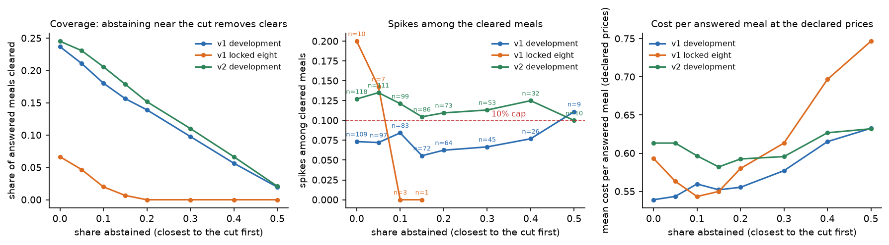
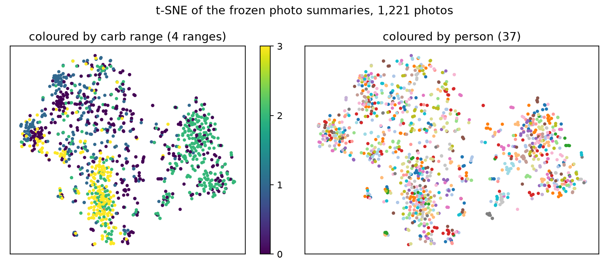
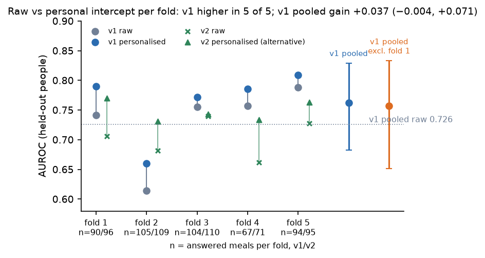

# GLIMPSE report appendix: secondary tables (26 Nov 2026, extended on 27 Nov)

Supporting tables only; not part of the graded report's length. Every row is cited from the report.

The report keeps the tables its argument needs; these are the rest, with the same evidence files and the same
tests (tests/test_report_numbers.py reads this file with the report). Unless a heading says v2, a table is about
v1, the photo-fusion model frozen on 6 Nov and measured once on the locked eight.

| Status at a glance | development (481 meals) | locked eight (153) | served, no history: dev / locked |
|---|---|---|---|
| AUROC, shipped (95% person-clustered) | 0.762 (0.682–0.829) | 0.645 (0.540–0.736) | – |
| intercept's gain over raw, paired | +0.037 (−0.004, +0.071), 5 of 5 folds: not established | +0.033 (−0.054, +0.100) | – |
| same intercept on gradient boosting (sensors + profile) | 0.750; shipped minus it +0.013 (−0.022, +0.043) | – | – |
| photo gate, pre-registered | +0.025 (−0.010, +0.061): not established | not computed (§6) | – |
| ECE, registered bins (target ≤ 0.05) | 0.052: not assessable, a perfectly calibrated model's median here | 0.061, below that median (0.094); the one-shot record gave 0.098 equal-mass | 0.023 / 0.162 |
| usefulness targets (protocol labels) | 1 met (can't judge), 3 on track: intervals cross | not met (at risk): 3 of 4 miss | not met: 2 of 4 miss / 2 of 4 miss |
| spikes among cleared meals (cap 10%) | 7.3% (2.9–14.2%) | 2 of 10 (exact 2.5–55.6%; person bootstrap 0–100%) | 9.6% / 21.9% |
| no history and no onboarding priors (the samples' path; dev, approximate) | – | – | AUROC 0.637; 11.4% cleared, 9 of 55 spike; cost −1.5% / –; with rule R13: 0 cleared, −0.3% |
| robustness | flips between low risk and caution ≤1.8% at every registered level; 3.7% without heart rate | – | – |
| monitoring | photo drift fires only on a synthetic week; the outcome rule is too noisy | no rule cleanly catches the cohort shift | – |

*Every cell is traced in the sections below and tested against outputs/report_metrics/report_metrics.json and the other evidence files.*

## v1 detail, from report section 1. System and tooling

| Parameters and cost | value | cap |
|---|---|---|
| largest model, deployed (ConvNeXt-Tiny + heads) | 27.8M | 200M |
| pretrained total | 27.8M | 1B |
| fine-tuned, deployed (last ConvNeXt stage + heads) | 15.5M | – |
| trained from scratch: heads 3,845 (also in the row above) + fusion 20 (deployed), SensorCNN 5,217 (evaluated only) | 9,082 | 50M |
| fine-tuning items (CGMacros photos; the planned 800 Nutrition5k items were cut) | 1,221 | 10,000 |
| cold first answer / warm median / p95 (model loaded once; measured 7 Nov on the frozen artifacts) | 1.57 s / 265 ms / 271 ms | ≤300 ms p95 |
| peak memory / checkpoint | 796 MB / 31 MB | – |

| Quality vs cost (development, all 481 meals, pooled over the same folds) | trained parameters | result |
|---|---|---|
| trend + profile features, logistic regression | 16 | AUROC 0.686 |
| SensorCNN, from scratch (mean ± sd of 3 seeds' AUROCs) | 5,217 | AUROC 0.688 ± 0.007 |
| photo: frozen ConvNeXt features + ridge (post hoc arm) | 769 | carb MAE 20.4 g, bin F1 0.38; fusion gain +0.017 (−0.008, +0.041) |
| photo: last stage + heads fine-tuned (shipped) | 15.5M | carb MAE 22.6 g, bin F1 0.61; fusion gain on all 481 meals (not the gate) +0.025 (−0.007, +0.059) |

| Where serving time goes (one answer, 2-CPU cloud machine, median of 50) | ms |
|---|---|
| photo decode + transform | 11.3 |
| ConvNeXt-Tiny pass, fp32 (int8 dynamic: 29.7, decisions not compared) | 47.4 |
| kNN check, heads, fusion and cut-offs | 0.4 |
| whole photo path / no-photo path (sensors + profile only) | 59.1 / 0.35 |
| backbone's share of the photo path | 80% |

*Sensor rows: outputs/cv/cv_summary.json (§3 gives the same models on the 460 answered meals). Timing: outputs/efficiency/stage_timing.json, random-initialised backbone (same arithmetic as the pinned weights); the 265 ms warm median above is the author's Mac, end to end. Photo rows: outputs/photo_cv/, outputs/fusion/ (gain over no meal on all 481 meals; the gate's photo-meals interval is −0.010 to +0.061). Both photo rows cost one backbone pass at serving. Budget: outputs/param_budget.csv, outputs/efficiency/, outputs/report_metrics/.*

## v1 detail, from report section 2. Multimodal design and the photo gate

| Photo recipe | value | how it was set |
|---|---|---|
| optimiser and rates | AdamW; heads 1e-3 (warm-up + cosine in the heads phase, constant after); last stage constant 1e-4 | fixed in the config (taught differential rates) |
| weight decay, batch | 0.05 (SensorCNN 0.01); 64 heads, 32 last stage | config; last-stage batch fixed in code |
| heads epochs per outer fold → shipped | 12–16 → 12 (median) | early stopping on 4 inner folds |
| last stage: keep, epochs → shipped | kept in 5 of 5 folds; 2–3 → 2 | kept only if inner MAE drops ≥0.5 g (it fell from 27.5–29.8 g to 24.2–26.1 g) |
| loss | Huber on log(1+grams) + 0.5 × bin cross-entropy | fixed in code |
| augmentation | flips, crops keeping 80% of the image area, brightness and contrast ±10%, no hue change; 2 saved views per photo, last-stage phase only | fixed in code, not ablated |

*Per-fold values in outputs/report_metrics/report_metrics.json (photo_recipe), from outputs/photo_cv/; settings in configs/default.yaml, src/glimpse/data/photos.py and src/glimpse/training/photo.py.*

| What the photo branch does (every committed result, gate first) | result |
|---|---|
| risk gate, pre-registered: AUROC gain over no meal information | +0.025 (−0.010, +0.061): not established |
| secondary endpoint, pre-registered: log-loss gain | +0.016, one-sided p = 0.094 |
| the same gate on the locked eight (D7's primary test) | not computed: the one locked run scored only the shipped pipeline (§6) |
| shuffled-photo control | −0.010 |
| participants' true logged carbs instead (RQ1 ceiling) | +0.024 (−0.003, +0.056) in the fusion arms; +0.031 (+0.003, +0.063) in the earlier trend + profile check |
| photo estimate vs logged carbs (margin 0.03) | +0.002 (−0.027, +0.027): non-inferior |
| D8: exact-macro training meals removed / size-matched random drop / paired difference | −0.005 / +0.037 / −0.041 (−0.093, +0.008) |
| carb estimate on held-out people: MAE, Spearman, bin F1 | 22.6 g, 0.53, 0.61 (ridge on frozen features 20.4 g, 0.56, 0.38; training median 27.7 g) |
| same recipe, 3 fresh seeds (intermediate split: 28 training, 4 validation people) | 24.9 ± 1.9 g, bin F1 0.55 ± 0.04 |
| grams head vs bin head, same bin | 51% (old aim 90%: missed) |
| refusals it adds | dev: 21 of 481 without a photo (the unfamiliar check does not apply to precomputed out-of-fold estimates); locked: 2 without a photo, 1 unfamiliar, of 153 |

*Sources: outputs/fusion/ (incl. carbs_check.json), outputs/ablations/, outputs/photo_cv/, outputs/training/photo_convnext_seeds.json, outputs/promised/, outputs/report_metrics/.*

## v1 detail, from report section 3. Evaluation and ablations

| risk (answered meals) | AUROC (95% person-clustered) | AUPRC (shipped: 95% CI; else base rate) | Brier (shipped: 95% CI; else constant forecast) | log-loss | ECE, 15 bins: equal-width / equal-mass |
|---|---|---|---|---|---|
| dev baselines (460): prevalence / profile only / trend + profile LR / gradient boosting on trend + profile / SensorCNN, 3 seeds' predictions averaged | 0.414 / 0.676 / 0.695 / 0.700 / 0.696 | 0.289 / 0.490 / 0.555 / 0.538 / 0.558 | 0.231 / 0.203 / 0.198 / 0.201 / 0.199 | – | – |
| dev raw fusion (460) | 0.726 (0.659–0.797) | 0.554 (0.328) | 0.192 (0.221) | 0.567 | 0.060 / 0.059 |
| dev + per-fold Platt | 0.714 pooled (= raw within every fold) | 0.541 | 0.194 | 0.572 | 0.023 / 0.056 |
| dev + personal intercept (shipped) | **0.762 (0.682–0.829)** | **0.591 (0.451–0.694)** | **0.180 (0.148–0.210)** | **0.537** | 0.052 / 0.049 |
| dev shipped, excluding fold 1 (370) | 0.757 (0.651–0.833) | 0.586 (0.335) | 0.185 (0.223) | 0.547 | 0.070 / 0.057 |
| locked raw fusion (150 of 153) | 0.611 (0.510–0.743) | 0.531 (0.420) | 0.251 (0.244) | 0.707 | 0.150 / 0.143 |
| locked shipped (150 of 153) | **0.645 (0.540–0.736)** | **0.547 (0.409–0.658)** | **0.230 (0.199–0.257)** | **0.650** | 0.061 / 0.098 |

*All AUROCs pooled over out-of-fold predictions (within-fold means are in the evidence files); the prevalence baseline pools five fold constants, hence below 0.5. Dev: 460 answered of 481 (21 had no photo). Locked: the 4 can't-judge answers are 2 without a photo, 1 unfamiliar photo (no risk) and 1 borderline (risk 0.158, scored). outputs/report_metrics/, outputs/evaluation_v2/, outputs/locked_eval/.*

| shipped minus raw, paired by meal (95% person-clustered) | development | locked |
|---|---|---|
| AUROC | +0.037 (−0.004, +0.071); higher in 5 of 5 folds | +0.033 (−0.054, +0.100) |
| Brier | −0.012 (−0.023, +0.000) | −0.021 (−0.059, +0.005) |
| log-loss | −0.030 (−0.060, −0.001) | −0.057 (−0.156, +0.009) |
| Brier reliability (calibration part), raw → shipped | 0.006 → 0.004 | 0.037 → 0.007 |
| Brier resolution (ranking part), raw → shipped | 0.035 → 0.043 | 0.029 → 0.021 |
| mean within-person AUROC (22 people with both outcomes), raw → shipped | 0.680 → 0.602; −0.078 (−0.110, −0.046), 19 of 22 worse | – |

*Paired person bootstrap, 2,000 draws; Brier parts over the 15 registered bins (Platt only, development: reliability 0.001, resolution 0.028). outputs/report_metrics/report_metrics.json.*

| the same per-person intercept on each model (dev, 460) | AUROC | shipped minus it (95% person-clustered) |
|---|---|---|
| profile only | 0.708 | +0.054 (+0.029, +0.090) |
| trend + profile LR | 0.742 | +0.021 (−0.003, +0.051) |
| gradient boosting on trend + profile | 0.750 | +0.013 (−0.022, +0.043) |
| SensorCNN, 3 seeds averaged | 0.736 | +0.026 (+0.003, +0.059) |
| shipped fusion without its Platt map | 0.763 | −0.001 (−0.008, +0.005) |
| fusion without the photo (the gate's no-meal arm) | 0.741 | +0.021 (−0.003, +0.053) |
| no model: each person's running spike rate, same gate, shrunk to the other folds' rate | 0.699 | +0.063 (+0.030, +0.113) |
| CGM removal: the no-photo arm minus profile only (both with the intercept) | – | +0.033 (+0.007, +0.065) |

*The shipped replay applied to each model's out-of-fold logits: same folds, m and gated history; it reproduces the shipped risk exactly (largest difference 1e-16). No Platt map was fitted for the baselines. report_metrics.json (fair_baselines).*

| further pre-registered comparisons (development, outputs/promised/promised.json) | result |
|---|---|
| class weighting vs thresholds alone (taught choice) | +0.006 (−0.001, +0.012): no gain established |
| label threshold 30 / 50 / 70 mg/dL: AUROC (spike rate) | 0.738 (57%) / 0.762 (33%) / 0.794 (19%) |
| photo arm with the photo masked vs no-meal arm (wiring check) | +0.002 (−0.023, +0.025) |

| calibration | development, shipped | locked, shipped | served, Platt only: development / locked |
|---|---|---|---|
| ECE, registered 15 equal-width bins (target ≤ 0.05) | 0.052 | 0.061 | 0.023 / 0.162 |
| ECE a perfectly calibrated model shows at this size: median, 95th percentile | 0.052, 0.072 | 0.094, 0.136 | – |
| share of perfectly calibrated draws scoring at or above the observed ECE | 48% | 94% | – |
| ECE, 15 equal-mass bins (used here until 26 Nov, switch unrecorded) | 0.049 | 0.098 | 0.056 / 0.157 |
| calibration-in-the-large (mean risk − spike rate) | −0.015 | −0.010 | +0.002 / −0.108 |
| per-person offset b, logit: median (10th, 90th percentile) | −0.17 (−0.94, +0.77) | +0.45 (−0.43, +1.62) | 0 |
| median abs. b by the person's labelled meals: 0 / 1–4 / 5–9 / 10+ | 0 / 0.36 / 0.50 / 0.66 | 0 / 0.36 / 0.44 / 0.78 | – |
| at the cut-offs: risk 0.10–0.15 / 0.15–0.20 (predicted → observed, meals) | 0.13 → 0.08 (51) / 0.18 → 0.26 (57) | – | – |
| under-confident / over-confident bins (observed, meals) | 0.50–0.63 (0.61–0.75, 77) / 0.77 (0.62, 13) | 0.30 (0.45, 20) / 0.70 (0.50, 10) | – |

*Floor: labels drawn as Bernoulli(risk), 2,000 draws. Offset b = logit(shipped) − logit(Platt only). Served = what the folder command returns. outputs/report_metrics/report_metrics.json.*

| development by glycaemic status | people, meals, spike rate | AUROC (95% person-clustered) | mean risk − spike rate | cleared, spikes among them, people with a clear |
|---|---|---|---|---|
| healthy | 11, 224, 21.0% | 0.738 (0.566–0.859) | +0.036 | 37.5% (84), 7, 11 of 11 |
| prediabetes | 12, 257, 43.2% | 0.736 (0.648–0.796) | −0.061 | 9.7% (25), 1, 6 of 12 |

*AUROC and calibration over answered meals; shares over all meals. report_metrics.json (subgroups).*

| fold | m | cut-offs (lo, hi) |
|---|---|---|
| 1 | 1.0 | .21, .21 |
| 2 | 2.0 | .13, .23 |
| 3 | 0.5 | .13, .20 |
| 4 | 1.0 | .15, .17 |
| 5 | 1.0 | .14, .14 |

## v1 detail, from report section 4. Trust and safety

| missed-spike cost ↓ / abstain price → (cost saved · cleared · missed among cleared) | ×0.5 | ×1 (declared) | ×2 | ×4 |
|---|---|---|---|---|
| 3× | 40.0% · 14.6% · 7.1% | 22.9% · 43.5% · 15.3% | 16.4% · 43.5% · 15.3% | 3.4% · 43.5% · 15.3% |
| 5× (declared) | 37.2% · 8.3% · 7.5% | **14.4% · 22.7% · 7.3%** | 3.1% · 26.6% · 11.7% | −9.9% · 26.6% · 11.7% |
| 7× | 36.8% · 1.9% · 11.1% | 6.5% · 11.9% · 8.8% | 2.2% · 20.6% · 8.1% | −10.8% · 20.6% · 8.1% |
| 10× | 38.2% · 0.4% · 0.0% | 4.5% · 8.3% · 7.5% | −8.0% · 11.9% · 8.8% | −21.1% · 11.9% · 8.8% |

*All 16 pre-registered settings, cut-offs re-chosen per fold for each; cost saved is against the better of always low risk and always caution, the protocol's simple policies (always abstaining would cost less at half the abstain price). outputs/evaluation_v2/dev_summary.json (cost_sweep).*

| Usefulness target (fixed before any result) | target | dev (481) | locked (153) | served, no history: dev / locked |
|---|---|---|---|---|
| cost reduction vs the best constant policy (always caution, both cohorts) | ≥10% | 14.4% (−4.6, +31.5) | −5.7% (−19.4, +5.9) | 8.7% (−4.6, +22.0) / −17.0% (−54.4, +17.8) |
| cleared as low risk | ≥20% | 22.7% (13.2–34.0%) | 6.5% (0.6–15.9%) | 15.2% / 20.9% |
| can't judge | ≤20% | 13.7% (8.7–19.2%) | 2.6% (0.6–5.0%) | 6.0% / 3.3% |
| missed among cleared | ≤10% | 7.3% (2.9–14.2%) | 20% (2 of 10; exact 2.5–55.6%; person bootstrap 0–100%) | 9.6% (7 of 73) / 21.9% (7 of 32) |
| the same without onboarding priors (dev, approximate) | – | – | – | 16.4% (9 of 55); 11.4% cleared; cost −1.5% / – |
| dev excluding fold 1 (385 meals): cleared, missed among them, cost saved | – | 19.0%, 4 of 73, 13.3% | – | – |
| people with a cleared meal | – | 17 of 23 | 3 of 8 (8 of the 10 clears from one person) | – |
| mean cost per meal: shipped / always caution / always low risk | – | 0.575 / 0.672 / 1.642 | 0.608 / 0.575 / 2.124 | – |
| verdict (protocol labels: met / on track / at risk) | – | 1 met (can't judge), 3 on track: intervals cross | not met (at risk): 3 of 4 miss | not met: 2 of 4 / 2 of 4 |

*Served = the deployed cut-offs on the Platt-only risk, recomputed from the committed answers (dev: per-fold models; locked: frozen Platt on the frozen fusion's raw risk); nothing refitted or rescored. outputs/report_metrics/report_metrics.json (decisions, errors, served_operating_point, served_imputed_priors, share_cis), outputs/figures/figures.json (the dev miss interval), outputs/locked_eval/locked_summary.json.*

| stress at three magnitudes | level 1 | level 2 | level 3 |
|---|---|---|---|
| CGM dropout 10/30/50% (same decision / low risk↔caution) | 100% / 0.0% | 99.8% / 0.0% | 99.6% / 0.2% |
| pre-meal gap 10/25/40 min (same decision / new refusals) | 100% / 0% | 11% / 89% | 11% / 89% |
| photo blur r=2/6/10 (same decision / low risk↔caution) | 98% / 0.7% | 94% / 0.9% | 89% / 1.7% |
| photo brightness ×0.5/×0.25/×0.1 (same decision / new refusals) | 98% / 1% | 96% / 2% | 10% / 90% |

*"Same decision" includes meals already refused before the perturbation; degraded photos also turn up to 2.6% of earlier refusals into answers (`recovered_answers`, blur r=10); low risk↔caution flips are `dangerous_flips` in the evidence files. Pre-registered 22 Nov; outputs/robustness/levels.json, the run Figure A1 draws with timing.json and promised.json (outputs/robustness/robustness.json is the earlier 2 Nov single-level run under pre-freeze pipelines, kept for the record).*

| unfamiliar-photo check at the 0.614 cut | photos | median kNN distance | refused by it |
|---|---|---|---|
| training photos, leave-one-out (the budget) | 1,221 | 0.291 | 1.1% (budget 2%) |
| real phone photos of local meals | 14 | 0.433 | 0 of 14 |
| synthetic non-meal pictures (monitoring week 4) | 6 | 0.709 | the week's median is above the cut |
| instructor screenshot / dark photo / local dish | 3 | 0.771 / 0.613 / 0.318 | screenshot only (the dark photo is refused by the contrast rule) |

*No realistic labelled out-of-distribution set exists, so no detection AUROC is claimed; local meals are food the check should accept. outputs/ood/, outputs/monitoring/monitoring.json.*

| monitoring signal (docs/monitoring.md) | demonstration | result |
|---|---|---|
| 1 photo drift: weekly median kNN distance above the training q90 (0.445) | simulated 4 weeks: 3 resampled training weeks, then 6 synthetic non-meal pictures | fires on week 4 only (0.709; weeks 1–3 0.25–0.37) |
| 1, on real photos | the 14 real phone photos | median 0.433: R7-style cuisine drift would not fire it |
| 2a missed-among-cleared above 10%, 80-answer windows | replay 1: dev answers at each fold's cut-offs, then locked | 7 of 21 ordinary dev windows (2–5 misses among 10–25 clears; overlapping windows over two runs of misses); locked windows too few clears; 1 of 3 mixed windows fires |
| 2a, deployed cut-offs on the evaluated (with-history) risk | replay 2 | 3 of 21 dev windows |
| 2b rolling AUROC below 0.645, 80-answer windows | replay 1 | 1 of 21 dev windows, 4 of 4 locked; circular, since 0.645 is the locked value itself |
| 3 behaviour: caution share above the highest dev week | both replays | cannot fire: one dev week is all caution |
| calibration-in-the-large | both replays | pooled −0.015 dev, −0.010 locked; locked window median +0.038, against a registered expectation of negative |
| 4 calibration drift (median abs. b_p over months) | not computable from ten days per person | – |
| CUSUM on the served risk's calibration (replay 3, registered first) | dev then locked, blocks of 20, k = 0.5, h = 4 | no alarm (statistic 2.4 of 4), against a registered expectation of a locked alarm |
| CUSUM on the caution share of logged decisions (registered) | same | one alarm, 7th locked week; dev blocks used each fold's cut-offs, locked the deployed ones |
| the same at the deployed cut-offs (added after that result) | same | no alarm; the statistic climbs to 2.6 of 4 by the last locked week |
| the same on the served (no-history) decisions (added after that result) | same | no alarm; peak 1.4 of 4 |

*Replays: logged answers as users arriving one after another (a "week" is a block of 20 answers), rules registered before each run; maintainer actions per alert in docs/monitoring.md; outputs/monitoring/.*

## v1 detail, from report section 5. Explainability and failure analysis

| failure class | count | corpus | root cause | action |
|---|---|---|---|---|
| T1 rule refusal | 7 of 13 (an 8th is the unfamiliar-photo check); 25 of 25 | instructor cases; stress suite | input (format, units, gaps) | named refusal; rules R1-R21, before/after in the rule ledger |
| T2 missing-photo abstention | 21 of 481 | development meals | input | refuse; typed carbs not wired |
| T3 borderline abstention | 45 of 481 | development meals (folds 2–4 only) | threshold band | dietitian review |
| T4 near-cut false clear | 4 of 109 | cleared development meals | threshold: the closer half, 0.005–0.030 below the cut | none; the price of a hard cut (report Figure 5) |
| T5 confident false clear | 4 of 109 | cleared development meals | model: the farther half, 0.047–0.138 below; two cold starts after steep falls, two with 10 and 20 labels | "falling now" check proposed, not shipped |
| locked false clear | 2 of 10 | cleared locked meals | threshold and cohort shift; 8 of 10 clears from one person | outcome monitor (too few clears to fire) |
| false caution (caution, no spike) | 175 of 306; 78 of 139 | development; locked cautions | one-point band, 33–42% base rate | none; cost-optimal at the declared prices |
| spike among can't judge | 19 of 66; 2 of 4 | development; locked | abstention near the base rate | dietitian sees the outcome |
| T6 confident wrong carb bin (R7) | 1 dish | instructor case 11; threshold sweep on 14 real phone photos | the embedding measures look, not nutrition | confirm-carbs prompt; nutrition-aware embedding later |
| T7 label-definition surprise | 1 probe | development counterfactual (probe B) | baseline-relative label | dietitian question; wording |
| T8 typed carbs not monotone | 1 tier | frozen fusion, typed 5–120 g | one-hot bins out of distribution | tier unwired; strict known-failure test |

*Counts from outputs/folder_run, outputs/stress_run, outputs/report_metrics/report_metrics.json (errors, false_clears_exploratory), outputs/ood/ and outputs/probes/.*

| T5 cold start (one earlier labelled meal) | pre-meal fall among the 109 cleared | four largest SHAP terms, logit |
|---|---|---|
| row 1024 | 3rd steepest | heart rate −0.39, window spread −0.35, prior rise +0.31, window mean −0.30 |
| row 847 | 2nd steepest | window spread −0.59, age −0.33, HbA1c −0.26, window rise +0.23 |

*Exploratory, chosen after the outcome; frozen fusion, fitted on these meals, not the fold models that answered. report_metrics.json (shap_terms_t5).*

| exploratory rule, not shipped | development: clears, misses, cost saved | locked: clears, misses, cost saved |
|---|---|---|
| as shipped | 109, 8, 14.4% | 10, 2, −5.7% |
| "falling now": never clear a meal in the steepest-falling tenth of all meals | 99, 5, 16.9% | – |
| cold-start hold: no clear before the person's third labelled meal | 97, 6, 14.4% | 7, 1, −2.3% |

*Arithmetic on the committed answers; flipped clears become caution. report_metrics.json (falling_now_what_if, cold_start_what_if).*

## v1 detail, from report section 6. Reproducibility

## v1 detail, from report section 7. Limitations and conclusion

| Taught technique (course week) | where |
|---|---|
| group split, pristine locked set (4–5) | §3, §6 |
| nested CV, thresholds over class weights (2) | §3, outputs/promised |
| wall-clock as a first-class number (3) | §1 |
| frozen features + simple classifier, differential rates, hue-preserving augmentation (5–6) | §1, §2 |
| shuffled-photo control, ceiling analysis, error taxonomy, pre-registration, subgroup caution, graceful degradation (11) | §2, §4, §5 |
| cost-chosen thresholds, refusal to human review, validated outputs, worst-slice reporting (9) | §4 |
| sequence models measured against the bar (8–10) | §2 (RQ2) |
| not used, reasons in the text: attention, full fine-tuning, ensembles (beyond averaging three SensorCNN seeds for its baseline), self-supervised pretraining | §2 |

| Glossary | meaning |
|---|---|
| RQ1, RQ2 | the proposal's questions: does the photo match true logged carbs (RQ1); does a from-scratch CNN beat hand-made trend features (RQ2) |
| D1-D8 | dated design decisions in docs/final_design.md (D7: the gate's endpoints; D8: the exact-macro exclusion test) |
| R1-R13 | rules in docs/rule_ledger.md (R13 acts on the output: no low risk with neither history nor both onboarding priors): R1-R5 and R8-R12 added after observed failures, R13 after a measured one, R6 a preventive check, R7 a recorded limitation |
| T1-T8 | failure classes (§5) |
| partition v2 | the final split: 23 development people in 5 outer folds, 14 T2D training-only, 8 locked |
| cgm_auto | the CGM's own label at +2 h, the training spike rule |
| Platt, b_p, m | population recalibration of the fusion logit; the per-person offset; its shrinkage |
| served point | the deployed cut-offs on the no-history risk, what the folder command returns |

## v2 detail (sensor first; docs/v2_sensor_first.md)

Figure 5's local panel: meal 847 was chosen by the registered rule as the lowest-risk confident false clear; its one labelled meal spiked, so its intercept raises the logit, as for meal 864, unlike 6 of the 9 where it lowered it; SHAP is computed on the frozen fusion, not the fold model that answered.

Probes A and C (moved from report §5): Probes A and C move one input at a time through a linear fusion, so their direction is guaranteed; what they show is size. The most extreme photo swap leaves 68.5% of v1's decisions unchanged. Moving one of HbA1c, fasting glucose or the two priors from its 10th to 90th percentile changes 11–17% of v1's decisions; in v2, age and the two priors move the most (35–39%), and HbA1c only 24%, so the registered expectation (priors and HbA1c lead) was half met.

History length (moved from report §3): On each person's last third of meals v2 scores 0.774 (0.681–0.841), against 0.740 on the first two thirds, but spikes among cleared meals rise from 9.6% (7 of 73) to 17.8% (8 of 45): more history does not make clears safer.

Referral band (moved from report §4): v2's referral tier is unstable: the folds chose bands 0, 10, 1, 0 and 1 points wide, so its 40 referred development meals (spike rate 15%) came mostly from one fold. The frozen band, 0.15 to 0.22, is seven points wide; applied to the same development risks (in-sample, since it was chosen on them) it refers 86 meals (18%, spike rate 15%), clears 20% with 11 of 98 spiking, and saves 13.2% against always flagging.

| v2 fold | C | Platt (slope, intercept) | m | cut-offs (low, caution) | AUROC raw → with intercept |
|---|---|---|---|---|---|
| v2 fold 1 | 0.01 | (1.10, −0.11) | 1.0 | 0.18, 0.18 | 0.706 → 0.770 |
| v2 fold 2 | 0.01 | (1.05, −0.15) | 2.0 | 0.16, 0.26 | 0.682 → 0.731 |
| v2 fold 3 | 0.01 | (1.18, −0.05) | 1.0 | 0.16, 0.17 | 0.740 → 0.744 |
| v2 fold 4 | 0.01 | (1.07, −0.24) | 1.0 | 0.17, 0.17 | 0.662 → 0.734 |
| v2 fold 5 | 0.03 | (0.91, −0.19) | 2.0 | 0.18, 0.19 | 0.728 → 0.763 |

*Each fold's values chosen on its inner folds only; frozen v2 values from the all-development replay: Platt (0.98, −0.17), m = 1.0, cut-offs 0.15 and 0.22 (outputs/finalize/finalize_sensor_first.json). v2_metrics.json (folds, per_fold).*

| v2 missed-spike cost ↓ / abstain price → (cost saved · cleared · missed among cleared) | ×0.5 | ×1 (declared) | ×2 | ×4 |
|---|---|---|---|---|
| v2 3× | 35.8% · 18.5% · 15.7% | 22.6% · 37.6% · 14.9% | 22.6% · 37.6% · 14.9% | 22.6% · 37.6% · 14.9% |
| v2 5× | 36.0% · 3.3% · 18.8% | 10.2% · 24.5% · 12.7% | 10.5% · 25.8% · 12.1% | 10.5% · 25.8% · 12.1% |
| v2 7× | 37.4% · 1.7% · 12.5% | −0.9% · 12.9% · 17.7% | −2.5% · 23.3% · 13.4% | −2.5% · 23.3% · 13.4% |
| v2 10× | 36.5% · 1.7% · 12.5% | 2.8% · 3.3% · 18.8% | −18.3% · 12.9% · 17.7% | −18.3% · 12.9% · 17.7% |

*All 16 pre-registered settings, cut-offs re-chosen per fold. v2_metrics.json (cost_sweep).*

| v2 abstention band (development, each fold's cut-offs) | value |
|---|---|
| band width per fold (caution minus low-risk cut-off) | 0.00, 0.10, 0.01, 0.00, 0.01 |
| borderline meals referred; their spike rate | 40; 15.0% |
| mean cost per answered meal: shipped / borderline meals given a caution instead | 0.603 / 0.613 |

*At the declared prices referring beats a caution below a 20% spike rate. v2_metrics.json (band).*

| v2 on the samples' path (development; no history, onboarding priors removed; exact refit of each fold) | before R13 | with R13 |
|---|---|---|
| AUROC on that path | 0.596 | same risks |
| cleared; spikes among them | 7.1%; 7 of 34 | 0 |
| referred (can't judge) | 13.9% | 21.0% |
| cost reduction vs always caution | −7.6% | −5.3% |

*v2_metrics.json (samples_path), frozen v2 cut-offs.*

The report's v1 prose as it stood before the v2 rewrite is kept for the record in docs/archive/report_v1_prose.md;
it is not part of the report.

## Moved from the report on 26 Nov (page limit)

The v3 candidate (moved from report §5): A regularised photo branch (v3: heads only on frozen summaries; checks 5 to 7) picked the strongest setting in every fold (weight decay 0.1, dropout 0.5, two augmented views). Its train-validation gap is 0.13 against v1's 0.35, carb error rose from 22.6 to 26.0 g (prediction not met) and AUROC moved −0.007 (−0.019, +0.006). Without repeated meals (check 6) its photo gain is +0.009 (−0.010, +0.031). The seed spread (0.005) is well below v3's ordinary gain (0.030; prediction not met), so the gain is not seed noise; with check 6 it points to meal recognition. v3 stays a candidate.

| v2 monitoring rows (moved from report §4) | demonstration | result |
|---|---|---|
| detection power, v2 (registered): stream switches to prediabetic people only (spike rate 43%) | 500 simulated streams | calibration CUSUM: 23% detect within 120 answers, 5% false alarms before the switch; caution share: 13%, 1% |
| v2 inputs (registered 26 Nov): share of answers without heart rate; Brier of the last 20 answers | 24 development blocks of 20, a watch-off block, 200 blocks with a quarter of labels wrong | heart rate: no clean alarm, the watch-off block fires; Brier: 2 clean alarms in 24, label errors caught in 26% of blocks; expectation not met (at most 1 in 20); development never lacked heart rate, so the first is a presence check |

*outputs/probes/v2_probes.json (monitors), registered in docs/v2_hardening.md (Part B); outputs/monitoring/.*

| v2-only stress rows (moved from report §4) | v2: AUROC, spikes among cleared | v2: caution → low risk | v1: AUROC | v1: caution → low risk |
|---|---|---|---|---|
| heart rate removed / half its readings dropped | 0.745 / 0.753; 11.6% / 12.7% | 17 (9 the other way) / 0 | – | – |
| onboarding priors removed (history kept) | 0.701; 14.6% | 7 (35 the other way) | – | – |
| history cut to the last 3 / last 10 meals | 0.740 / 0.745; 13.0% / 11.8% | 13 / 7 | – | – |
| 10% / 25% of history labels flipped | 0.735 / 0.699; 16.9% / 11.7% | 2 / 2 (23 / 50 the other way) | – | – |

Decisions per 100 meals (moved from report §4): Of every 100 development meals v1 clears 23, flags 64 and refers 14; of the 23 cleared, about 2 spike. v2 clears 25 with about 3 spiking. Without history both products are worse; without priors as well, v2 would clear 7% of meals with 7 of 34 spiking and cost more than always flagging. Rule R13 refers those meals instead: no misses, 21% referred, 5.3% more costly than always flagging.

| Quality row (moved from §1) | | | |
|---|---|---|---|
| SensorCNN from scratch instead of trend features (no intercept) | 0.688 ± 0.007 (3 seeds) | 5,217 parameters |

| Photo row (moved from §2) | | | |
|---|---|---|---|
| probe E: zoom in so the food fills more of the frame | grams rise on 40% of development photos (in-sample); 57% of the 14 unseen, inconclusive |

| Status rows moved from page one | v1 served, development (481 meals) | v1 served, locked eight (153) | v2 alternative, development (481) |
|---|---|---|---|
| mean within-person AUROC (a person's own meals) | 0.60 (raw 0.68) | – | 0.54 (raw 0.63) |
| the samples' path (no history, no priors), with rule R13 | – | – | 0 cleared; cost −5.3% |

| Parameter row moved from §1 | v1 (served) | v2 (alternative) | cap |
|---|---|---|---|
| trained from scratch in the product: carb heads 3,845 (inside the 15.5M) + fusion | 3,865 | 3,861 | 50M |

| by glycaemic status, development | people, meals, spike rate | v1 AUROC (95%) | v1 cleared, spikes among them | v2 AUROC | v2 cleared, spikes among them |
|---|---|---|---|---|---|
| healthy, both products | 11, 224, 21.0% | 0.738 (0.566–0.859) | 37.5% (84), 7 | 0.701 | 39.3% (88), 9 |
| prediabetes, both products | 12, 257, 43.2% | 0.736 (0.648–0.796) | 9.7% (25), 1 | 0.739 | 11.7% (30), 6 |

*v1's AUROC is on its answered meals (217 and 243). report_metrics.json (subgroups), v2_metrics.json (subgroups).*

| Glossary | meaning |
|---|---|
| v1, v2 | v1: photo fusion, frozen 6 Nov, locked-tested, served; v2: sensor first, frozen 26 Nov, the tested alternative |
| intercept, m | the per-person offset learned from earlier labelled meals; its shrinkage toward zero |
| Platt | population recalibration of the fusion logit |
| R1–R21 | the rules in docs/rule_ledger.md, each with the failure that prompted it (R6 and R15 preventive, R7 a recorded limitation) |
| partition v2 | the final split: 23 development people in 5 outer folds, 14 T2D training only, 8 locked; outputs/evaluation_v2/ is v1 on partition v2, product v2 lives in outputs/evaluation_sensor_first/ |
| D7, D8 | design decisions: the photo gate's endpoints; the repeated-meal test |

| Photo recipe | value | how it was set |
|---|---|---|
| optimiser and rates | AdamW; heads 1e-3 (warm-up + cosine), last stage 1e-4 | fixed in the config (taught differential rates) |
| heads epochs per outer fold → shipped | 12–16 → 12 (median) | early stopping on 4 inner folds |
| last stage: keep, epochs → shipped | kept in 5 of 5 folds; 2–3 → 2 | kept only if inner MAE drops ≥0.5 g (it fell from 27.5–29.8 g to 24.2–26.1 g) |
| loss; augmentation | Huber on log(1+grams) + 0.5 × range cross-entropy; flips, crops keeping 80% of the area, brightness and contrast ±10%, no hue change | fixed in code, not ablated |
| seed spread of the recipe (intermediate split, 3 seeds) | carb MAE 24.9 ± 1.9 g, range F1 0.55 ± 0.04 | outputs/training/photo_convnext_seeds.json |

| unfamiliar-photo check at the 0.614 cut | photos | median kNN distance | flagged |
|---|---|---|---|
| training photos, leave-one-out (the budget) | 1,221 | 0.291 | 1.1% (budget 2%) |
| real phone photos of local meals | 14 | 0.433 | 0 of 14 |
| synthetic non-meal pictures (monitoring week 4) | 6 | 0.709 | the week's median is above the cut |
| instructor screenshot / dark photo / local dish | 3 | 0.771 / 0.613 / 0.318 | screenshot only (the dark photo is caught by the contrast rule) |

*Study O1 (report §4, docs/final_switch.md) adds a detection AUROC, 0.988, on 31 synthetic or generated non-meal pictures against 74 real meal photos; no realistic labelled out-of-distribution set exists. In v2 a flagged photo only withholds the carb estimate. outputs/ood/, outputs/monitoring/monitoring.json.*

## Source notes as they stood before the 26 Nov trim (word limit)

The report's italic source notes were shortened; the full versions are kept here.

- Every cell is traced below and tested against outputs/report_metrics/ (report_metrics.json for v1, v2_metrics.json for v2) and the other evidence files. Secondary tables are in docs/report_appendix.md.
- Parameter counts: outputs/param_budget.csv (`just params`); memory: outputs/efficiency/efficiency.json. Timing: outputs/efficiency/end_to_end.json, whole folder-command answers (profile, CSV parsing at 4 ms, rules, models) with the pinned weights on a 2-CPU cloud machine, 50 runs; the author's Mac measured v1 at 265 ms warm median on 7 Nov. int8: outputs/efficiency/int8.json; registered on 1,221 photos, run on the 460 development photos that carry a v1 decision so agreement is per decision (a deviation, disclosed in docs/photo_probes_int8.md). AUROCs: outputs/evaluation_v2/, outputs/evaluation_sensor_first/, outputs/cv/.
- Figure 3 (now Figure 2) shows the training curves of the inner folds of the intermediate run (outputs/training/). outputs/cv/, outputs/photo_cv/, outputs/robustness_v3/robustness_v3.json.
- outputs/fusion/, outputs/photo_cv/, outputs/promised/, outputs/probes/photo_probes.json, outputs/training/photo_convnext_seeds.json, outputs/v2_explain/v2_explain.json (carb_value); probes D and E registered in docs/photo_probes_int8.md before they ran.
- All AUROCs pooled over out-of-fold predictions; a constant per fold scores below 0.5 when pooled because training and test prevalence move in opposite directions across folds. v1 answers 460 development meals (21 had no photo); v2 answers all 481. outputs/report_metrics/, outputs/evaluation_v2/, outputs/evaluation_sensor_first/, outputs/locked_eval/.
- Paired person bootstrap, 2,000 draws. Holm over the 7 v1 and v2-minus-v1 development contrasts (p from each interval by a normal approximation; outputs/report_metrics/holm.json): only the running-spike-rate and v1 within-person contrasts survive; the other five do not. Every intercept baseline uses the shipped replay on its own out-of-fold logits (it reproduces the shipped risk to 1e-16). report_metrics.json (paired_personal_minus_raw, fair_baselines, within_person), v2_metrics.json (paired_v2_minus_v1, within_person).
- Shuffled-label and learning-curve checks: development people only, no intercept, C fixed at 0.03, hence 0.750 and not 0.762; outputs/final_checks/final_checks.json.
- Floor: labels drawn as Bernoulli(risk), 2,000 draws; ECE intervals are person-bootstrap and biased upward. v2's equal-mass ECE is 0.076. report_metrics.json, v2_metrics.json, outputs/v2_explain/v2_explain.json (calibration).
- v1's served point (no history) clears 15.2% with 9.6% spiking on development; on the locked eight it clears 20.9% with 21.9% spiking (report_metrics.json served_operating_point). report_metrics.json, v2_metrics.json (decisions, served_no_history), outputs/locked_eval/locked_summary.json.
- Registered in docs/stress_quality.md and (heart rate, priors, history) docs/v2_explain.md before their runs; every development meal, clean and perturbed, history from the clean answers. v1's photo stress compares the frozen photo model with itself (in-sample photos). v2's heart-rate, priors and history rows are in the appendix. outputs/robustness/stress_quality.json and v2_input_stress.json; the 22 Nov three-level study (Figure A1) is in the appendix.
- outputs/monitoring/; v2's two monitoring rows are in the appendix; maintainer actions per alert in docs/monitoring.md.
- outputs/folder_run and outputs/stress_run (v1, served), outputs/v2_sensor_first/ (v2), report_metrics.json (errors, false_clears_exploratory), v2_explain.json (taxonomy), outputs/probes/. Half of v1's 8 development false clears are in fold 1; v2's 15 spread over all five folds (6 in fold 5).

Moved from report section 5 on 26 Nov: the per-person intercept moves v2's logit by 0.51 on average, against 0.64 for the whole fusion (outputs/v2_explain/v2_explain.json).

## Added on 27 Nov

Figure A4 was Figure 2 of the report until 27 Nov (moved for the page limit; the later figures were renumbered).

{width=90%}

{width=60%}

Moved from report sections 4 and 5 on 27 Nov (page limit): a what-if that withholds clears for a prediabetic profile until 20 labelled meals cuts their misses from 6 to 2 and their clears from 30 to 3 (saving 10.4%); it was chosen on the data it is scored on, so it is not shipped. At 70% CGM dropout only meals with too few recent readings are refused (20 in v2); the photo cannot move v2's risk; with the watch left off, v2's misses among clears fall to 11.6% and the saving rises to 12.8%, so at v2's cut heart rate does not help its decisions. In v2 the same four inputs lead the SHAP ranking (outputs/v2_explain/), and the sign has a reading (exploratory): within a person, a higher heart rate than usual before a meal goes with fewer spikes (−0.51, −0.88 to −0.25, person fixed effects). A regularised photo branch (v3, robustness checks 5 to 7) cut the overfitting gap from 0.35 to 0.13 but raised carb error to 26.0 g; it stays a candidate. With no refer band, referring the 10% of answered meals closest to the cut moves the error on answered meals (a spike after low risk, or none after caution) from 47.0% to 48.1%.

Post-freeze checks of 27 Nov in full: docs/post_freeze_checks.md and outputs/post_freeze/post_freeze.json. External check: docs/external_bigideas.md and outputs/external_bigideas/.

Moved from report sections 1, 3 and 4 on 27 Nov (word limit): input rules R17 to R21 cover semicolon CSVs, a photo not named photo.*, Dexcom "Low"/"High" text, day-first Libre dates and units in the profile. Study C1 lets the intercept learn from labels drawn from the model itself; the registered prediction (v2 typical) was not met. For the risk inputs, a distance to the development people separates the 14 type-2 diabetes people's meals with AUROC 0.89; HbA1c alone does it perfectly and fasting glucose reaches 0.92.

Moved from report sections 2 and 4 on 27 Nov (page limit). Training table row:

| what was trained | starts from | trained parameters | loss; optimiser and schedule | epochs (inner folds) | validation result |
|---|---|---|---|---|---|
| v3 candidate: the photo heads alone, regularised (appendix) | frozen summaries | 3,845 | as the photo model; weight decay 0.1, dropout 0.5, 2 augmented views (chosen) | 7–12 | out-of-fold carb MAE 26.0 g |

Monitoring rows:

| monitoring (docs/monitoring.md) | demonstration | result |
|---|---|---|
| CUSUM on calibration, v1 development then locked (registered) | blocks of 20 answers | no alarm (2.4 of 4), against a registered expectation of one |
| CUSUM on the caution share (registered) | same | one alarm in the 7th locked block at the per-fold cut-offs; none at the deployed or served cut-offs |

Moved from report section 5 on 27 Nov (page limit):

| the course's debugging checks | evidence | status |
|---|---|---|
| classical and zero-shot photo baselines (check 4) | colour histogram + ridge 27.5 g, against 20.4 g for frozen summaries + ridge; zero-shot needs CLIP weights this offline build cannot fetch | classical done; zero-shot a gap |

Moved from report sections 1 and 3 on 27 Nov (word limit): as first shipped, rules R14 to R16 changed no development or locked decision; the later R14 amendment refers one development meal. A stricter null (study C1) finds v1's 0.052 typical (33% of draws at or below) and v2's 0.029 lower than all but 1.5%, an anomaly the adaptive intercept does not explain. On the external data, with carb errors the size of the photo model's (a simulation with errors drawn independently of the meal) the carb gain is still +0.101 (docs/external_bigideas.md, Part 2).
